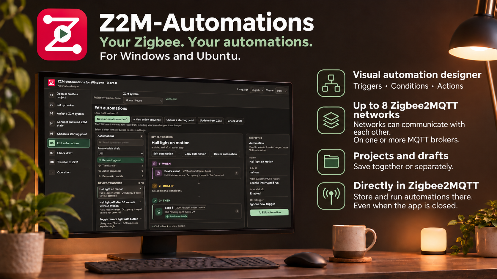

# Z2M-Automations

**English | [Deutsch](README_DE.md)**

**Your Zigbee. Your automations.**

Z2M-Automations helps you turn buttons, sensors, lights and other Zigbee devices
into useful everyday automations, without programming. Available as
**Z2M-Automations for Windows** and **Z2M-Automations for Linux (Ubuntu)**, the app
connects directly to your existing Zigbee2MQTT setup.

## Idea and purpose

Build a rule visually: **When → Only if → Then**. Choose what triggers it, add
optional conditions and decide what should happen. A clear flow view helps you
understand and change your automations later.

The app stores your rules directly in Zigbee2MQTT, where our extension runs them.
**After transfer, release and activation, you can close the app.** Zigbee2MQTT,
the extension, the MQTT connections and the participating devices keep the
automations running.

## What you can do

- React to button presses, motion, window-handle positions and other device states.
- Use temperatures and other measurements, schedules, sunrise and sunset.
- Combine conditions, ordered actions, delays, scenes and reusable action sequences.
- Manage up to **eight Zigbee2MQTT networks** on one or more MQTT brokers.
- Let devices in different networks work together in the same automation.
- Read existing automations, create new rules and check changes before transfer.
- See which rules are released and whether automatic operation is active.
- Work in **English or German**, with a light or dark appearance.

## Everyday examples

- Turn on the hall light when motion is detected and turn it off after a delay.
- Use a wall button to toggle a light or start a sequence of actions.
- Include a window-handle position in a heating or ventilation rule.
- Switch outdoor lighting at sunset.
- Use a button in one Zigbee network to control a light in another.

## Keep your work organized

Save your connections, networks and drafts together as a **project (.z2map)**.
You can also save selected automations separately as a **draft file (.z2mad)**
and add them to another project. Existing **.z2ma** project files still open.

When you connect, the app reads the stored Z2M automations and merges them with
your local work. Conflicting changes are presented for your decision. Backups
help you recover earlier work, and new rules stay disabled until you release them.

## Requirements

- A computer running **Windows 11 x64** or **Ubuntu Desktop 24.04 LTS x64**.
- An existing **Zigbee2MQTT installation** with the devices you want to use.
- A reachable **MQTT broker**, its address, any required credentials and suitable
  access permissions.
- Our compatible **Z2M-Automations extension** in each participating Zigbee2MQTT
  instance. The app includes the extension and offers installation and updates.
- For automations across separate brokers: an MQTT bridge configured to carry
  the required messages between them.
- On Ubuntu, an available desktop keyring if you want to save credentials
  permanently in protected storage.

## User manual

The [illustrated user manual](docs/USER_GUIDE.md) explains installation, your
first automation, working with drafts, transfer and activation, and troubleshooting.
Its screenshots match the selected documentation language.

## License

Z2M-Automations is available under the
[PolyForm Noncommercial 1.0.0 license](LICENSE) for noncommercial use.
