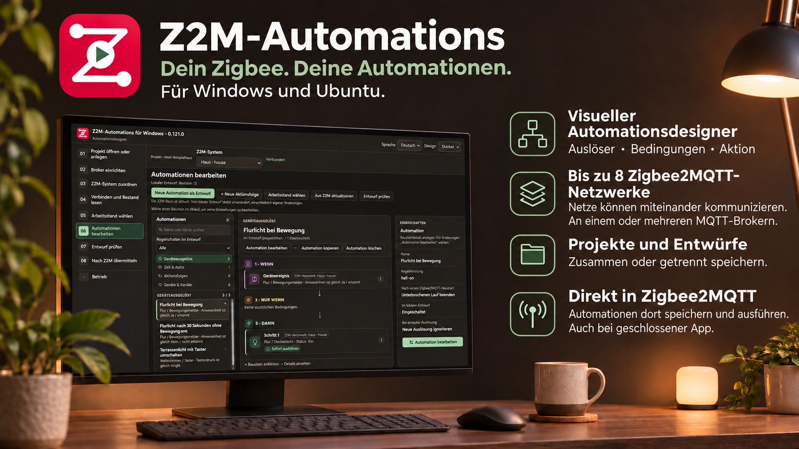

# Z2M-Automations

**Deutsch | [English](README.md)**

Ein eigenständiger Designer für Zigbee2MQTT-Automationen unter **Windows und
Ubuntu Linux**. Die gemeinsame Oberfläche verwaltet bis zu acht Systeme an einem
oder mehreren MQTT-Brokern. Die Automationen laufen unabhängig von der
Anwendung in unserer eigenen Z2M-Erweiterung.

**Entwicklungsstand:** Der Betrieb aus Meilenstein D6 wurde in der Windows- und
Ubuntu-CI geprüft. Die Abnahme installierter Beta-Pakete aus D7 ist für Windows
und Ubuntu Desktop 24.04 unter Hyper-V abgeschlossen. Siehe
[englisches Anwenderhandbuch](docs/USER_GUIDE.md),
[deutsches Anwenderhandbuch](docs/USER_GUIDE_DE.md) und
[D7-Abnahme](docs/D7_DE.md).

## Entwicklungsanwendung starten

Installiere Node 24.20.0 und führe in einem eigenständigen Klon Folgendes aus:

~~~sh
npm ci --ignore-scripts --no-audit --no-fund
npm run setup:tools
npm start
~~~

setup:tools führt ausschließlich die geprüfte Vorbereitung von Electron und den
Windows-Installationswerkzeugen aus. Es verbindet sich nicht mit Z2M.
Für die Diagnose öffne „Desktop-Diagnose“ unterhalb des Designers und starte
eine einminütige Aufzeichnung.

~~~sh
npm run verify:local
npm run smoke
npm run make
npm run smoke:packaged
~~~

make erstellt unter Windows eine Setup-EXE, unter Linux eine Ubuntu-DEB.
Das Windows-Setup bietet Deutsch/Englisch und eine Wahl des Installationsordners;
siehe [Windows-Installation](docs/WINDOWS_INSTALLER_DE.md). Die Ergebnisse sind
nicht signierte Entwicklungspakete, keine Veröffentlichung. Linux benötigt
zusätzlich fakeroot/dpkg und eine Anzeige, in der CI Xvfb.
Die Plattformgrenzen beschreibt die [D1-Umsetzung](docs/D1_DE.md).

## Funktionen

- Gemeinsame Anwendung für Windows 11 x64 und Ubuntu Desktop LTS x64.
- Deutsch und Englisch über lokale Sprachkataloge, ohne Übersetzungsdienst.
- Geräteereignisse, Uhr-/Sonnenzeiten, Bedingungen, Szenen und Aktionsfolgen.
- Direkter MQTT-Zugang, getrennte Entwürfe, ausdrückliche Übermittlung und
  systemübergreifende Aktionen.
- Erweiterungsverwaltung, Systemstatus und zeitlich begrenzte Laufdiagnose.

## Projektdokumentation

Beim Verbinden werden gespeicherte Z2M-Automationen automatisch mit der lokalen
Arbeit abgeglichen. Projekte verwenden `.z2map`; bestehende `.z2ma`-Dateien
bleiben lesbar. Ausgewählte Regeln mit benötigten Aktionsfolgen lassen sich als
`.z2mad` speichern und in der App, im Symcon-Browserdesigner oder in der Kachel
zu einem gewählten Netz hinzufügen. Neue importierte Regeln bleiben
ausgeschaltet. Siehe [Arbeitsstandabgleich](docs/adr/0006-draft-reconciliation-and-portable-files_DE.md).

- [Umsetzungsplan D0–D7](docs/DESKTOP_PLAN_DE.md)
- [Projektkontext](PROJECT_CONTEXT_DE.md) und [Entwicklungsregeln](AGENTS_DE.md)
- [Architektur](docs/ARCHITECTURE_DE.md) und [Entwicklungsbefehle](docs/DEVELOPMENT_DE.md)
- [Automatische Versionierung](docs/VERSIONING_DE.md) und [Lokalisierung](docs/LOCALIZATION_DE.md)
- [RC1-Vorbereitung und native Abnahme](docs/RC1_DE.md)
- [Lokale Projekte und Zugangsdaten](docs/D2_DE.md)
- [Gemeinsames Designer-Paket](packages/designer/README_DE.md)
- [Gesamte Dokumentation auf Deutsch und Englisch](docs/README_DE.md)

Das [Symcon-Produkt](https://github.com/Burki24/Symcon_Z2MAutomations) übernimmt
unser geprüftes Designer-Paket mit festgelegter Version. Die Z2M-Erweiterung
bleibt dort die maßgebliche Quelle. Keine der Anwendungen benötigt eine
PHP-Laufzeit oder zur Laufzeit ein benachbartes Repository.

## Lizenz

[PolyForm Noncommercial 1.0.0](LICENSE). Vorhandene Urheberrechtshinweise des
Designers bleiben erhalten. Fremdabhängigkeiten behalten ihre eigenen Lizenzen.
Ein signiertes Installationspaket oder eine veröffentlichte Desktop-Version
liegt noch nicht vor.
