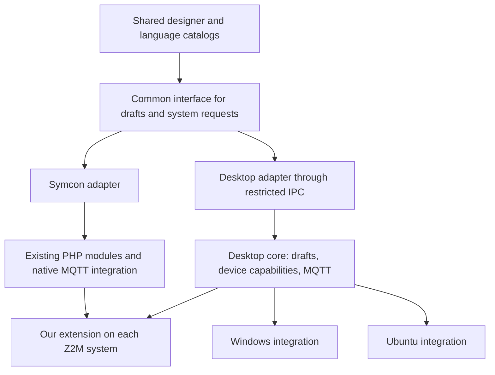

# Z2M-Automations – Implementation plan

As of 2026-11-09. This is the operational desktop agenda for the new repository
`Burki24/Z2M-Automations`, located locally at `E:\git\Z2M-Automations`.
Windows and Linux will be developed in parallel; **Ubuntu LTS x64** is the
confirmed first Linux platform. The repository and development guidelines are
prepared. D0 and D1 are complete for the shared offline foundation. Windows and
Ubuntu 24.04 CI passed; native installed-app acceptance remains open. D2 local
projects, drafts and credentials passed Windows/Ubuntu CI. D3 read-only MQTT
passed Windows/Ubuntu CI. D4 local editing passed both platform jobs. D5
installation and storage and D6 operation passed both platform jobs. D7 adds
a beta user guide and installed-package CI checks. Native acceptance remains
open. See [D6](D6.md) and [D7](D7.md).
See [D1](D1.md), [D2](D2.md) and [D3](D3.md) for verification limits.
Importing this plan did not change any Symcon or Z2M installation.

Imported from the [original plan in the Symcon repository](https://github.com/Burki24/Symcon_Z2MAutomations/blob/01f444d91d5c664177a5d2a60a5d644c72840523/docs/DESKTOP_PLAN.md)
at source commit `01f444d91d5c664177a5d2a60a5d644c72840523`. Scope and sequence
are preserved; repository context, source ownership and links are adapted here.
This file is now the authoritative desktop agenda. Repository documentation is
maintained in English; the application still targets German and English UI support.

Architecture decision: [ADR 0001](adr/0001-parallel-desktop-platforms.md).

## 1. Goals and product separation

| Component | Decision |
| --- | --- |
| Product | Z2M-Automations |
| Platform editions | Z2M-Automations for Windows / Z2M-Automations for Linux |
| Repository | `Burki24/Z2M-Automations`; local path `E:\git\Z2M-Automations` |
| Development | Shared permanent `dev` branch; `main` for verified release states |
| Windows target | Windows 11 x64 as the first planned reference |
| Linux target | Ubuntu Desktop LTS x64; initially 24.04 LTS for builds/tests, with an additional planned acceptance run on 26.04 LTS |
| Initial languages | German and English; further languages can be added through catalogs |
| Systems | Up to eight Z2M systems on one or more brokers |
| Execution | In our existing Z2M extension; the application may be closed after setup |

The Symcon library has its own repository, `Symcon_Z2MAutomations`. Its GitHub
rename and the separate creation of this application repository are complete.
Both products retain independent versioning and releases. This desktop project
does not change technical Symcon module identifiers.

The named OS editions are verification targets, not demonstrated support.
Before the first beta, record the installed test environments and versions
actually accepted. Further Linux distributions, ARM64 and macOS are later goals;
do not introduce unnecessary barriers to them in the shared code.

There will be no separate Windows and Linux source branches. Each feature belongs
to the same milestone on both platforms. The Symcon library remains a separate
product with its own versioning and acceptance process.

## 2. Technical foundation

**Planning decision: Electron with TypeScript for the desktop backend,
Electron Forge for packaging and MQTT.js for direct MQTT connections.** Reuse
our existing HTML/CSS/JavaScript designer incrementally. An additional UI framework
is not a prerequisite.

| Alternative | Assessment for this application |
| --- | --- |
| Electron | Consistent Chromium behavior on Windows and Linux; Node.js for MQTT/TLS and local files; fits our existing JavaScript codebase. Weigh larger packages and resource usage against reuse. |
| Tauri | An alternative using native WebViews and a Rust backend. Windows and Linux have different WebView foundations; our current JavaScript focus would require additional Rust/adapter work. Not selected for the initial shared implementation. |

When creating the skeleton, verify current stable dependency versions, pin them
and make builds reproducible through a lockfile. A framework version does not
establish support for every operating-system version.

The desktop application loads its interface and language files locally. It needs
neither a Symcon web server nor an Internet connection to administer Z2M systems
reachable on the local network. Broker passwords, file access and MQTT clients
do not belong in the renderer.

## 3. Shared interface, separate adapters



D1 introduces an explicit transport adapter: Symcon keeps its existing HTTP
contract and the offline desktop uses a restricted preload bridge. The next
milestones expand this boundary for:

- Systems, selection, device data and capabilities.
- Local drafts, unsaved edits, copying/deleting and action sequences.
- Validation, transfer, operational status, single-run start and stop.
- Extension installation, diagnostics and bounded execution recording.
- Partner permissions and optional features of each product.

The Symcon adapter continues using the existing verified PHP entry points,
locks and confirmations. The desktop adapter uses a local service in the
Electron backend. Port the necessary PHP business logic to our own TypeScript
code; do not ship a PHP runtime. Shared synthetic cases verify equivalent
editor and transfer behavior.

Symcon event import and native object references remain Symcon-adapter features.
The desktop designer hides them through capabilities instead of exposing
nonfunctional Symcon buttons.

## 4. Source ownership and reuse

Planned repository structure:

```text
apps/desktop/         Electron windows, main process, preload and package configuration
packages/designer/    Shared UI and translations
packages/core/        Desktop model, drafts, conflict checks and adapter contracts
packages/mqtt/        Direct broker connections and Z2M request workflows
packages/platform/    File paths, dialogs and protected credential storage
tests/                Shared cases and platform-specific integration tests
docs/                 Setup, architecture, verification and platform requirements
```

Canonical UI ownership moved once from the Symcon repository to
`packages/designer/src` during D1. It provides a versioned designer package
for both products. Symcon receives
pinned, reproducible assets with version/source references and checksums;
adapt and verify its existing asset-allowlist/CSP contract. Do not maintain two
independently edited UI copies or download assets from another repository at runtime.

The canonical Z2M extension and schema initially remain in
`Symcon_Z2MAutomations/libs/z2m` in the separate Symcon repository. The application
bundles only an explicitly identified, verified artifact with build identity and
schema. Do not split the extension into Windows and Linux implementations.
Interface changes must account for both management products.

The existing Symcon helpers have been reviewed. `HelperTranslationHelper` is
PHP/Symcon-specific; visualization, origin and debug helpers continue to be
consumed normally by the Symcon adapter. Do not import modified copies into the
desktop application. Do not move designer business logic to `Symcon_ModuleHelper`
solely for the application. A third shared repository is not needed initially.

## 5. Multilingual support as the first step

Decision updated on 2026-11-07: use local JSON catalogs and a small implementation
of our own, with no i18next dependency. This supersedes the translation-library
choice in the original imported plan.

1. Inventory all visible text: static HTML, JavaScript, dialogs, confirmations,
   titles, help text, accessibility labels, status/errors, startup failures and
   native application menus.
2. Define stable message keys and parameters. PHP responses also need identifiers
   the UI can resolve; a preformatted German sentence is not a reliable
   international data contract. Preserve the meaning of existing response fields
   during the transition and verify additional identifiers.
3. Maintain local `de.json` and `en.json` catalogs with our own small resolver,
   without a translation runtime dependency.
   Preserve the meaning of existing UI text during the initial extraction.
4. Use the browser/system language by default, with a manually selected language
   taking precedence and a saved preference per user. English is the fallback.
5. Use `Intl` to display numbers, dates, weekdays and plural forms. Device/rule
   names, MQTT values such as `ON`, IDs and YAML keys remain unchanged.
6. Switch languages without losing unsaved edits. Language does not change time
   zones or stored rule values. Verify number input and internal representation
   separately, including `18,5` and `18.5`.
7. Automatically verify catalog completeness, matching placeholders, long text,
   singular/plural forms and missing translations. Check German/English in the
   browser, tile and desktop. Other writing systems are not yet verified support.

Required native Symcon debug output remains German and uses the canonical helper.
Desktop diagnostics use structured events with system, request, rule, run and
step correlation and localized display. Do not log passwords, access credentials,
private device contents or complete YAML documents.

## 6. Direct MQTT connections and device selection

Manage broker connections separately from Z2M systems. One broker may serve
multiple base topics. Share connections per broker in a controlled way and use
client IDs distinct from Symcon and other applications. Establish MQTT only
after an explicit connection request.

Plan for TCP and TLS, username/password and CA/client certificates as needed.
Do not silently disable certificate verification. The renderer may not publish
to arbitrary topics; it can issue only validated requests for assigned systems.

Reuse the existing health, status, catalog, editor, validation, storage, operation
and debug protocols. Keep fresh session, revision, checksum, request correlation,
timeout and acknowledgement handling separate per system. MQTT reconnection is
allowed; it does not blindly resend an uncertain save, installation or device
request. Explicitly review library-side offline queues and QoS retries and
configure control requests accordingly. Never retain control requests.

**The desktop application cannot require Symcon action variables.** Use two
explicit action policies:

| Product | Basis for device selection |
| --- | --- |
| Symcon | Z2M capability plus an existing actionable native Symcon variable. |
| Desktop | Confirmed Z2M catalog: published values for triggers/conditions and settable properties for actions, including types, units, channels, limits and supported values. |

The existing extension catalog already provides a limited set of typed properties
with access bits. Check completeness first and extend it where desktop features
need additional metadata. Unknown devices, properties or permissions remain
blocked; raw data does not automatically authorize actions. Verify groups and
scenes independently. Do not infer capabilities for all group members from one member.

Up to eight systems, identical identifiers on different systems, explicit mesh
targets and directed partner permissions remain verification requirements.
The application does not install/configure MQTT brokers or automatically create
broker bridges. The existing [Mosquitto setup guide](https://github.com/Burki24/Symcon_Z2MAutomations/blob/01f444d91d5c664177a5d2a60a5d644c72840523/Z2MConnection/README.md#bis-zu-acht-mqtt-broker-miteinander-verbinden)
remains the separate setup procedure.

## 7. Local projects, import and conflicts

- Versioned portable project format with stable system/rule/sequence identifiers,
  local drafts and known Z2M base revisions/checksums.
- Store broker configuration separately from secrets. Normal project exports
  contain no passwords, sessions, Symcon instance IDs or other editors' access
  credentials. Keep certificate keys outside the project.
- Device identities remain Z2M identifiers with explicit system ownership.
  Display names and paths are not substitute keys.
- Set up Z2M read-only first: back up stored YAML unchanged as the baseline and
  preserve rules, IDs, enabled flags, sequences and partner permissions. Reading
  neither activates nor stops anything. New rules and copies start disabled.
- Symcon drafts not yet transferred to Z2M need a separate, verified export/import
  path. Reading older Z2M state must not discard them. Native variable permissions
  are not exported.
- Compare against Z2M again before every save. On conflict, keep separate backups
  and show differences; never silently merge or overwrite.
- Existing ownership mapping is local to a Symcon installation, not a global lock
  against other applications. Explicitly verify coexistence with Symcon and a
  second desktop application using fresh Z2M state.
- Visibly distinguish local editing, validated draft, confirmed storage and active
  operation. Before changes, provide a private backup and a reversible local
  draft. Local rollback does not restore Z2M operation already changed remotely.

Manage credentials through OS-backed encrypted storage in the desktop backend.
On Linux, check for an available secret service. If protection is unavailable
or the service is locked, do not silently accept plaintext storage. Offer
session-only credentials that must be entered again after restarting the app.
Reopening a project does not save or activate automations.

## 8. Security and platform boundaries

Keep the Electron renderer isolated and sandboxed, without Node integration.
Preload/IPC expose a small fixed allowlist with schema and sender validation.
Do not expose shell commands, general file operations or arbitrary MQTT publish
functions to UI content. Local assets, restrictive CSP and controlled navigation
and link handling belong in the skeleton.

Windows and Linux share the same business logic. Separate only OS paths, file
dialogs, protected storage, desktop integration, packages and updates. On Linux,
verify locked/unavailable keyrings, Wayland/X11, file permissions, case sensitivity
and package dependencies. On Windows, verify DPI scaling, per-user installation,
locked files and protected storage.

A WSL, browser or headless Linux run does not replace acceptance of the installed
Ubuntu desktop package. Establish concrete Windows/Ubuntu test environments
before package acceptance. The user has not yet confirmed a separate Ubuntu
desktop test machine.

## 9. Shared implementation milestones

| Step | Deliverables | Evidence and completion criteria |
| --- | --- | --- |
| D0 – Multilingual designer | German/English catalogs, language settings, message identifiers and automated catalog checks in the existing designer. | Complete workflows in both languages without input loss; preserve current Symcon and tile workflows. |
| D1 – New project and two application builds | Repository skeleton, restricted desktop adapter, extracted shared designer, Electron window and separate CI jobs. | The same source state starts on Windows and Ubuntu; initially use synthetic offline data and no real brokers. Verify the versioned UI reference consumed by the library. |
| D2 – Projects and credentials | Portable local format, backup/restore, credential storage and OS file dialogs. | Save/open/export without secrets; handle missing Linux secret service and Windows file locks. |
| D3 – Read-only MQTT first | Broker/system wizard, TLS, connection, status, device/scene catalog and reading existing automations. | Shared and separate brokers; disconnect/reconnect without draft loss. No device command or upload. |
| D4 – Complete local editing | Device/clock/solar rules, conditions, multiple actions, colors, scenes, sequences, partner permissions and export/import of Symcon drafts. | Equivalent data cases and limits to the existing editor; correct Z2M write permissions without a Symcon dependency. |
| D5 – Extension, validation and storage | Bundled artifact, build comparison, installation, validation, transfer and status confirmation. | Isolated Z2M peer only; verify stale revision, cancellation and lost responses. Rules initially disabled. |
| D6 – Operation and mesh | Activation, stop, single-run start, restart recovery and correlated execution recording; up to eight systems. | Synthetic 1/2/8-system cases, branch failure and shared/blocked targets; real device cases only under a separate practical-test request. Separately demonstrate closing the app and continued Z2M operation. |
| D7 – Installed beta on both platforms | Windows installer and Ubuntu package, localized setup, update/rollback and user guide. | Install, update, restart and uninstall on both reference systems while preserving drafts; publish only when explicitly requested. |

Each step includes Windows and Linux verification. Do not defer a failing platform
job as later Linux work. Integrate Symcon changes as bounded changes with their
own regression tests. Preserve existing beta evidence; it does not establish new
desktop support.

## 10. Packages, CI and release

- Provide a Windows setup EXE through Electron Forge/NSIS with an installation
  directory wizard; see [Windows installer](WINDOWS_INSTALLER.md). This replaces
  the initial fixed-path Squirrel.Windows choice at the owner's request.
- Initially provide an Ubuntu `.deb` through Electron Forge. AppImage, Snap and
  Flatpak are later package targets, not prerequisites for the first shared beta.
- Both platforms receive the same application version from the same source state;
  library and extension versions remain independent.
- Build Windows packages on Windows and Linux packages on Linux. Use verified,
  pinned build environments and lockfiles rather than unpinned daily versions.
- Shared unit/contract tests, UI tests and synthetic MQTT/Z2M complement
  platform-specific installation, keyring and desktop checks.
- Minimum matrix: German/English, light/dark, narrow/wide windows, DPI/scaling,
  keyboard, dialogs/selects, drag and drop, mouse wheel and scroll boundaries.
  Record Linux Wayland/X11 and both planned LTS editions separately.
- Before public distribution, define and test Windows code signing, package
  checksums and the update channel. Initially provide no unattended automatic
  updates. Verify rollback and data-format migration before updates.
- The owner confirmed PolyForm Noncommercial 1.0.0 for the full desktop app.
  Existing source notices and third-party licenses remain intact. Signing and
  publication are separate future decisions.
- The user continues to commit and push. Project creation, package builds and
  internal tests do not authorize Store publication or releases.

## 11. Immediate next step

**D0 implementation:** Local German/English JSON catalogs and our own resolver
are implemented in the canonical shared designer. Synthetic browser/native
checks cover open input, typed values, order, preferences and protected debug;
see [LOCALIZATION.md](LOCALIZATION.md). A real module/tile update check remains
separate. No installed desktop application has been tested.

**D1 complete for the offline foundation:** CI run 42472007945 passed Windows
and Ubuntu 24.04 from the same source, including package builds, all 13 tests,
renderer/layout/capture checks and designer archives; see [D1 evidence](D1.md).
Native installed-app acceptance remains open. **D2 implementation/CI complete:**
run 42481799451 passed Windows and Ubuntu 24.04; native Linux keyring and
file-dialog acceptance remains separate. See [D2 evidence](D2.md). **D3
implementation/CI complete:** explicit MQTT/TLS connections, correlated
read-only status/editor requests, catalogs and separate stored snapshots. See
[D3 evidence](D3.md). D3 run 42491457811 passed both platforms.
D4 passed Windows and Ubuntu CI in run 42553084613. D5 implements extension
installation, validation and disabled-rule storage. See [D5 evidence](D5.md)
for the isolated tests and remaining acceptance.

During designer extraction, both repositories must clearly reference the source
ownership transition and pinned designer package. The imported original plan
remains provenance evidence; maintain progress and open items in this desktop agenda.

## 12. Technical references from the original plan

The original plan consulted these primary sources on 2026-11-07. No framework
versions were reverified or installed during import. Before implementation,
recheck and pin concrete package versions and supported OS editions.

- [Electron: processes and shared web interface](https://www.electronjs.org/docs/latest/tutorial/process-model)
- [Electron: security and IPC boundaries](https://www.electronjs.org/docs/latest/tutorial/security)
- [Electron: protected storage and Linux differences](https://www.electronjs.org/docs/latest/api/safe-storage)
- [Electron Forge: Windows installer](https://www.electronforge.io/config/makers/squirrel.windows)
- [Electron Forge: Debian/Ubuntu package](https://www.electronforge.io/config/makers/deb)
- [Tauri: platform prerequisites](https://v2.tauri.app/start/prerequisites/)
- [MQTT.js: Node/TLS connections and reconnection](https://github.com/mqttjs/MQTT.js)
- [Z2M: exposes and access bits](https://www.zigbee2mqtt.io/guide/usage/exposes.html)
- [Ubuntu: supported LTS editions](https://ubuntu.com/about/release-cycle)
