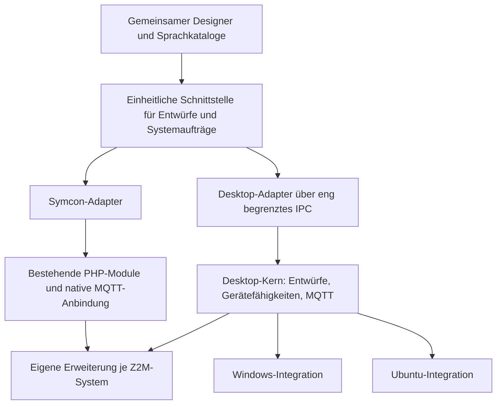

# Z2M-Automations – Umsetzungsplan

Stand: 07.11.2026. Dies ist die operative Desktop-Agenda im neuen Repository
`Burki24/Z2M-Automations`, lokal unter `E:\git\Z2M-Automations`.
Windows und Linux werden parallel entwickelt; als erste Linux-Plattform ist
**Ubuntu LTS auf x64** bestätigt. Repository und Entwicklungsvorgaben sind
angelegt. Die App selbst und D0–D7 sind noch nicht implementiert oder abgenommen.
Keine Symcon-/Z2M-Installation wurde bei der Planübernahme verändert.

Übernommen aus der [Ausgangsplanung im Symcon-Repository](https://github.com/Burki24/Symcon_Z2MAutomations/blob/01f444d91d5c664177a5d2a60a5d644c72840523/docs/DESKTOP_PLAN.md)
zum Quellstand `01f444d91d5c664177a5d2a60a5d644c72840523`. Fachlicher Umfang und Reihenfolge bleiben
bestehen; Repositorybezug, Quellenzuständigkeiten und Links sind hier angepasst.
Diese Datei wird ab jetzt als maßgebliche Desktop-Agenda weitergeführt.

Architekturentscheidung: [ADR 0001](adr/0001-parallel-desktop-platforms.md).

## 1. Ziel und Produktaufteilung

| Bestandteil | Festlegung |
| --- | --- |
| Produkt | Z2M-Automations |
| Plattformangaben | Z2M-Automations für Windows beziehungsweise für Linux |
| Repository | `Burki24/Z2M-Automations`; lokaler Pfad `E:\git\Z2M-Automations` |
| Entwicklung | Gemeinsamer dauerhafter `dev`; `main` für geprüfte Veröffentlichungsstände |
| Windows-Ziel | Windows 11, x64 als erste geplante Referenz |
| Linux-Ziel | Ubuntu Desktop LTS, x64; zunächst 24.04 LTS als Build-/Testbasis, 26.04 LTS als zusätzlicher geplanter Abnahmelauf |
| Erste Sprachen | Deutsch und Englisch; zusätzliche Sprachen durch Kataloge ergänzbar |
| Systeme | Bis zu acht Z2M-Systeme, an einem oder mehreren Brokern |
| Ausführung | In der bestehenden eigenen Z2M-Erweiterung; die App darf nach der Einrichtung geschlossen werden |

Die Symcon-Library wird im eigenen Repository `Symcon_Z2MAutomations` geführt.
Die GitHub-Umbenennung und die getrennte Anlage dieses App-Repositorys sind
erfolgt. Beide Produkte behalten eigene Versionierung und Freigaben; technische
Symcon-Modulkennungen werden durch dieses Desktop-Projekt nicht geändert.

Die konkreten OS-Ausgaben sind Prüfziele, noch keine nachgewiesene Unterstützung.
Vor der ersten Beta werden installierte Testumgebungen und die tatsächlich
bestandenen Versionen festgehalten. Weitere Linux-Distributionen, ARM64 und
macOS sind spätere Ziele; der gemeinsame Code erhält dafür keine unnötigen Sperren.

Es entstehen keine getrennten Windows- und Linux-Quellzweige. Jede Funktion
gehört auf beiden Zielplattformen zum selben Meilenstein. Die Symcon-Library
bleibt ein eigenständiges Produkt mit eigener Versionierung und Abnahme.

## 2. Technische Grundlage

**Planungsentscheidung: Electron mit TypeScript für den Desktop-Unterbau,
Electron Forge für Pakete und MQTT.js für direkte MQTT-Verbindungen.** Der
vorhandene HTML-/CSS-/JavaScript-Designer wird schrittweise weiterverwendet;
ein zusätzliches UI-Framework wird dafür nicht vorausgesetzt.

| Alternative | Bewertung für diese Anwendung |
| --- | --- |
| Electron | Gemeinsames Chromium-Verhalten auf Windows und Linux, Node.js für MQTT/TLS und lokale Dateien; Anschluss an unsere vorhandene JavaScript-Codebasis. Größere Pakete und zusätzlicher Ressourcenbedarf sind gegen die Wiederverwendung abzuwägen. |
| Tauri | Mögliche Alternative mit systemeigenen WebViews und Rust-Unterbau. Unter Windows und Linux unterschiedliche WebView-Grundlagen; zusätzliche Rust-/Adapterarbeit für unseren derzeitigen JavaScript-Schwerpunkt. Für den ersten gemeinsamen Umsetzungsweg nicht gewählt. |

Die endgültigen Abhängigkeitsversionen werden beim Grundgerüst anhand aktueller
stabiler Versionen geprüft, fest gebunden und per Lockdatei reproduzierbar gemacht.
Eine Frameworkversion ist kein pauschaler Nachweis für jede Betriebssystemversion.

Die Desktop-App lädt ihre Oberfläche und Sprachdateien lokal. Sie benötigt
weder einen Symcon-Webserver noch eine Internetverbindung für die Administration
der im eigenen Netz erreichbaren Z2M-Systeme. Brokerpasswörter, Dateizugriffe
und MQTT-Clients gehören nicht in den Renderer.

## 3. Gemeinsame Oberfläche, getrennte Anbindungen



Der heutige Designer verwendet `fetch`, Hookadressen, Symcon-Zugänge und bereits
formulierte PHP-Meldungen direkt in mehreren Dateien. Er kann deshalb nicht
unverändert als bloße Fensterhülle übernommen werden. Zuerst erhält er einen
expliziten Adapter für:

- Systeme, Auswahl, Gerätedaten und Gerätefähigkeiten.
- Lokale Entwürfe, offene Bearbeitungen, Kopieren/Löschen und Aktionsfolgen.
- Validierung, Übertragung, Betriebsstatus, Einzelstart und Stopp.
- Erweiterungsinstallation, Diagnose und begrenzte Ablaufaufzeichnung.
- Partnerfreigaben sowie optionale Funktionen des jeweiligen Produkts.

Der Symcon-Adapter nutzt weiterhin die bestehenden geprüften PHP-Einstiege,
Sperren und Bestätigungen. Der Desktop-Adapter nutzt einen lokalen Dienst im
Electron-Unterbau. Er portiert die benötigte PHP-Fachlogik in eigenen TypeScript-
Code; eine PHP-Laufzeit wird nicht mitgeliefert. Gemeinsame synthetische Fälle
prüfen, dass Editor- und Übertragungsverhalten übereinstimmen.

Symcon-Ereignisimport und native Objektverweise bleiben Funktionen des
Symcon-Adapters. Der Desktop-Designer blendet sie über Fähigkeiten aus, statt
funktionslose Symcon-Buttons anzubieten.

## 4. Quellzuständigkeit und Wiederverwendung

Geplante Struktur im neuen Repository:

```text
apps/desktop/          Electron-Fenster, Main-Prozess, Preload und Paketkonfiguration
packages/designer/    Gemeinsame UI und Übersetzungen
packages/core/        Desktop-Fachmodell, Entwürfe, Konfliktprüfung, Adapterverträge
packages/mqtt/        Direkte Brokeranbindung und Z2M-Auftragsabläufe
packages/platform/    Dateipfade, Dialoge und geschützte Zugangsdatenablage
tests/                Gemeinsame Fälle und plattformabhängige Integrationstests
docs/                 Einrichtung, Architektur, Prüfungen und Plattformangaben
```

Bis zum geprüften Übergang bleiben die Designerquellen in
`Symcon_Z2MAutomations/Z2MAutomations/visualization` maßgeblich. Bei der tatsächlichen Extraktion wechselt die kanonische UI-Quelle
einmalig nach `packages/designer` im Desktop-Repository. Dieses liefert ein
versioniertes Designerpaket für beide Produkte. Symcon erhält einen fest
gebundenen, reproduzierbaren Assetstand mit Versions-/Quellbezug und Prüfsummen;
der vorhandene Asset-Allowlist-/CSP-Vertrag wird gezielt angepasst und geprüft.
Es gibt keine zwei unabhängig weiterbearbeiteten UI-Kopien und keinen Laufzeit-
Download aus einem fremden Repository.

Die kanonische Quelle der Z2M-Erweiterung einschließlich Schema bleibt zunächst
in `Symcon_Z2MAutomations/libs/z2m` im getrennten Symcon-Repository. Die App bündelt ausschließlich ein genau bezeichnetes, geprüftes
Artefakt mit Buildkennung und Schema. Die Erweiterung wird nicht für Windows
und Linux auseinanderentwickelt. Änderungen an ihrer Schnittstelle müssen
beide Verwaltungsprodukte berücksichtigen.

Die vorhandenen Symcon-Helper wurden betrachtet. `HelperTranslationHelper` ist
PHP-/Symcon-gebunden; Visualisierungs-, Origin- und Debug-Helper werden im
Symcon-Adapter weiter regulär eingebunden. Sie werden nicht als veränderte
Kopien in die Desktop-App übernommen. Fachlicher Designercode wird nicht allein
für die App nach `Symcon_ModuleHelper` verschoben. Ein drittes gemeinsames
Repository wird für den Einstieg nicht benötigt.

## 5. Mehrsprachigkeit als erster Baustein

1. Alle sichtbaren Texte erfassen: statisches HTML, JavaScript, Dialoge,
   Bestätigungen, Titel, Hilfetexte, Barrierefreiheitsbeschriftungen,
   Status-/Fehleranzeigen, Startfehler und native App-Menüs.
2. Stabile Meldungsschlüssel und Parameter definieren. Auch PHP-Antworten
   benötigen für die UI auflösbare Kennungen; ein deutscher fertiger Satz ist
   kein zuverlässiger internationaler Datenvertrag. Für den Übergang erhalten
   bestehende Antwortfelder ihre Bedeutung, zusätzliche Kennungen werden geprüft.
3. i18next lokal bündeln; deutsche und englische Kataloge vollständig pflegen.
   Vorhandene UI-Texte zuerst inhaltlich übernehmen, nicht nebenbei umdeuten.
4. Browser-/Systemsprache als Vorgabe, manuelle Auswahl mit Vorrang und
   gespeicherter Präferenz je Benutzer. Englisch als definierte Ersatzsprache.
5. `Intl` für Darstellung von Zahlen, Daten, Wochentagen und Mehrzahlformen.
   Geräte-/Regelnamen, MQTT-Werte wie `ON`, IDs und YAML-Schlüssel bleiben unverändert.
6. Sprachwechsel ohne Verlust offener Bearbeitungen. Sprache ändert weder
   Zeitzonen noch gespeicherte Regelwerte. Zahlenannahme und interne Darstellung
   werden getrennt geprüft, beispielsweise `18,5` und `18.5`.
7. Katalogvollständigkeit, gleiche Platzhalter, lange Texte, Singular/Plural und
   fehlende Übersetzungen automatisiert prüfen. Deutsch/Englisch in Browser,
   Kachel und Desktop prüfen. Andere Schriften sind noch keine geprüfte Zusage.

Die vorgeschriebenen nativen Symcon-Debugausgaben bleiben deutsch und verwenden
den kanonischen Helper. Desktop-Diagnose erhält strukturierte Ereignisse mit
System-, Auftrags-, Regel-, Lauf- und Schrittbezug sowie lokalisierbarer Anzeige.
Passwörter, Zugänge, private Geräteinhalte und komplette YAML werden nicht protokolliert.

## 6. Direkte MQTT-Anbindung und Geräteauswahl

Die App verwaltet Brokerverbindungen getrennt von Z2M-Systemen. Ein Broker kann
mehrere unterschiedliche Basistopics bedienen. Pro Broker werden Verbindungen
kontrolliert geteilt; Client-IDs sind eindeutig gegenüber Symcon und anderen Apps.
Erst nach ausdrücklichem Verbinden wird MQTT aufgebaut.

Geplant sind TCP und TLS, Benutzer/Passwort sowie bei Bedarf CA-/Clientzertifikate.
Zertifikatsprüfungen werden nicht still abgeschaltet. Der Renderer darf keine
beliebigen Topics veröffentlichen; nur geprüfte Aufträge für zugeordnete Systeme.

Die vorhandenen Health-, Status-, Katalog-, Editor-, Prüf-, Speicher-, Betriebs-
und Debugprotokolle werden übernommen. Frische Sitzung, Revision, Prüfsumme,
Anfragezuordnung, Zeitlimit und Bestätigung bleiben pro System getrennt.
Eine MQTT-Wiederverbindung ist erlaubt; ein unsicherer Speicher-, Installations-
oder Schaltauftrag wird dadurch nicht blind erneut gesendet. Bibliotheksseitige
Offlinewarteschlangen und QoS-Wiederholungen müssen dafür ausdrücklich geprüft
und für Steueraufträge passend konfiguriert werden. Keine retained Steueraufträge.

**Die Desktop-App kann keine Symcon-Schaltvariablen voraussetzen.** Deshalb gelten
zwei bewusst getrennte Aktionsrichtlinien:

| Produkt | Grundlage der Geräteauswahl |
| --- | --- |
| Symcon | Z2M-Fähigkeit plus weiterhin vorhandene schaltbare native Symcon-Variable. |
| Desktop | Bestätigter Z2M-Katalog: veröffentlichte Werte für Auslöser/Bedingungen, setzbare Eigenschaften für Aktionen, einschließlich Typ, Einheit, Kanal, Grenzen und unterstützter Werte. |

Der bestehende Erweiterungskatalog liefert bereits begrenzte typisierte
Eigenschaften mit Zugriffsbits. Er wird zuerst auf Vollständigkeit geprüft und
gezielt ergänzt, falls Desktop-Funktionen zusätzliche Metadaten benötigen.
Unbekannte Geräte, Eigenschaften oder Rechte bleiben gesperrt; Rohdaten sind
keine automatische Schaltfreigabe. Gruppen und Szenen werden eigenständig geprüft;
von einem Gruppenmitglied wird keine Fähigkeit pauschal auf alle Mitglieder übertragen.

Bis zu acht Systeme, gleiche Kennungen auf verschiedenen Systemen, eindeutige
Mesh-Ziele und gerichtete Partnerfreigaben bleiben Prüfgegenstand. Die App
installiert oder konfiguriert keine MQTT-Broker und legt keine Broker-Bridges
automatisch an. Die vorhandene [Mosquitto-Anleitung](https://github.com/Burki24/Symcon_Z2MAutomations/blob/01f444d91d5c664177a5d2a60a5d644c72840523/Z2MConnection/README.md#bis-zu-acht-mqtt-broker-miteinander-verbinden)
bleibt der gesonderte Einrichtungsweg.

## 7. Lokale Projekte, Übernahme und Konflikte

- Versioniertes, portables Projektformat mit stabilen System-/Regel-/Folgenkennungen,
  lokalen Entwürfen und den bekannten Z2M-Basisrevisionen/-prüfsummen.
- Brokerkonfiguration und Geheimnisse getrennt speichern. Ein normaler
  Projektexport enthält keine Passwörter, Sitzungen, Symcon-Instanz-IDs oder
  fremden Bearbeitungszugänge. Zertifikatsschlüssel bleiben außerhalb des Projekts.
- Geräteidentitäten bleiben Z2M-Kennungen mit ausdrücklicher Systemzuordnung;
  Anzeigenamen und Pfade werden nicht als Ersatzschlüssel verwendet.
- Z2M zuerst lesend einrichten: gespeicherte YAML unverändert als Basis sichern,
  Regeln, IDs, Regelschalter, Folgen und Partnerfreigaben erhalten. Lesen aktiviert
  oder stoppt nichts. Neue Regeln und Kopien beginnen ausgeschaltet.
- Noch nicht nach Z2M übertragene Symcon-Entwürfe benötigen einen eigenen
  geprüften Export-/Importweg. Sie dürfen nicht durch Einlesen des älteren
  Z2M-Stands verloren gehen. Native Variablenrechte werden nicht exportiert.
- Vor jeder Speicherung erneut gegen Z2M vergleichen. Bei Konflikt getrennt
  sichern und Unterschiede zeigen; kein stilles Zusammenführen oder Überschreiben.
- Die bisherige Besitzerzuordnung ist innerhalb einer Symcon-Installation lokal.
  Sie ist keine globale Sperre gegen andere Apps. Koexistenz mit Symcon und einer
  zweiten Desktop-App wird explizit über frische Z2M-Stände geprüft.
- Lokale Bearbeitung, geprüfter Entwurf, bestätigte Speicherung und laufender
  Betrieb bleiben sichtbar getrennt. Vor Änderungen private Sicherung und
  rücknehmbaren lokalen Entwurf bereitstellen. Ein lokaler Rückweg setzt keinen
  bereits geänderten Z2M-Betrieb zurück.

Zugangsdaten werden über eine OS-gestützte verschlüsselte Ablage im Desktop-
Unterbau verwaltet. Unter Linux ist ein verfügbarer Schlüsseldienst zu prüfen.
Bei fehlendem Schutz oder gesperrtem Schlüsseldienst wird kein Klartext-Ersatz
still akzeptiert: wahlweise nur für die Sitzung verwenden und nach App-Neustart
erneut eingeben.
Das Wiederöffnen eines Projekts speichert oder aktiviert keine Automationen.

## 8. Sicherheits- und Plattformgrenze

Der Electron-Renderer bleibt isoliert und sandboxed, ohne Node-Integration.
Preload/IPC bieten eine kleine feste Positivliste mit Schema-/Senderprüfung.
Keine Shellkommandos, allgemeinen Dateioperationen oder beliebigen MQTT-Publish-
Funktionen für UI-Inhalte. Lokale Assets, restriktive CSP und kontrollierte
Navigation/Linköffnung gehören in das Grundgerüst.

Windows und Linux verwenden dieselbe Fachlogik. Getrennt werden nur OS-Pfade,
Dateidialoge, geschützte Ablage, Desktopintegration, Pakete und Updates behandelt.
Auf Linux insbesondere gesperrter/fehlender Keyring, Wayland/X11, Dateirechte,
Groß-/Kleinschreibung und Paketabhängigkeiten prüfen. Auf Windows DPI-Skalierung,
Benutzerinstallation, gesperrte Dateien und geschützte Ablage prüfen.

Ein WSL-, Browser- oder headless Linux-Lauf ersetzt nicht die Abnahme des
installierten Ubuntu-Desktop-Pakets. Verfügbare Windows-/Ubuntu-Testumgebungen
werden vor der Paketabnahme konkret bereitgestellt; bislang ist kein separater
Ubuntu-Desktop-Testrechner durch den Benutzer bestätigt.

## 9. Umsetzung in gemeinsamen Meilensteinen

| Schritt | Lieferumfang | Nachweis und Abschlusskriterium |
| --- | --- | --- |
| D0 – Sprachfähiger Designer | Deutsche/englische Kataloge, Spracheinstellung, Meldungskennungen und automatische Katalogprüfung im bestehenden Designer. | Vollständige Bedienwege mit beiden Sprachen, ohne Eingabeverlust; aktuelle Symcon- und Kachelabläufe erhalten. |
| D1 – Neues Projekt und zwei App-Builds | Repository-Grundgerüst, enger Desktop-Adapter, extrahierter gemeinsamer Designer, Electron-Fenster und getrennte CI-Jobs. | Derselbe Quellstand startet auf Windows und Ubuntu; zunächst synthetische Offline-Daten, keine echten Broker. Versionierter UI-Bezug zur Library geprüft. |
| D2 – Projekte und Zugänge | Portables lokales Format, Sicherung/Wiederherstellung, Zugangsdatenablage und OS-Dateidialoge. | Speichern/Öffnen/Export ohne Geheimnisse; fehlender Linux-Schlüsseldienst und Windows-Dateisperren abgefangen. |
| D3 – MQTT zunächst lesend | Broker-/Systemassistent, TLS, Verbindung, Status, Geräte-/Szenenkatalog und vorhandene Automationen lesen. | Ein gemeinsamer sowie getrennte Broker; Ausfall/Wiederverbindung ohne Entwurfsverlust. Kein Gerätebefehl oder Upload. |
| D4 – Vollständige lokale Bearbeitung | Geräte-/Zeit-/Sonnenregeln, Bedingungen, Mehrfachaktionen, Farben, Szenen, Folgen, Partnerfreigaben; Export-/Importweg für Symcon-Entwürfe. | Gleiche Datenfälle und Grenzen wie im bestehenden Editor; korrekte Z2M-Schreibrechte ohne Symcon-Abhängigkeit. |
| D5 – Erweiterung, Prüfung und Speicherung | Mitgeliefertes Artefakt, Buildvergleich, Installation, Validierung, Übertragung und Statusbestätigung. | Ausschließlich isolierte Z2M-Gegenstelle; stale Revision, Abbruch und verlorene Antwort geprüft. Regeln zunächst ausgeschaltet. |
| D6 – Betrieb und Mesh | Aktivieren, Stopp, Einzelstart, Wiederanlauf und korrelierte Ablaufaufzeichnung; bis acht Systeme. | Synthetische 1/2/8-Systemfälle, Zweigausfall und geteilte/gesperrte Ziele; reale Schaltfälle nur mit gesondertem Praxisauftrag. App schließen und Z2M-Betrieb getrennt nachweisen. |
| D7 – Installierte Beta beider Plattformen | Windows-Installer und Ubuntu-Paket, sprachgerechte Einrichtung, Update-/Rückweg und Benutzeranleitung. | Installation, Update, Neustart und Deinstallation auf beiden Referenzsystemen; Entwürfe erhalten; Veröffentlichung ausschließlich nach Auftrag. |

Jeder Schritt enthält Windows- und Linux-Prüfungen. Ein roter Plattformjob wird
nicht als spätere Linux-Aufgabe ausgeklammert. Symcon-Änderungen werden als
abgegrenzte Änderungen mit eigenen Regressionstests integriert. Vorhandene
Beta-Nachweise bleiben erhalten, belegen aber keine neue Desktop-Unterstützung.

## 10. Pakete, CI und Freigabe

- Windows zunächst Setup-EXE über Electron Forge/Squirrel.Windows.
- Ubuntu zunächst `.deb` über Electron Forge; AppImage, Snap und Flatpak sind
  spätere Paketziele, keine Bedingung für die erste gemeinsame Beta.
- Beide Plattformen erhalten dieselbe App-Version aus demselben Quellstand;
  Library- und Erweiterungsversion bleiben unabhängig.
- Windows-Paket auf Windows, Linux-Paket auf Linux bauen. Geprüfte feste
  Buildumgebungen und Lockdateien statt ungepinnter Tagesstände verwenden.
- Gemeinsame Unit-/Vertragstests, UI-Tests und synthetisches MQTT/Z2M ergänzen
  plattformspezifische Installations-, Keyring- und Desktopprüfungen.
- Mindestmatrix: Deutsch/Englisch, Hell/Dunkel, schmale/breite Fenster,
  DPI/Skalierung, Tastatur, Dialoge/Auswahllisten, Drag & Drop, Mausrad und
  Scrollgrenzen. Linux Wayland/X11 und beide vorgesehenen LTS-Ausgaben getrennt erfassen.
- Vor öffentlicher Ausgabe Windows-Codesignierung, Paketprüfsummen und den
  Updatekanal festlegen und testen. Im ersten Schritt keine unbeaufsichtigte
  automatische Aktualisierung. Rückweg und Datenformatmigration vor Updates prüfen.
- Lizenz und gewünschtes Vertriebsmodell vor Veröffentlichung ausdrücklich
  festlegen. Bestehende PolyForm-Noncommercial-Quellen und fremde Lizenzen werden
  nicht still geändert; dieser Plan trifft keine neue Lizenzentscheidung.
- Commit/Push erfolgen weiterhin durch den Benutzer. Projektanlage, Paketbau
  und interne Tests sind keine Erlaubnis für Store-/Releaseveröffentlichungen.

## 11. Unmittelbar nächster Arbeitsschritt

**D0 zuerst:** Textinventar und Meldungsvertrag festlegen, i18next lokal anbinden,
Deutsch/Englisch im aktuellen Designer vollständig durchziehen und mit erhaltenen
Eingaben prüfen. D0 ist weiterhin ein abgegrenztes Arbeitspaket an den noch
kanonischen Designerquellen im Symcon-Repository; es wurde durch diese
Planübernahme nicht begonnen. Danach D1 mit beiden nativen App-Zielen beginnen.
Die Projektanlage und die vorliegenden Vorgaben schließen D1 noch nicht ab.

Bei der tatsächlichen Designer-Extraktion müssen beide Repositories den
Wechsel der kanonischen Quelle und das gebundene Designerpaket nachvollziehbar
referenzieren. Der übernommene Ausgangsplan bleibt Herkunftsnachweis;
Fortschritt und offene Punkte werden in dieser Desktop-Agenda geführt.

## 12. Geprüfte technische Quellen

Die Ausgangsplanung hat diese Primärquellen am 07.11.2026 herangezogen.
Bei der Planübernahme wurden keine Frameworkversionen neu geprüft oder
installiert; konkrete Paketversionen und unterstützte OS-Stände vor der
Implementierung erneut prüfen und fest binden.

- [Electron: Prozesse und gemeinsame Weboberfläche](https://www.electronjs.org/docs/latest/tutorial/process-model)
- [Electron: Sicherheit und IPC-Grenzen](https://www.electronjs.org/docs/latest/tutorial/security)
- [Electron: geschützte Ablage und Linux-Unterschiede](https://www.electronjs.org/docs/latest/api/safe-storage)
- [Electron Forge: Windows-Installer](https://www.electronforge.io/config/makers/squirrel.windows)
- [Electron Forge: Debian-/Ubuntu-Paket](https://www.electronforge.io/config/makers/deb)
- [Tauri: plattformspezifische Voraussetzungen](https://v2.tauri.app/start/prerequisites/)
- [MQTT.js: Node-/TLS-Anbindung und Wiederverbindung](https://github.com/mqttjs/MQTT.js)
- [Z2M: Exposes und Zugriffsbits](https://www.zigbee2mqtt.io/guide/usage/exposes.html)
- [i18next: lokale Ressourcen und Einbindung](https://www.i18next.com/overview/getting-started)
- [Ubuntu: unterstützte LTS-Ausgaben](https://ubuntu.com/about/release-cycle)
