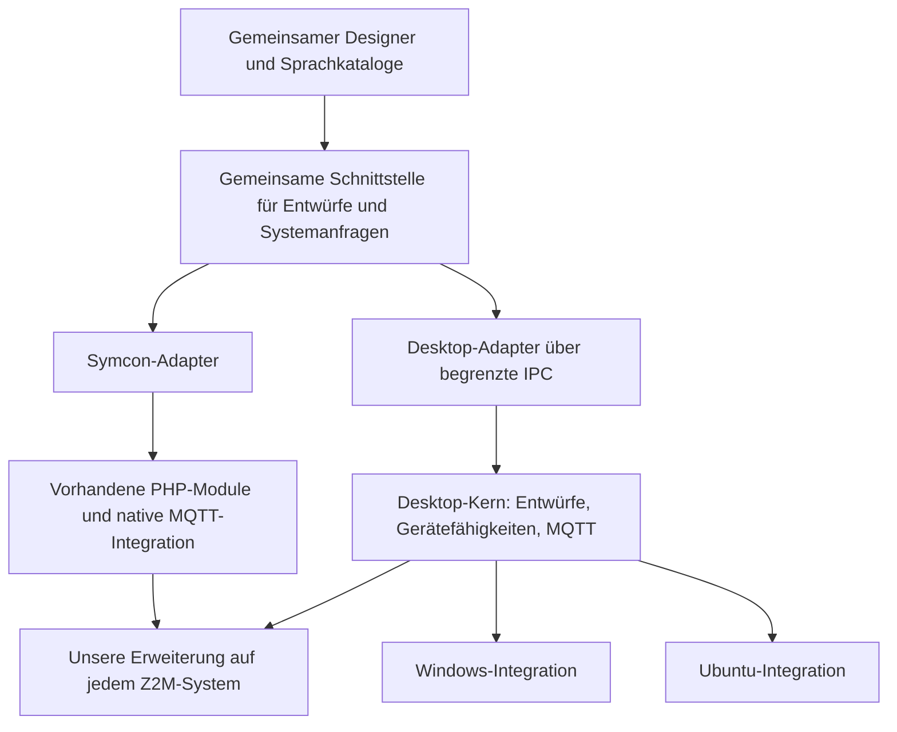

<a id="z2m-automations--implementation-plan"></a>

# Z2M-Automations – Umsetzungsplan

**Deutsch | [English](DESKTOP_PLAN.md)**

Stand: 2026-11-09. Dies ist die operative Desktop-Arbeitsplanung für das neue
Repository `Burki24/Z2M-Automations`, lokal unter `E:\git\Z2M-Automations`.
Windows und Linux werden parallel entwickelt; **Ubuntu LTS x64** ist die
bestätigte erste Linux-Plattform. Repository und Entwicklungsrichtlinien sind
vorbereitet. D0 und D1 sind für die gemeinsame Offline-Grundlage abgeschlossen.
Windows- und Ubuntu-24.04-CI bestanden. D2 mit lokalen Projekten, Entwürfen und
Zugangsdaten bestand Windows-/Ubuntu-CI, ebenso D3 mit lesendem MQTT.
D4 mit lokaler Bearbeitung bestand beide Plattformjobs. D5 mit Installation und
Speicherung sowie D6 mit Betrieb bestanden beide Jobs. D7 ist für Windows und
Ubuntu Desktop 24.04 unter Hyper-V abgeschlossen. Siehe [D6](D6_DE.md) und
[D7](D7_DE.md). Prüfgrenzen stehen in [D1](D1_DE.md), [D2](D2_DE.md) und [D3](D3_DE.md).
Der Eigentümer bestätigte außerdem am 2026-11-13 nach D7 die Abnahme von
Bearbeiten, Erstellen und Einrichten systemübergreifender Automationen bis zur
bestätigten Übertragung und Ausführung mit Anwendung 0.99.0. Siehe
[Arbeitsablaufabnahme](D7_DE.md#post-d7-workflow-acceptance-0990). Der neue
Desktop-Ablauf ist die abgenommene Grundlage einer getrennt eingegrenzten
Anpassung für Symcon-Browserdesigner und Kachel; diese Oberflächenübernahme steht
noch aus. Der Import dieses Plans änderte keine Symcon- oder Z2M-Installation.

Importiert aus dem [ursprünglichen Plan im Symcon-Repository](https://github.com/Burki24/Symcon_Z2MAutomations/blob/01f444d91d5c664177a5d2a60a5d644c72840523/docs/DESKTOP_PLAN.md)
auf Quellcommit `01f444d91d5c664177a5d2a60a5d644c72840523`. Umfang und Reihenfolge
bleiben erhalten; Repository-Kontext, Quellzuständigkeit und Links sind hier
angepasst. Diese Datei ist jetzt die maßgebliche Desktop-Arbeitsplanung.
Englische Dokumentation ist maßgeblich; vollständige deutsche Fassungen werden
daneben gepflegt. Die Anwendung unterstützt Deutsch und Englisch über lokale
Sprachkataloge.

Architekturentscheidung: [ADR 0001](adr/0001-parallel-desktop-platforms_DE.md).

<a id="1-goals-and-product-separation"></a>

## 1. Ziele und Produkttrennung

| Komponente | Entscheidung |
| --- | --- |
| Produkt | Z2M-Automations |
| Plattformausgaben | Z2M-Automations for Windows / Z2M-Automations for Linux |
| Repository | `Burki24/Z2M-Automations`; lokal `E:\git\Z2M-Automations` |
| Entwicklung | Gemeinsamer dauerhafter Branch `dev`; `main` für geprüfte Veröffentlichungsstände |
| Windows-Ziel | Windows 11 x64 als erste geplante Referenz |
| Linux-Ziel | Ubuntu Desktop LTS x64; zunächst 24.04 LTS für Builds/Tests, zusätzlich geplante Abnahme auf 26.04 LTS |
| Erste Sprachen | Deutsch und Englisch; weitere über Kataloge ergänzbar |
| Systeme | Bis zu acht Z2M-Systeme auf einem oder mehreren Brokern |
| Ausführung | In unserer vorhandenen Z2M-Erweiterung; die App darf nach Einrichtung geschlossen werden |

Die Symcon-Bibliothek hat ein eigenes Repository `Symcon_Z2MAutomations`.
Dessen GitHub-Umbenennung und die getrennte Erstellung dieses App-Repositories
sind abgeschlossen. Beide Produkte behalten unabhängige Versionierung und
Veröffentlichungen. Dieses Desktop-Projekt ändert keine technischen
Symcon-Modulkennungen.

Die genannten Betriebssystemausgaben sind Prüfziele, keine nachgewiesene
Unterstützung. Vor der ersten Beta tatsächlich abgenommene installierte
Testumgebungen und Versionen erfassen. Weitere Linux-Distributionen, ARM64 und
macOS sind spätere Ziele; im gemeinsamen Code keine unnötigen Hürden dafür schaffen.

Es gibt keine getrennten Windows-/Linux-Quellbranches. Jede Funktion gehört auf
beiden Plattformen zum selben Meilenstein. Die Symcon-Bibliothek bleibt ein
getrenntes Produkt mit eigener Versionierung und Abnahme.

<a id="2-technical-foundation"></a>

## 2. Technische Grundlage

**Planungsentscheidung: Electron mit TypeScript für das Desktop-Backend,
Electron Forge für Paketbau und MQTT.js für direkte MQTT-Verbindungen.**
Unseren vorhandenen HTML-/CSS-/JavaScript-Designer schrittweise weiterverwenden.
Ein zusätzliches Oberflächenframework ist keine Voraussetzung.

| Alternative | Bewertung für diese Anwendung |
| --- | --- |
| Electron | Einheitliches Chromium-Verhalten unter Windows und Linux; Node.js für MQTT/TLS und lokale Dateien; passt zur vorhandenen JavaScript-Codebasis. Größere Pakete und Ressourcenbedarf gegen Wiederverwendung abwägen. |
| Tauri | Alternative mit nativen WebViews und Rust-Backend. Windows und Linux haben unterschiedliche WebView-Grundlagen; der aktuelle JavaScript-Schwerpunkt bräuchte zusätzliche Rust-/Adapterarbeit. Für die erste gemeinsame Umsetzung nicht gewählt. |

Beim Erstellen des Grundgerüsts aktuelle stabile Abhängigkeitsversionen prüfen,
festsetzen und Builds durch Sperrdatei reproduzierbar machen. Eine
Frameworkversion belegt nicht die Unterstützung jeder Betriebssystemversion.

Die Desktop-App lädt Oberfläche und Sprachdateien lokal. Sie benötigt weder
Symcon-Webserver noch Internet, um im lokalen Netz erreichbare Z2M-Systeme zu
verwalten. Brokerpasswörter, Dateizugriff und MQTT-Clients gehören nicht in den
Renderer.

<a id="3-shared-interface-separate-adapters"></a>

## 3. Gemeinsame Oberfläche, getrennte Adapter



D1 führt einen ausdrücklichen Transportadapter ein: Symcon behält seinen
HTTP-Vertrag; Offline-Desktop verwendet eine begrenzte Preload-Schnittstelle.
Die nächsten Meilensteine erweitern diese Grenze für:

- Systeme, Auswahl, Gerätedaten und Fähigkeiten.
- Lokale Entwürfe, ungespeicherte Arbeit, Kopieren/Löschen und Aktionsfolgen.
- Validierung, Übertragung, Betriebsstatus, Einzellaufstart und Stopp.
- Erweiterungsinstallation, Diagnose und begrenzte Ausführungsaufzeichnung.
- Partnerfreigaben und optionale Funktionen beider Produkte.

Der Symcon-Adapter nutzt weiterhin bestehende geprüfte PHP-Einstiege, Sperren
und Bestätigungen. Der Desktop-Adapter nutzt einen lokalen Dienst im
Electron-Backend. Benötigte PHP-Fachlogik in eigenen TypeScript-Code übertragen;
keine PHP-Laufzeit ausliefern. Gemeinsame synthetische Fälle prüfen gleichwertiges
Editor- und Übertragungsverhalten.

Symcon-Ereignisimport und native Objektverweise bleiben Symcon-Adapterfunktionen.
Desktop blendet sie über Fähigkeiten aus, statt funktionslose Symcon-Schaltflächen
anzuzeigen.

<a id="4-source-ownership-and-reuse"></a>

## 4. Quellzuständigkeit und Wiederverwendung

Geplante Repository-Struktur:

```text
apps/desktop/         Electron windows, main process, preload and package configuration
packages/designer/    Shared UI and translations
packages/core/        Desktop model, drafts, conflict checks and adapter contracts
packages/mqtt/        Direct broker connections and Z2M request workflows
packages/platform/    File paths, dialogs and protected credential storage
tests/                Shared cases and platform-specific integration tests
docs/                 Setup, architecture, verification and platform requirements
```

Die maßgebliche Oberfläche wechselte während D1 einmalig vom Symcon-Repository
nach `packages/designer/src`. Sie liefert ein versioniertes Designer-Paket für
beide Produkte. Symcon erhält festgelegte reproduzierbare Dateien mit Versions-/
Quellverweisen und Prüfsummen; bestehenden Dateierlaubnislisten-/CSP-Vertrag
anpassen und prüfen. Keine zwei unabhängig bearbeiteten Oberflächenkopien pflegen
oder Dateien zur Laufzeit aus anderen Repositories laden.

Maßgebliche Z2M-Erweiterung und Schema bleiben zunächst in
`Symcon_Z2MAutomations/libs/z2m` im getrennten Symcon-Repository. Die App enthält
nur ein ausdrücklich gekennzeichnetes geprüftes Artefakt mit Build-Kennung und
Schema. Erweiterung nicht in Windows-/Linux-Implementierungen aufteilen.
Schnittstellenänderungen müssen beide Verwaltungsprodukte berücksichtigen.

Vorhandene Symcon-Hilfsfunktionen wurden geprüft. `HelperTranslationHelper` ist
PHP-/Symcon-spezifisch; Visualisierungs-, Ursprungs- und Diagnosehilfen werden
weiter normal vom Symcon-Adapter genutzt. Keine veränderten Kopien in Desktop
importieren. Designer-Fachlogik nicht allein für die App nach
`Symcon_ModuleHelper` verschieben. Ein drittes gemeinsames Repository ist anfangs
nicht nötig.

<a id="5-multilingual-support-as-the-first-step"></a>

## 5. Mehrsprachigkeit als erster Schritt

Entscheidung vom 2026-11-07: lokale JSON-Kataloge und eine kleine eigene Umsetzung
ohne i18next-Abhängigkeit. Dies ersetzt die Bibliothekswahl des ursprünglichen
importierten Plans.

1. Alle sichtbaren Texte erfassen: statisches HTML, JavaScript, Dialoge,
   Bestätigungen, Titel, Hilfen, Barrierefreiheitsbeschriftungen, Status/Fehler,
   Startfehler und native Anwendungsmenüs.
2. Stabile Meldungsschlüssel und Parameter festlegen. Auch PHP-Antworten brauchen
   von der Oberfläche auflösbare Kennungen; ein fertig formulierter deutscher
   Satz ist kein zuverlässiger internationaler Datenvertrag. Beim Übergang
   Bedeutung bestehender Antwortfelder erhalten und zusätzliche Kennungen prüfen.
3. Lokale Kataloge `de.json` und `en.json` mit eigener kleiner Auflösung ohne
   Übersetzungs-Laufzeitabhängigkeit pflegen. Bei erster Auslagerung die Bedeutung
   bestehender Oberflächentexte erhalten.
4. Standardmäßig Browser-/Systemsprache nutzen; manuelle Wahl und gespeicherte
   Präferenz je Benutzer haben Vorrang. Englisch ist der Rückfall.
5. Zahlen, Daten, Wochentage und Pluralformen mit `Intl` anzeigen. Geräte-/
   Regelnamen, MQTT-Werte wie `ON`, Kennungen und YAML-Schlüssel bleiben unverändert.
6. Sprache ohne Verlust ungespeicherter Arbeit wechseln. Sprache ändert weder
   Zeitzonen noch gespeicherte Regelwerte. Zahleneingabe und interne Darstellung
   getrennt prüfen, einschließlich `18,5` und `18.5`.
7. Katalogvollständigkeit, passende Platzhalter, lange Texte, Ein-/Mehrzahl und
   fehlende Übersetzungen automatisch prüfen. Deutsch/Englisch in Browser,
   Kachel und Desktop prüfen. Andere Schriftsysteme sind noch nicht als
   unterstützt geprüft.

Vorgeschriebene native Symcon-Diagnose bleibt deutsch und nutzt die maßgebliche
Hilfsfunktion. Desktop-Diagnose nutzt strukturierte Ereignisse mit Zuordnung zu
System, Anfrage, Regel, Lauf und Schritt sowie übersetzte Anzeige. Keine
Passwörter, Zugangsdaten, privaten Geräteinhalte oder vollständigen YAML-Dokumente
protokollieren.

<a id="6-direct-mqtt-connections-and-device-selection"></a>

## 6. Direkte MQTT-Verbindungen und Geräteauswahl

Broker-Verbindungen getrennt von Z2M-Systemen verwalten. Ein Broker kann mehrere
Basistopics bedienen. Verbindungen je Broker kontrolliert teilen und von Symcon
und anderen Anwendungen getrennte Clientkennungen nutzen. MQTT nach
ausdrücklicher Verbindungsanfrage oder erfolgreichem Projektöffnen mit lokaler
Freigabe für diesen Projekt-Broker-Endpunkt herstellen.

TCP und TLS, Benutzername/Passwort sowie nötige CA-/Clientzertifikate vorsehen.
Zertifikatsprüfung nicht stillschweigend deaktivieren. Der Renderer darf nicht
an beliebige Topics senden, sondern nur geprüfte Anfragen für zugeordnete
Systeme stellen.

Vorhandene Protokolle für Gesundheit, Status, Katalog, Editor, Validierung,
Speicherung, Betrieb und Diagnose wiederverwenden. Frische Sitzung, Revision,
Prüfsumme, Anfragezuordnung, Frist und Bestätigung je System getrennt halten.
MQTT-Wiederverbindung ist erlaubt; unklare Speicher-, Installations- oder
Geräteanfragen werden nicht blind wiederholt. Bibliotheksseitige
Offline-Warteschlangen und QoS-Wiederholungen ausdrücklich prüfen und
Steueranfragen passend konfigurieren. Steueranfragen nie retained senden.

**Die Desktop-App darf keine Symcon-Aktionsvariablen voraussetzen.** Zwei
ausdrückliche Aktionsrichtlinien verwenden:

| Produkt | Grundlage der Geräteauswahl |
| --- | --- |
| Symcon | Z2M-Fähigkeit plus vorhandene ausführbare native Symcon-Variable. |
| Desktop | Bestätigter Z2M-Katalog: veröffentlichte Werte für Auslöser/Bedingungen und schreibbare Eigenschaften für Aktionen, einschließlich Typen, Einheiten, Kanälen, Grenzen und unterstützten Werten. |

Der vorhandene Erweiterungskatalog bietet bereits begrenzte typisierte
Eigenschaften mit Zugriffsbits. Zuerst Vollständigkeit prüfen und bei benötigten
zusätzlichen Desktop-Metadaten erweitern. Unbekannte Geräte, Eigenschaften oder
Freigaben bleiben gesperrt; Rohdaten erlauben nicht automatisch Aktionen.
Gruppen und Szenen unabhängig prüfen. Fähigkeiten nicht von einem Mitglied
auf alle Gruppenmitglieder übertragen.

Bis zu acht Systeme, gleiche Kennungen in unterschiedlichen Systemen,
ausdrückliche Mesh-Ziele und gerichtete Partnerfreigaben bleiben Prüfanforderungen.
Die App installiert/konfiguriert keine MQTT-Broker und erstellt keine
Broker-Brücken automatisch. Die vorhandene
[Mosquitto-Einrichtungsanleitung](https://github.com/Burki24/Symcon_Z2MAutomations/blob/01f444d91d5c664177a5d2a60a5d644c72840523/Z2MConnection/README.md#bis-zu-acht-mqtt-broker-miteinander-verbinden)
bleibt das getrennte Einrichtungsverfahren.

<a id="7-local-projects-import-and-conflicts"></a>

## 7. Lokale Projekte, Import und Konflikte

- Versioniertes portables Projektformat mit stabilen System-/Regel-/
  Aktionsfolgenkennungen, lokalen Entwürfen und bekannten Z2M-Basisrevisionen/-prüfsummen.
- Broker-Konfiguration getrennt von Geheimnissen speichern. Normale Exporte
  enthalten weder Passwörter, Sitzungen, Symcon-Instanzkennungen noch
  Zugriffsdaten anderer Editoren. Zertifikatsschlüssel außerhalb halten.
- Geräteidentitäten bleiben Z2M-Kennungen mit ausdrücklicher Systemzugehörigkeit.
  Anzeigenamen und Pfade ersetzen keine Kennungen.
- Z2M zunächst lesend einrichten: gespeichertes YAML unverändert als Basis
  sichern und Regeln, Kennungen, Schalter, Aktionsfolgen und Partnerfreigaben
  erhalten. Lesen aktiviert und stoppt nichts. Neue Regeln und Kopien starten aus.
- Noch nicht an Z2M übertragene Symcon-Entwürfe benötigen einen getrennten
  geprüften Export-/Importweg. Lesen älteren Z2M-Stands darf sie nicht verwerfen.
  Native Variablenberechtigungen werden nicht exportiert.
- Vor jedem Speichern erneut mit Z2M vergleichen. Bei Konflikt getrennte
  Sicherungen behalten und Unterschiede zeigen; nie stillschweigend
  zusammenführen oder überschreiben.
- Bestehende Eigentumszuordnung gilt lokal für eine Symcon-Installation, nicht
  als globale Sperre gegen andere Apps. Zusammenspiel mit Symcon und einer
  zweiten Desktop-App anhand frischen Z2M-Stands ausdrücklich prüfen.
- Lokale Bearbeitung, geprüften Entwurf, bestätigte Speicherung und aktiven
  Betrieb sichtbar unterscheiden. Vor Änderungen private Sicherung und
  rückgängig machbaren lokalen Entwurf anbieten. Lokales Zurücksetzen stellt
  bereits entfernt geänderten Z2M-Betrieb nicht wieder her.

Zugangsdaten über betriebssystemgestützte Verschlüsselung im Backend verwalten.
Unter Linux verfügbaren Secret Service prüfen. Fehlt Schutz oder ist der Dienst
gesperrt, Klartext nicht stillschweigend akzeptieren. Sitzungszugangsdaten
anbieten, die nach App-Neustart erneut eingegeben werden müssen. Wiederöffnen
eines Projekts speichert oder aktiviert keine Automationen.

<a id="8-security-and-platform-boundaries"></a>

## 8. Sicherheit und Plattformgrenzen

Electron-Renderer isoliert und in Sandbox ohne Node-Integration halten.
Preload/IPC bieten eine kleine feste Erlaubnisliste mit Schema- und
Absenderprüfung. Oberflächeninhalten keine Shellbefehle, allgemeinen
Dateivorgänge oder beliebigen MQTT-Sendefunktionen geben. Lokale Dateien,
restriktive CSP und kontrollierte Navigation/Linkbehandlung gehören ins Grundgerüst.

Windows und Linux teilen dieselbe Fachlogik. Nur Betriebssystempfade,
Dateidialoge, geschützten Speicher, Desktop-Integration, Pakete und Updates
trennen. Unter Linux gesperrte/fehlende Schlüsselbünde, Wayland/X11,
Dateiberechtigungen, Groß-/Kleinschreibung und Paketabhängigkeiten prüfen.
Unter Windows DPI-Skalierung, Benutzerinstallation, gesperrte Dateien und
geschützten Speicher prüfen.

Ein WSL-, Browser- oder Headless-Linux-Lauf ersetzt keine Abnahme des
installierten Ubuntu-Desktop-Pakets. Vor Paketabnahme konkrete Windows-/
Ubuntu-Testumgebungen festlegen. Der Benutzer hat noch keinen getrennten
Ubuntu-Desktop-Testrechner bestätigt.

<a id="9-shared-implementation-milestones"></a>

## 9. Gemeinsame Umsetzungsmeilensteine

| Schritt | Ergebnisse | Nachweise und Abschlusskriterien |
| --- | --- | --- |
| D0 – Mehrsprachiger Designer | Deutsche/englische Kataloge, Spracheinstellung, Meldungskennungen und automatische Katalogprüfungen im bestehenden Designer. | Vollständige Abläufe in beiden Sprachen ohne Eingabeverlust; bestehende Symcon-/Kachelabläufe erhalten. |
| D1 – Neues Projekt und zwei App-Builds | Repository-Grundgerüst, begrenzter Desktop-Adapter, ausgelagerter gemeinsamer Designer, Electron-Fenster und getrennte CI-Jobs. | Derselbe Quellstand startet unter Windows und Ubuntu; zunächst synthetische Offline-Daten ohne echte Broker. Versionierten Oberflächenbezug der Bibliothek prüfen. |
| D2 – Projekte und Zugangsdaten | Portables lokales Format, Sicherung/Wiederherstellung, Zugangsdaten und Betriebssystem-Dateidialoge. | Speichern/Öffnen/Export ohne Geheimnisse; fehlenden Linux-Secret-Service und Windows-Dateisperren behandeln. |
| D3 – Zuerst lesendes MQTT | Broker-/Systemassistent, TLS, Verbindung, Status, Geräte-/Szenenkatalog und vorhandene Automationen lesen. | Gemeinsame/getrennte Broker; Trennen/Verbinden ohne Entwurfsverlust. Keine Gerätebefehle oder Übertragung. |
| D4 – Vollständige lokale Bearbeitung | Geräte-/Uhrzeit-/Sonnenregeln, Bedingungen, mehrere Aktionen, Farben, Szenen, Aktionsfolgen, Partnerfreigaben und Symcon-Entwurfsexport/-import. | Gleichwertige Datenfälle/Grenzen zum bisherigen Editor; korrekte Z2M-Schreibrechte ohne Symcon-Abhängigkeit. |
| D5 – Erweiterung, Validierung und Speicherung | Mitgeliefertes Artefakt, Build-Vergleich, Installation, Prüfung, Übertragung und Statusbestätigung. | Nur isolierter Z2M-Partner; veraltete Revision, Abbruch und verlorene Antworten prüfen. Regeln anfangs aus. |
| D6 – Betrieb und Mesh | Aktivierung, Stopp, Einzellauf, Neustartwiederherstellung und zugeordnete Ausführungsaufzeichnung; bis acht Systeme. | Synthetische 1-/2-/8-Systemfälle, Zweigfehler und gemeinsame/gesperrte Ziele; echte Geräte nur mit getrenntem praktischem Testauftrag. App-Schließen und fortgesetzten Z2M-Betrieb getrennt nachweisen. |
| D7 – Installierte Beta auf beiden Plattformen | Windows-Installer und Ubuntu-Paket, übersetztes Setup, Update/Rückkehr und Anwenderhandbuch. | Installation, Update, Neustart und Deinstallation auf beiden Referenzsystemen unter Erhalt von Entwürfen; Veröffentlichung nur auf ausdrücklichen Auftrag. |

Jeder Schritt umfasst Windows- und Linux-Prüfung. Einen fehlgeschlagenen
Plattformjob nicht als spätere Linux-Arbeit verschieben. Symcon-Änderungen
begrenzt mit eigenen Regressionstests integrieren. Bestehende Beta-Nachweise
erhalten; sie belegen keine neue Desktop-Unterstützung.

<a id="10-packages-ci-and-release"></a>

## 10. Pakete, CI und Veröffentlichung

- Windows-Setup-EXE über Electron Forge/NSIS mit Installationsordner-Assistent
  bereitstellen; siehe [Windows-Installer](WINDOWS_INSTALLER_DE.md). Dies ersetzt
  auf Wunsch des Eigentümers die ursprüngliche feste Squirrel.Windows-Pfadwahl.
- Anfangs Ubuntu-`.deb` über Electron Forge bereitstellen. AppImage, Snap und
  Flatpak sind spätere Paketziele, keine Voraussetzungen der ersten gemeinsamen Beta.
- Beide Plattformen erhalten dieselbe App-Version aus demselben Quellstand;
  Bibliotheks- und Erweiterungsversionen bleiben unabhängig.
- Windows-Pakete unter Windows und Linux-Pakete unter Linux bauen. Geprüfte
  feste Build-Umgebungen und Sperrdateien statt ungebundener Tagesversionen nutzen.
- Gemeinsame Unit-/Vertrags-/Oberflächentests und synthetisches MQTT/Z2M ergänzen
  plattformspezifische Installations-, Schlüsselbund- und Desktop-Prüfungen.
- Mindestmatrix: Deutsch/Englisch, hell/dunkel, schmal/breit, DPI/Skalierung,
  Tastatur, Dialoge/Auswahllisten, Ziehen/Ablegen, Mausrad und Scrollgrenzen.
  Linux Wayland/X11 und beide geplanten LTS-Ausgaben getrennt erfassen.
- Vor öffentlicher Verteilung Windows-Codesignatur, Paketprüfsummen und
  Updatekanal festlegen und prüfen. Anfangs keine unbeaufsichtigten automatischen
  Updates anbieten. Rückkehr und Datenformatmigration vor Updates prüfen.
- Der Eigentümer bestätigte PolyForm Noncommercial 1.0.0 für die gesamte App.
  Bestehende Quellhinweise und Fremdlizenzen bleiben erhalten. Signierung und
  Veröffentlichung sind getrennte künftige Entscheidungen.
- Der Benutzer erstellt weiter Commits und Pushes. Projekterstellung, Paketbau
  und interne Tests erlauben keine Store-Veröffentlichung oder Releases.

<a id="11-immediate-next-step"></a>

## 11. Unmittelbar nächster Schritt

**D0-Umsetzung:** Lokale deutsche/englische JSON-Kataloge und eigene Auflösung
sind im maßgeblichen gemeinsamen Designer umgesetzt. Synthetische Browser-/
native Prüfungen decken offene Eingaben, typisierte Werte, Reihenfolge,
Präferenzen und geschützte Diagnose ab; siehe [LOCALIZATION.md](LOCALIZATION_DE.md).
Echte Modul-/Kachelupdate-Prüfung bleibt getrennt. Es wurde keine installierte
Desktop-App geprüft.

**D1 für Offline-Grundlage abgeschlossen:** CI-Lauf 42472007945 bestand Windows
und Ubuntu 24.04 mit derselben Quelle einschließlich Paketbau, allen 13 Tests,
Renderer-/Layout-/Aufnahmeprüfungen und Designer-Archiven; siehe
[D1-Nachweis](D1_DE.md). Native Abnahme installierter Apps bleibt offen.
**D2-Umsetzung/CI abgeschlossen:** Lauf 42481799451 bestand Windows und Ubuntu
24.04; native Linux-Schlüsselbund-/Dateidialogabnahme bleibt getrennt. Siehe
[D2-Nachweis](D2_DE.md). **D3-Umsetzung/CI abgeschlossen:** ausdrückliche MQTT-/
TLS-Verbindungen, zugeordnete lesende Status-/Editoranfragen, Kataloge und
getrennte gespeicherte Stände. Siehe [D3-Nachweis](D3_DE.md). D3-Lauf 42491457811
bestand beide Plattformen. D4 bestand Windows-/Ubuntu-CI in Lauf 42553084613.
D5 umfasst Erweiterungsinstallation, Validierung und Speicherung ausgeschalteter
Regeln. Siehe [D5-Nachweis](D5_DE.md) für isolierte Tests und verbleibende Abnahme.

Bei Designer-Auslagerung müssen beide Repositories den Wechsel der
Quellzuständigkeit und das festgelegte Designer-Paket klar referenzieren.
Der importierte ursprüngliche Plan bleibt Herkunftsnachweis; Fortschritt und
offene Punkte in dieser Desktop-Arbeitsplanung pflegen.

<a id="12-technical-references-from-the-original-plan"></a>

## 12. Technische Quellen des ursprünglichen Plans

Der ursprüngliche Plan nutzte diese Primärquellen am 2026-11-07. Beim Import
wurden keine Frameworkversionen erneut geprüft oder installiert. Vor Umsetzung
konkrete Paketversionen und unterstützte Betriebssystemausgaben erneut prüfen
und festlegen.

- [Electron: Prozesse und gemeinsame Weboberfläche](https://www.electronjs.org/docs/latest/tutorial/process-model)
- [Electron: Sicherheit und IPC-Grenzen](https://www.electronjs.org/docs/latest/tutorial/security)
- [Electron: geschützter Speicher und Linux-Unterschiede](https://www.electronjs.org/docs/latest/api/safe-storage)
- [Electron Forge: Windows-Installer](https://www.electronforge.io/config/makers/squirrel.windows)
- [Electron Forge: Debian-/Ubuntu-Paket](https://www.electronforge.io/config/makers/deb)
- [Tauri: Plattformvoraussetzungen](https://v2.tauri.app/start/prerequisites/)
- [MQTT.js: Node-/TLS-Verbindungen und Wiederverbindung](https://github.com/mqttjs/MQTT.js)
- [Z2M: Exposes und Zugriffsbits](https://www.zigbee2mqtt.io/guide/usage/exposes.html)
- [Ubuntu: unterstützte LTS-Ausgaben](https://ubuntu.com/about/release-cycle)
