# Z2M-Automations — user manual

**English | [Deutsch](USER_GUIDE_DE.md)**

For Z2M-Automations for Windows and Z2M-Automations for Linux.
Illustrated reference: application **0.125.0**, bundled extension **0.2.4**.

This manual takes you from installation to a running automation. No programming
is needed for ordinary rules. You need an existing Zigbee2MQTT installation and
the address of its MQTT broker. Server administration, MQTT accounts and bridges
remain separate tasks.

The screenshots show the real shared app interface with fictional example data,
captured on Windows. English screenshots belong to this English manual; the
German manual has a separate German image set. The shared designer works the
same way on Ubuntu. Native installation, file and credential dialogs follow
your operating system and are described separately below.

## Contents

1. [What the app does and the terms you need](#concepts)
2. [Install and start](#installation)
3. [Find your way around the interface](#interface)
4. [Step 1: create, open and save a project](#project)
5. [Step 2: configure a broker and credentials](#broker)
6. [Step 3: assign a Z2M network](#systems)
7. [Step 4: connect and read the inventory](#connection)
8. [Working copies, automatic merging and conflicts](#drafts)
9. [Build a rule: When, Only if, Then](#editor)
10. [Example: light on motion and off after 30 seconds](#motion)
11. [Examples: button, measurement, window handle and sunset](#examples)
12. [Step 7: check the draft and correct findings](#check)
13. [Step 8: transfer and resume previous operation](#transfer)
14. [Operation: release, start, test and stop](#operation)
15. [Automations across two networks](#networks)
16. [Project files, draft files, backups and recovery](#files)
17. [Action sequences and advanced settings](#advanced)
18. [Update the app or the Z2M extension](#updates)
19. [Troubleshooting and diagnostics](#troubleshooting)
20. [Completion checklist and glossary](#checklist)

## 1. What the app does and the terms you need

The app edits rules and sends them to our extension inside Zigbee2MQTT.
**Zigbee2MQTT runs the automations.** After setup, you may close the app.
Zigbee2MQTT, its extension, the MQTT infrastructure and the devices must remain
available.

| Term | Meaning | Example |
| --- | --- | --- |
| Broker | The MQTT server used to exchange messages | House broker |
| Z2M system / network | One Zigbee2MQTT instance with its own base topic | House, topic house |
| Device | A sensor, button, light or other participant in that network | Hall / Motion sensor |
| Property / channel | One value or function exposed by a device | Occupancy, temperature, state_l1 |
| Automation / rule | Triggers, optional conditions and an ordered list of actions | Switch the hall light on |
| Local draft | Your editable working copy in the app | An unfinished new rule |
| Stored Z2M configuration | The configuration confirmed as stored by the extension | Revision 11 on House |
| Released / enabled rule | A stored rule permitted to react automatically | Hall light on motion |
| Automatic operation | The network's overall switch for automatic execution | House operation is active |
| Project | The local container for brokers, networks and their drafts | My example home.z2map |

These are separate states:

1. **Saved project:** the local file contains your work.
2. **Transferred configuration:** Z2M has received and confirmed that work.
3. **Released rule:** the stored rule is enabled.
4. **Active automatic operation:** the network is allowed to react to triggers.

A saved file alone does not change Z2M. A successfully transferred rule does not
necessarily run automatically. Both its release and the required network
operation must be active.

Local revisions and Z2M revisions are counted independently. A larger local
number is not proof that the local content is newer. Use the built-in read and
merge functions instead of deciding which version to keep from those numbers.

## 2. Install and start

Use the package supplied for your platform. The reference environments are
Windows 11 x64 and Ubuntu Desktop 24.04 LTS x64. Ubuntu 26.04 is an additional
acceptance target. The current RC packages are unsigned.

### Windows

1. Download and unpack the Windows artifact, if it is supplied as a ZIP.
2. Run the file ending in **Windows-x64-Setup.exe**.
3. Choose **English** for the installer. The app's language can be chosen
   independently after installation.
4. Choose installation for yourself or all users. The all-users option requires
   administrator approval.
5. Choose a dedicated application directory. Keep portable project files in
   your own documents folder rather than the application directory.
6. Finish setup and start **Z2M-Automations** from the Start menu.

The application directory holds the program. Your local preferences and protected
credential storage remain in your Windows user profile. Selecting a directory
on another drive does not move the Windows profile or temporary files.

### Ubuntu

1. Download and unpack the Linux artifact, if supplied as a ZIP.
2. Open a terminal in the folder containing the DEB.
3. Install the actual downloaded filename, for example:

~~~sh
sudo apt install ./z2m-automations_0.120.0_amd64.deb
~~~

4. Start **Z2M-Automations** from the application menu.
5. Make sure your desktop keyring / secret service is available if you want
   protected credentials. If it is locked, unlock it in your desktop session.

The filename above is an example for the illustrated version. Use the filename
of your downloaded package. A desktop keyring problem is different from an
incorrect MQTT password; see [troubleshooting](#troubleshooting).

## 3. Find your way around the interface

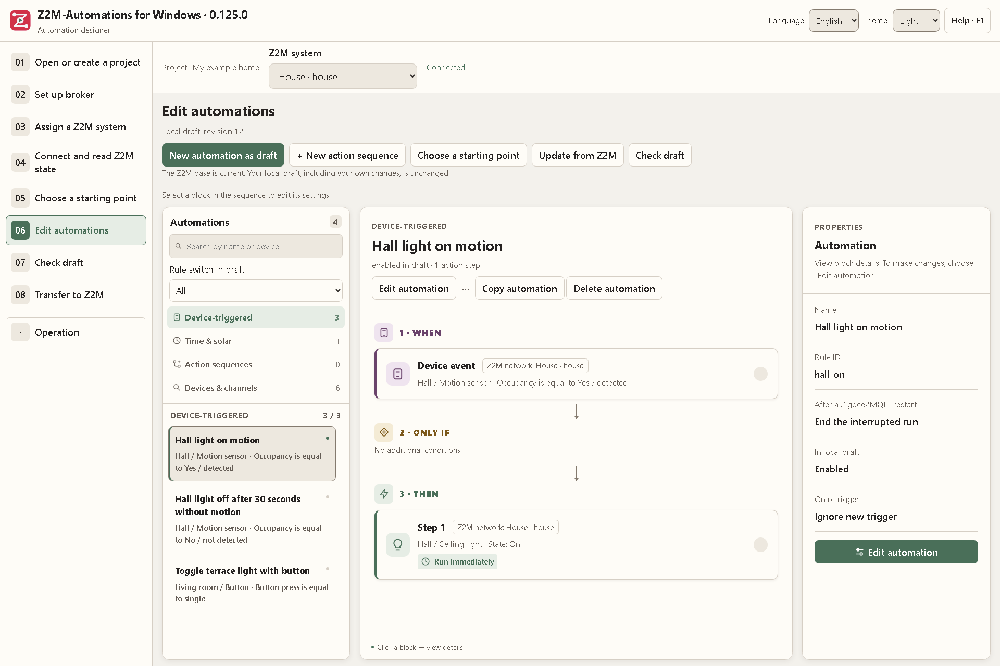

**Figure 1 — Your workspace.** Read it in this order:

1. **Numbered navigation on the left:** setup, editing, checking and transfer.
   **Operation** below it manages the stored rules.
2. **Z2M system selector above the work area:** this is the network you are
   editing or controlling. Check it before every transfer and start.
3. **Automation list:** search by name or device and choose the category.
   **Time & solar** contains scheduled rules; an empty device category does not
   mean that scheduled rules have disappeared.
4. **Middle flow:** When → Only if → Then for the selected rule.
5. **Properties at right:** details of the selected rule or block. Choose
   **Edit automation** to change a rule.

The list, flow and properties can scroll independently. Place the pointer over
the area you want to scroll. The last rule may be below the list's visible end.
Clear the search and rule-state filter when an expected rule is missing.
In narrow windows the layout rearranges and provides a **Workflow step** picker.

Choose **Language → English** and a light or dark **Theme** in the header.
Changing the UI language does not translate your own device names, rule names,
MQTT values, topics or file contents.

Use Tab / Shift+Tab to move focus, Enter or Space for appropriate controls and
Escape to cancel supported dialogs. A highlighted focus outline shows which
control receives keyboard input. Closing a form with Cancel does not apply it.

Choose **Help · F1** or press **F1** to open the complete manual included with the
app, even without Internet access. It opens at the chapter for your current step;
while a rule form is open, it explains the editor. Your unfinished input stays in
the app. The manual has a contents link, a text search and a language switch.
Select an illustration to enlarge it; Escape or Close returns to the text.

Pause over an important control, or focus it with the keyboard, to show a short
explanation. Press Escape to dismiss a tooltip. Warnings about stopping operation
remain visible in the page and confirmations; tooltips add guidance to them.

## 4. Step 1: create, open and save a project

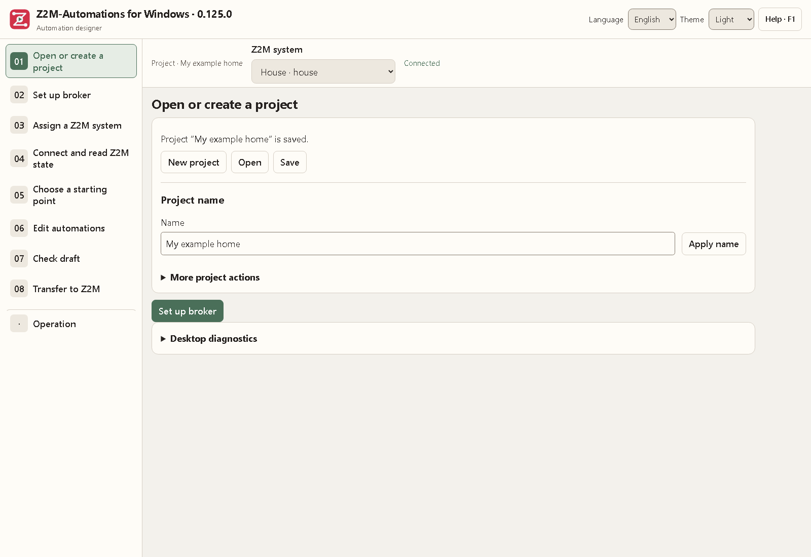

**Figure 2 — Local project management.** The saved/unsaved text refers to your
local project file, not the remote Z2M configuration.

1. Open **01 Open or create a project**.
2. Create a project and give it a meaningful name, such as **My example home**.
3. Save it in a folder you back up, using the new **.z2map** extension.
4. Return here and save after changing brokers, systems or drafts.
5. Use the further project actions for Save as, backups and opening another
   project. The operating system supplies the file chooser.

An existing configured project may open directly in **Edit automations**.
This is expected. Use step 1 whenever you need file actions.

There are two steps to preserving form changes: apply the form to the local
project, then save the project file. Likewise, **Add to draft disabled** in the
automation editor adds a rule locally; it does not upload it to Z2M.

Existing **.z2ma** files still open. Saving updates the project format; an old
filename is not automatically renamed. To adopt the new extension, use Save as
and explicitly choose **.z2map**. Keep the original until the new file reopens
successfully.

Portable projects do not contain broker passwords or private TLS keys. If you
move a project to another computer, supply that computer's credentials separately.

## 5. Step 2: configure a broker and credentials

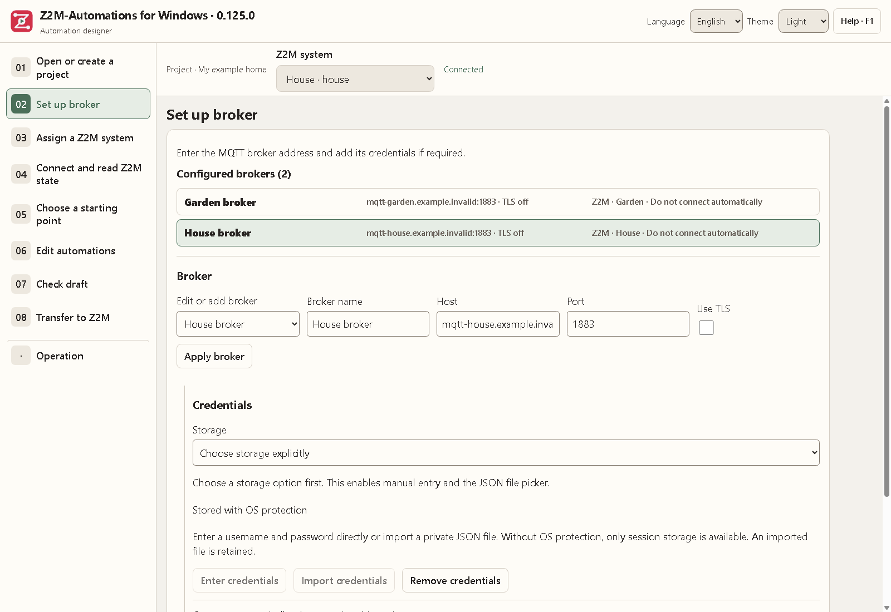

**Figure 3 — One broker connection.** The broker address is an MQTT server
address, not the URL or port of the Zigbee2MQTT web frontend.

1. Open **02 Set up broker**.
2. Select an existing broker to edit it, or create one.
3. Enter a display name, host and port. Use your actual MQTT settings.
4. Enable TLS when your broker requires it and apply the broker form.
5. If authentication is required, choose credential storage and then **Enter
   credentials** or **Import credentials**.

The fictional hosts in these images deliberately cannot be used as real servers.
For a real installation ask the broker administrator for its address, port,
TLS requirements, username and password. Do not use a Z2M device topic as a host.

### Credential storage

| Choice | What happens | What to expect next time |
| --- | --- | --- |
| Protected storage | The OS protects the credentials on this computer | Available when the OS protection/keyring can be unlocked |
| Session storage | Credentials last for the current application session | Enter them again after reopening the app |
| No authentication | Only appropriate for a broker explicitly configured to allow it | The connection uses no MQTT credentials |

On Ubuntu, unavailable protected storage does not silently become plaintext
storage. Unlock the keyring or explicitly choose session storage. Importing a
credential file does not delete that file; keep it private.

**Connect automatically when opening this project** is an explicit preference
for this computer, project and broker endpoint. Choose saved credentials or an
explicit connection without authentication. Missing/session-only credentials
can still prevent the next automatic connection. After correcting them, connect
again in step 4.

TLS validates certificates. If you need a private CA or client certificates,
use the TLS-material controls in the connection area. Imported material stays
in the main process for that project session and is not exported in a project.

## 6. Step 3: assign a Z2M network

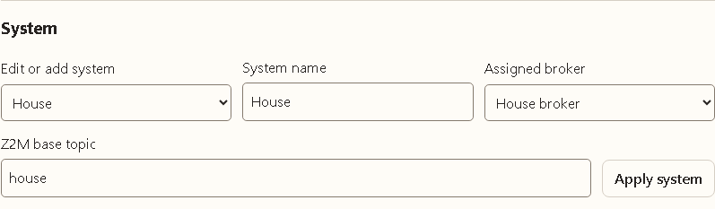

**Figure 4 — Broker and network are different things.** A broker can serve more
than one Z2M network. Each network needs its own unambiguous assignment.

1. Open **03 Assign Z2M system**.
2. Enter a display name, for example **House**.
3. Select the broker that this Zigbee2MQTT instance actually uses.
4. Enter the base topic from the Z2M configuration, for example **house**.
5. Apply the system form and save the project.

The base topic identifies the Z2M instance on MQTT. Do not append a device name
or a wildcard. A display name such as House is only a label; it does not change
the instance's configured topic.

Repeat for another instance, for example **Garden**, base topic **garden**.
You can configure up to eight systems. Separate networks may use the same broker
or different brokers; use unique base topics for cross-system features.

Partner permissions are needed only when rules use another network's devices.
First get one network working, then follow [the two-network chapter](#networks).

## 7. Step 4: connect and read the inventory

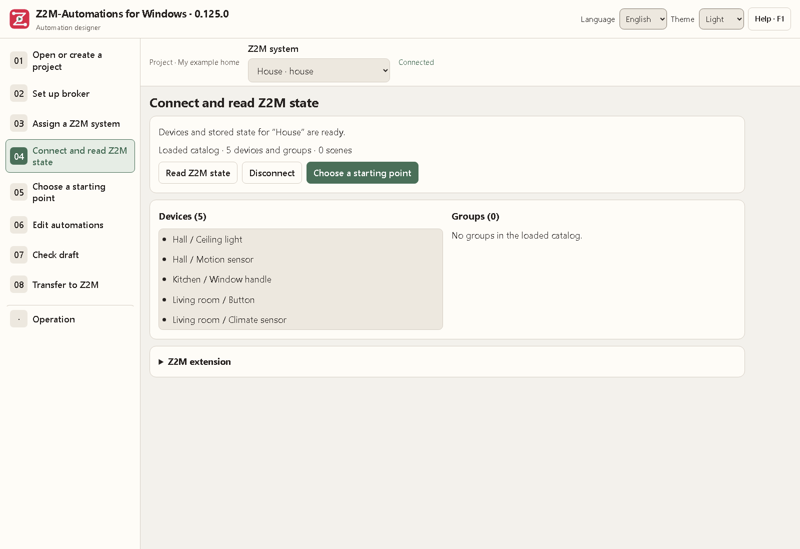

**Figure 5 — Read before editing.** This step obtains the device capabilities and
stored automation configuration needed to check a draft reliably.

1. Select the intended network above the work area.
2. Open **04 Connect and read Z2M state**.
3. Connect using the configured broker. Wait for the inventory read to finish.
4. Check that the expected devices and groups appear.
5. If no compatible extension is installed, use **Z2M extension** on this page.
   Review the explicit installation/update confirmation.
6. Continue to the local draft after a successful read.

Reading inventory does not release rules or start/stop automatic operation.
Connecting also reads the existing automations and reconciles them with local
work. See [automatic merging](#drafts).

Refresh the inventory after adding devices, changing their capabilities or
updating the extension. In the desktop app, the read action is in step 4.
In the Symcon browser designer/tile the corresponding action is **Refresh device
data**; their connection administration is different from the standalone app.

If device names are replaced by IDs or a channel is missing, first verify the
selected network and read its inventory again. A connected broker alone is not
proof that the catalog and extension replies are current.

For a cross-system rule, read every participating network. If required partner
catalog data are missing, the transfer must stop at preflight and the existing
automatic operation continues.

## 8. Working copies, automatic merging and conflicts

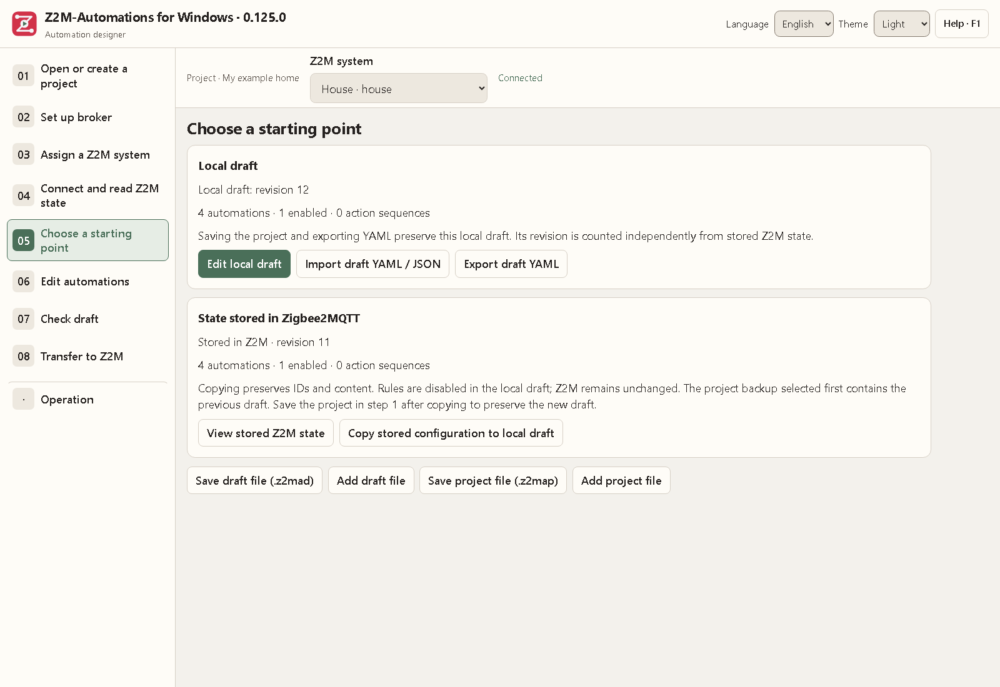

**Figure 6 — Two locations for content.** The editable local draft and the
configuration stored in Z2M are shown separately. Reading Z2M does not upload
your local changes.

### Normal connection

When the connection reads the complete stored configuration, the app compares:
the last accepted common content, your current local draft and the new Z2M
content. It matches rules by their stable IDs.

- A newly created local rule is retained when existing remote rules arrive.
- An independent remote addition is added to the local draft.
- Independent edits can be combined automatically.
- Competing edits to the same rule, or an edit versus a deletion, need a choice.

Thus, forgetting to read Z2M before making a local addition does not mean you
must discard that addition. Connect and let the app reconcile the content.
**Update from Z2M** in step 6 explicitly starts a fresh read and reconciliation.

### If a conflict appears

1. Finish or close open editor forms first.
2. Read the displayed local and Z2M versions of each affected entry.
3. Choose **Keep my version** or **Use the read version** for that entry. This selects a version of that
   entry; it does not combine arbitrary fields inside a conflicted rule.
4. Review every conflict and choose **Merge choices**.
5. Inspect the resulting automation list, then save the project.
6. Check and confirm a separate transfer if you want Z2M to use that result.

An automatic recovery snapshot is made before applying a merge/import.
**Restore previous draft** can undo that local change while its exact result is
still current. Later edits can make this shortcut unavailable; use a saved
project backup if necessary.

A complete **Copy stored configuration to local draft** operation in step 5 is
different from merging. It replaces the local configuration after confirmation and backup.
Use it only when you really intend to adopt the whole remote content.

For a new network that cannot yet be read, choose **Edit offline** explicitly.
Offline drafts can be saved, but fresh device data and remote validation are
still required before transfer. A lower remote revision or uncertain read must
not silently roll your local work back.

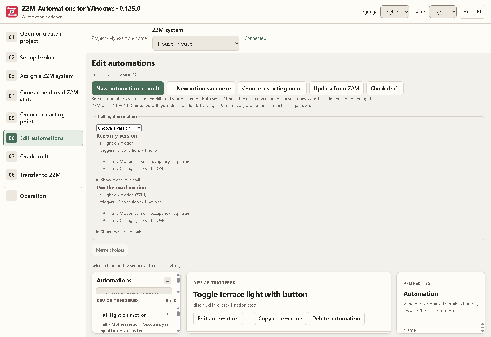

**Detail — Resolve a conflict deliberately.** Compare the trigger and action
summaries before choosing a version. The other, independent rules are retained.

## 9. Build a rule: When, Only if, Then

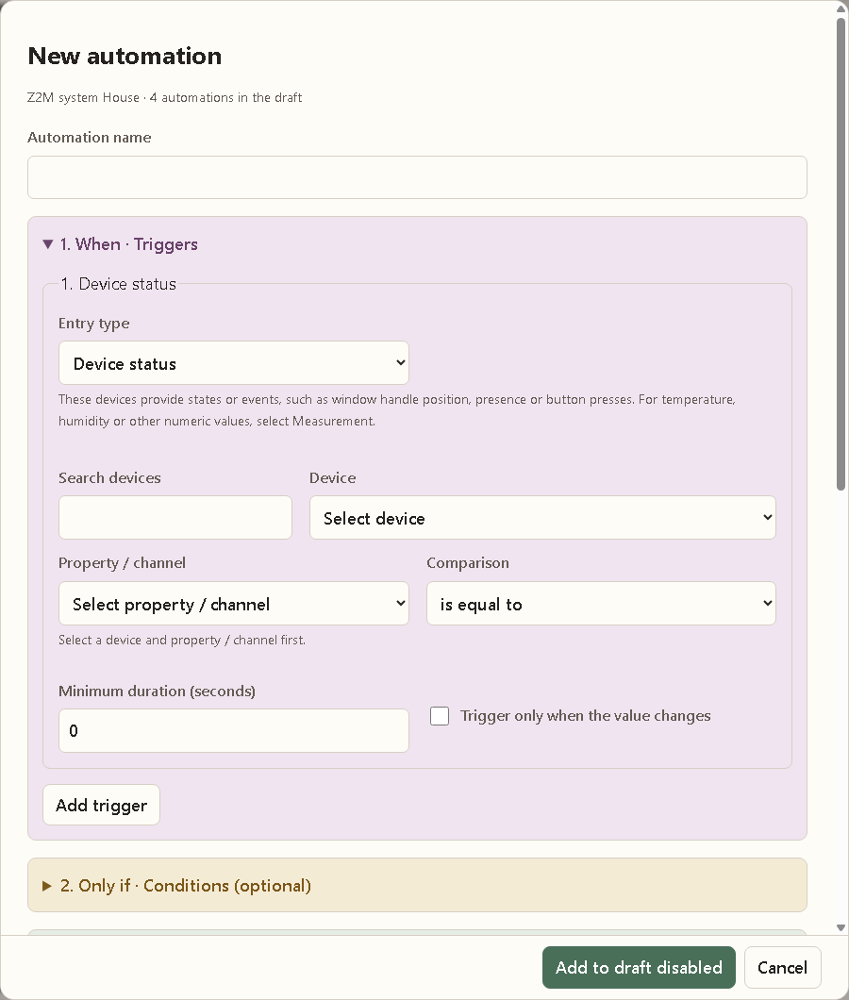

**Figure 7 — The rule editor starts locally.** Give the rule a name and configure
its sections. The footer's **Add to draft disabled** keeps a new rule disabled.
Scroll inside the form to reach conditions, actions and further settings.

### When — triggers

A trigger answers **what event should start the rule?** Choose a suitable kind:

| Kind | Typical use | What to select |
| --- | --- | --- |
| Device status | Presence, contact/handle position, a button event | Device → discrete property → comparison → offered value |
| Measured value | Temperature, humidity, brightness, power | Device → numeric property → comparison → threshold |
| Time | A fixed daily time | Time and time zone |
| Sunrise / Sunset | An astronomical event | Event, offset, location and time zone |

**Multiple triggers are alternatives (OR).** Each matching trigger can start
the rule. They do not all have to match at the same moment.

For “button pressed while a window is open”, put the button in **When** and the
window state in **Only if**. Two entries in When would mean that either event
could start the rule.

**Minimum duration** requires the device comparison to stay true for that many
seconds. If it becomes false earlier, that pending trigger is cancelled.
Zero means no duration wait.

**Trigger only when the value changes** ignores repeated reports of the same
value. It can be useful for a persistent state. Many buttons repeatedly report
the same event text, such as single, for successive presses. Leave this option
off when those repeated presses must each trigger the rule.

### Why a button appears under Measurement

Filtering applies to properties, not the device's everyday name. A button can
also report numeric battery charge. A radar sensor can report numeric brightness.
Those numeric properties belong under Measurement; their button/presence
properties belong under Device status. Window-handle position is a status.

### Only if — conditions

Conditions answer **under which circumstances may the actions run?** All listed
conditions must pass (AND). An empty condition list adds no restriction.
Device values, measured values, weekdays and time windows can be used.

By default, conditions are checked at the start and before actions. **Check only
at start** limits a condition to the start of the run. For example, a condition
“light is currently off” can intentionally be start-only when a later action
switches that same light on.

An unknown remote value is not a positive condition result. Confirm catalogs,
permissions and receiver operation before using a cross-system condition.

### Then — actions

Actions run in the displayed order. **Delay before this step** waits before that
action, not after it. Check the order again after adding or moving a step.

- **Set values:** send one or more writable properties to a device.
- **Toggle:** invert a supported state channel, such as state or state_l1.
- **Scene:** recall a scene offered by the selected target.
- **Action sequence:** run a reusable sequence already present in the draft.

The form offers writable channels for the selected target. A measurable sensor
value is not automatically writable. For a state channel, Set values can also
offer On, Off and Toggle. Do not type a translated word into raw YAML; MQTT
values such as ON, OFF and TOGGLE remain protocol values.

## 10. Example: light on motion and off after 30 seconds

Use two rules so the switch-on and switch-off events remain easy to understand.
The sensor must report presence/occupancy and the light must expose a writable
state channel.

### Rule A: switch on

1. Select the sensor's network, then **06 Edit automations**.
2. Choose **New automation as draft**.
3. Name it **Hall light on motion**.
4. In **When**, choose **Device status**, the motion sensor, its occupancy
   property, **is equal to**, and **Yes / detected**.
5. Leave minimum duration at **0**.
6. Leave conditions empty for this first example.
7. In **Then**, choose **Set values**, the hall light, its state channel and
   **On**. Leave delay at **0**.
8. Choose **Add to draft disabled**, then save the project.

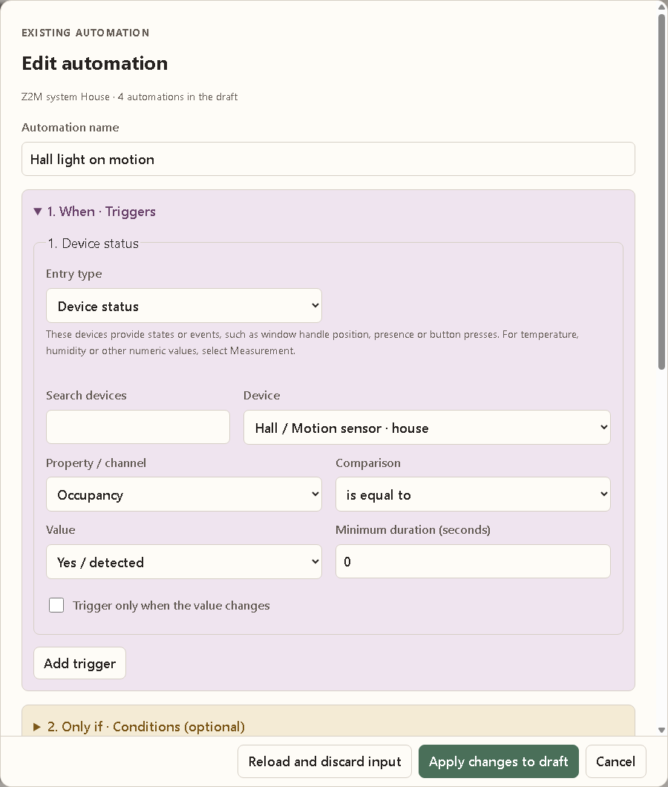

**Detail — The completed switch-on trigger.** The name explains the purpose;
the selected property and value determine which actual sensor report matches.

### Rule B: switch off after absence

1. Create **Hall light off after 30 seconds without motion**.
2. Choose the same sensor and occupancy property.
3. Compare with **No / not detected**.
4. Set **Minimum duration** to **30** seconds.
5. Add a **Set values** action: hall light → state → **Off**, delay **0**.
6. Add the disabled draft and save.

If motion returns before the 30-second absence has elapsed, the off trigger is
cancelled. This is different from a rule that starts immediately and then
delays an unconditional Off action for 30 seconds.

Next, check and transfer both rules. Release them intentionally in Operation,
then activate automatic operation. A normal motion event should switch on the
light; continuous absence for 30 seconds should switch it off. Allow for the
sensor's own reporting interval and detection timeout.

**Detail — Wait for continuous absence.** The 30 seconds belong to the trigger's
minimum duration. They are not an unconditional delay on the Off action.

### Add a brightness condition

Edit Rule A. Under **Only if**, add **Measured value**, select the sensor's
brightness property and choose, for example, **is less than 30 lx**. Choose a
threshold appropriate to the actual installation. Check, transfer and verify the
rule again. The brightness sensor's last valid reading determines the condition;
it is not a new measurement command.

## 11. Examples: button, measurement, window handle and sunset

### A button toggles a light

Use **Device status → button → action → is equal to → single** as the trigger.
Select the actual event your button exposes; not every device uses single.
Leave “only when the value changes” off for repeated identical press events.

Add a **Toggle** action and choose the light and writable state channel.
For a multi-channel switch, select the intended channel, for example **State L1
[state_l1]**. Test that channel, not the whole device, and verify the physical
result. The special case of a light in another network is explained below.

### A window-handle position starts a rule

Choose **Device status**, the handle, its position property, the comparison and
one of its actual offered values. Values such as up are device data. Do not
assume that every manufacturer's value has the same physical meaning; compare
the device's reported value with the actual handle position.

Use the handle as a condition instead when another event, such as a button
press, should initiate the action only while the handle has a certain position.

### A measured value starts a rule

Choose **Measured value → climate sensor → temperature → is greater than** and
enter your threshold, for example 25 °C. The property must be numeric. Consider
the reporting frequency, minimum duration and repeated reports before controlling
heating, ventilation or other equipment.

### An action at sunset

Choose **Sunset**, the intended location and time zone. An offset of **-15**
minutes means 15 minutes before sunset; **+15** means 15 minutes afterwards.
The position and time zone must match the site. A sunrise/sunset rule belongs to
**Time & solar** in the list.

These examples provide configuration patterns. Choose devices and thresholds
suitable for your own installation, then test them under supervision.

## 12. Step 7: check the draft and correct findings

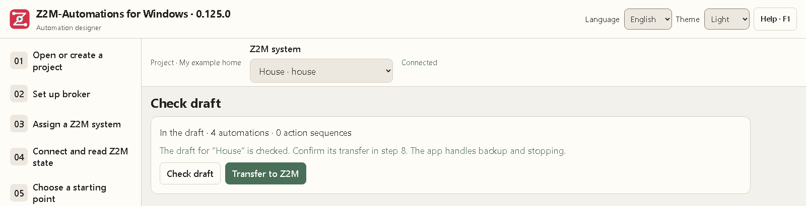

**Figure 8 — Ready for a separate transfer.** Passing this check does not yet
change the remote configuration.

1. Finish or close open editor forms.
2. Choose **Check draft** in step 6 or open **07 Check draft**.
3. Read the result, including target network and any findings.
4. Use a finding's **Go to the draft field** button to correct the exact entry.
5. Apply the correction and run the check again.
6. Continue to step 8 only after the current draft is ready.

An offline check verifies local structure. A current connected check additionally
uses confirmed device capabilities and the receiver. Changes to a draft, system
binding or relevant read data can invalidate the previous check. Recheck after
such changes; an earlier green result is not permanent permission to upload.

Partner catalogs are checked **before** operation is stopped. If a required
partner catalog is unavailable, obtain it on that network and check again. The
existing automatic operation should continue while this prerequisite is missing.

## 13. Step 8: transfer and resume previous operation

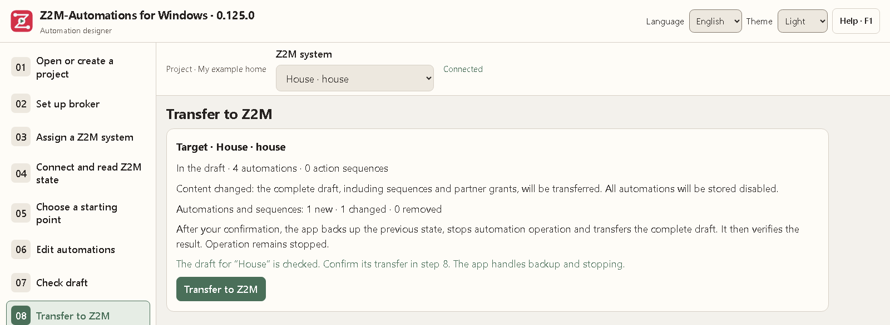

**Figure 9 — Check the target and the whole draft.** This transfer concerns the
selected network's checked configuration, not just the currently highlighted
rule. Review additions, changes and removals.

1. Verify the network name, base topic and rule counts.
2. Choose **Transfer to Z2M**.
3. Read the confirmation, including the effect on operation and rule switches.
4. Decide whether **Resume previous operation afterwards** is appropriate.
5. Confirm once and wait for completion and readback.
6. Read the final result and the confirmed enabled-rule count.

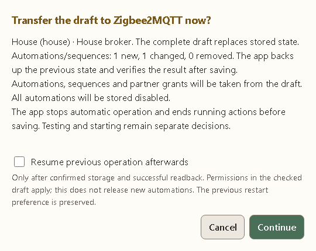

**Figure 10 — Resuming is an explicit choice for this transfer.** The option
starts unchecked. Selecting it does not grant permission to new automations.

| Situation | Result |
| --- | --- |
| Normal content transfer without resuming | Previous content is backed up; operation stops and rules are stored disabled |
| Explicit resume choice with previously confirmed active operation | After successful checks, storage and readback, previous operation resumes with the reviewed releases |
| Previously stopped or unconfirmed operation | This choice does not start it |
| A newly created/imported disabled rule | Remains disabled until explicitly released |
| Verification or confirmation is missing | No automatic repeated start or transfer |

Switch-only changes are detected separately and preserve the reviewed enabled
flags. Always use the displayed transfer mode and final counts to understand
what was stored.

Waiting for a reply is not a reason to click Transfer repeatedly. An unclear
result requires a status/readback check. Never assume that a timeout means a
command was not executed.

The resume choice is different from **Resume automatic operation after Z2M
restart** in Operation. One concerns this transfer; the other is the stored
restart preference.

## 14. Operation: release, start, test and stop

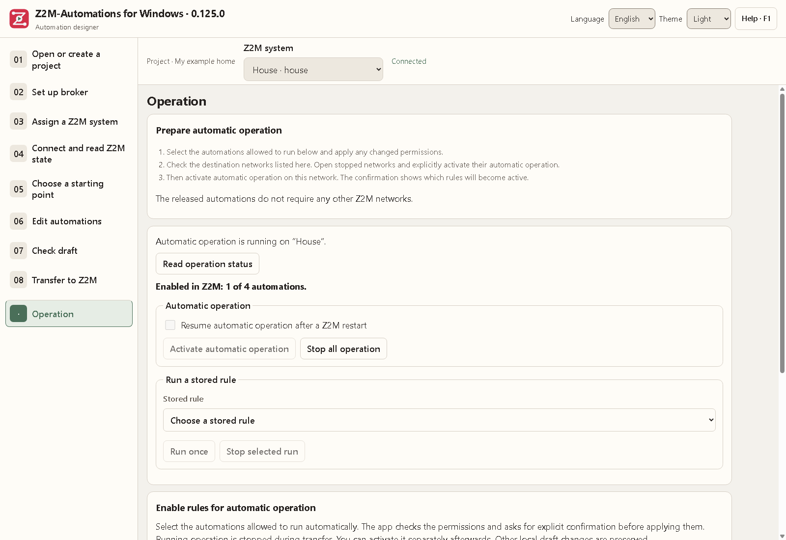

**Figure 11 — Overall operation and individual releases are separate.**
The number “enabled in Z2M” refers to the confirmed stored rules.

### Release rules

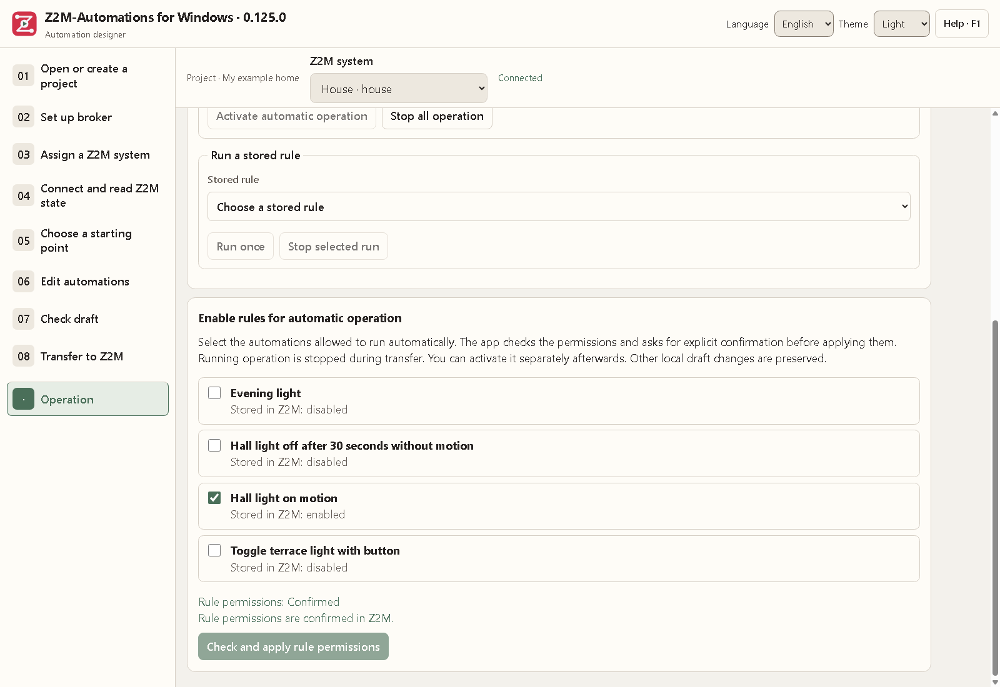

**Figure 12 — Choose exactly which stored rules may run automatically.**
Ticking a box prepares a change; the stored state changes only after checking,
confirmation and successful transfer.

1. Open **Operation** for the intended network.
2. Read the operating status if it is not currently confirmed.
3. Under **Enable rules for automatic operation**, select the desired rules.
4. Choose **Check and apply rule permissions** and review the confirmation.
5. Wait for the confirmed stored count.
6. Start automatic operation separately when indicated.

The confirmation state uses text as well as color: **Not confirmed** means the
selection/result is not confirmed; **Unknown** means current evidence is missing;
**Confirmed** refers to the matching stored release state. A green release
confirmation alone does not mean that automatic operation is running.

### Start automatic operation

Select the desired restart preference, then choose **Activate automatic
operation**. Wait for the confirmed running status. A disabled start control can
mean that no rules are released, the network is already running or the current
state is not yet confirmed.

### Run a saved rule once

Choose a rule under **Run stored rule**, then **Run once**. This is a real command
to the stored rule, not a preview of unsent editor input. Check conditions, target
devices and delays before using it. A disabled automatic release does not prevent
an explicitly permitted one-time test.

Watch the run status. An acknowledgement confirms that a request was accepted;
verify the device effect separately. Use **Stop selected run** for the selected
active run, or **Stop all operation** when you intend to stop the network.
Already completed device actions are not undone.

Closing or uninstalling the app does not stop the extension. To stop automations,
send and confirm the appropriate stop command while connected.

## 15. Automations across two networks

Example: a button belongs to **House**, while **Terrace / Lighting** belongs to
**Garden**. The rule belongs to House, because its device trigger belongs there.
Its action can target Garden.

### Prepare both sides

1. Configure both networks with unambiguous topics.
2. Connect and read both inventories. Keep the current extension on both sides;
   remote device conditions require version 0.2.1 or newer.
3. In step 3, configure the relevant partner declarations for the two systems.
   This desktop workflow checks both sides' permissions.
4. Check and transfer each changed system configuration separately.
5. Confirm operation on both the source and required receiver network.

If both use one broker, no broker bridge is needed. If they use separate brokers,
their extension messages need an independently configured MQTT bridge and
appropriate permissions for **z2ma/mesh/#**. Connecting the app to both brokers
does not itself connect those brokers.

The **Connect systems to each other** assistant in step 3 checks readable
prerequisites and offers supplementary Mosquitto partner/ACL/bridge examples.
Those examples contain placeholders. They do not install a bridge, change user
accounts or prove the rights of the Z2M/bridge accounts. Preserve the existing
server configuration and avoid duplicate bridge routes.

### Build the example rule

1. Select **House**.
2. Create **Toggle terrace light with button**.
3. In When, select the House button's actual action value, for example single.
4. In Then, select **Toggle**.
5. Choose **Device's Z2M system → Garden** before choosing the target device.
6. Select **Terrace / Lighting** and **State L1 [state_l1]**.
7. Apply the disabled draft, check it, transfer it and explicitly release it.
8. Verify automatic operation on House and the Garden receiver, then press the
   actual button and check the physical light.

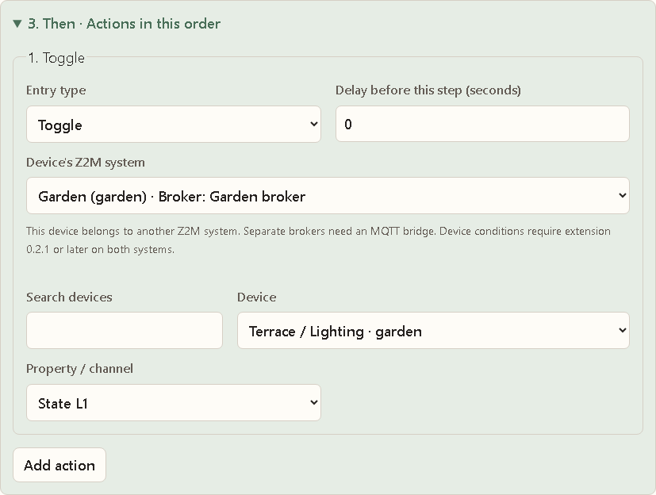

**Detail — Choose the owner network before the target.** Garden owns this light;
the House button still remains the trigger of the House rule.

The flow cards identify each device's network. If the receiver is stopped, use
the displayed direct link to its **Operation** page, check/start that system and
return to the source. The app does not automatically start every involved network.

A receiver may need active partner operation even if it has no enabled local
automations. Its receiver-specific start action makes this explicit.
An unavailable or unknown remote value must not be treated as a passed condition.

## 16. Project files, draft files, backups and recovery

| File | Purpose | Important boundary |
| --- | --- | --- |
| .z2map | Save a complete desktop project | Contains assigned networks and drafts; no broker secrets |
| .z2ma | Existing project format/filename | Remains readable; use Save as for a new filename |
| .z2mad | Exchange selected rules and required sequences | Add to a chosen existing destination network |
| YAML / JSON configuration | Inspect or exchange a system configuration | A replacement import is different from adding draft entries |

### Save selected draft rules

1. Open the draft/file actions for the selected network.
2. Choose **Save draft file (.z2mad)**.
3. Select the rules to include. Required action sequences are included with them.
4. Save as **.z2mad** in a location you control.
5. Keep the full project as well if you need its complete broker/network setup.

### Add a draft file or take rules from another project

1. Open the intended destination project and select the destination network.
2. Choose **Add draft file**.
3. Select a supported draft/project file.
4. If it contains several networks, choose the source network.
5. Select the rules and destination and review any version/dependency choices.
6. Confirm the local import, inspect the resulting list and save the project.
7. Read device data, check and transfer separately when ready.

Imported additions start disabled. Importing rules does not create native
connection ownership or expand the destination's partner grants. The same
portable draft container is supported by the app, Symcon browser designer and
tile; connection/credential setup remains product-specific.

Automatic recovery snapshots and explicit project backups have different roles.
The automatic snapshot supports undo of a recent local operation. An explicit
backup is a retained file you can reopen later or move to another computer.
Neither is a backup of broker credentials.

If a project file was changed outside the app, use **Save as** to retain both
versions. Do not blindly overwrite the file. Restore a project into a copy first
when investigating a problem; opening it does not automatically roll Z2M back.

## 17. Action sequences and advanced settings

### Reusable action sequences

Choose **New action sequence**, give it a meaningful name and define its actions
in order. Save it locally, then select that sequence as an action in a rule.
Sequences cannot be nested; the supported sequence limit is 16 steps.
Keep a referenced sequence when exporting or copying rules.

### What happens when a rule triggers again

Use **Further settings** to choose how an already running rule handles a new
trigger. The choices can ignore the new trigger, start again or reset a current
wait. Choose the behavior deliberately when the rule contains delays. Resetting
the current wait does not replay completed actions.

### What happens after a Z2M restart

The default ends an interrupted run. The resume alternatives apply to waiting
automatic runs, with distinct choices for an expired wait. Downtime counts
towards the waiting time. Completed actions are not replayed and one-time runs
are not resumed. Overall automatic operation after restart must also be enabled
for an automatic waiting run to continue.

For ordinary first rules, keep the defaults until the basic event, target and
operation behavior has been tested.

## 18. Update the app or the Z2M extension

### Update the application

1. Apply open editor changes and save all projects.
2. Retain a project backup and the previous installer.
3. Close the app.
4. On Windows, run the newer setup with the same scope and installation folder.
   On Ubuntu, install the newer DEB with apt.
5. Reopen the project and check networks, drafts, language and credential access.

App updates are manual. Installing a new app does not automatically update the
extension on every network.

### Update the extension

1. Select the intended network and open step 4.
2. Compare the installed and bundled versions under **Z2M extension**.
3. Start the explicit update and read the confirmation.
4. Wait through backup, stop, update, Z2M restart and status confirmation.
5. Read the inventory again, then check dependent rules.

An extension update can interrupt that network's operation and restart Z2M.
The app's managed update verifies the result and restores the previous automatic
operation when its workflow permits it. Read the final outcome; do not repeat an
uncertain installation blindly. Repeat deliberately for another network if needed.

### Return to an earlier app version

Keep both the current project and its backup. On Windows uninstall the newer app
and install the earlier package in the original scope. On Ubuntu use the actual
older filename:

~~~sh
sudo apt install --allow-downgrades ./<older-package>.deb
~~~

If the older app cannot read a newer project format, open a copy of the retained
pre-update backup. Downgrading the app does not roll back the extension or remote
rules.

### Uninstall

Remove the Windows app through **Installed apps**, or on Ubuntu run:

~~~sh
sudo apt remove z2m-automations
~~~

Retain your saved projects and backups. Stop the intended Z2M operation explicitly
before disconnecting if you want those automations to stop.

## 19. Troubleshooting and diagnostics

| What you see | Check first | What to do |
| --- | --- | --- |
| Broker will not connect | Host/port, credentials, TLS and network reachability | Correct step 2; retry the connection in step 4 |
| Protected credentials unavailable | OS secret service or locked Ubuntu keyring | Unlock it, or explicitly choose session storage |
| Devices appear as IDs / channels are missing | Selected network, extension version and fresh inventory | Read the correct network in step 4; update the extension if needed |
| Window handle missing from a picker | Trigger kind and readable position property | Choose Device status, refresh the catalog; inspect the actual exposed property |
| A button appears under Measurement | It also exposes a numeric property | Select its status/event under Device status; battery is a measurement |
| An automation seems missing | Search, rule-state filter, category and list scroll | Clear filters, check Time & solar, scroll within the list |
| The old draft returns after reopening | Project file was not saved after applying changes, or another file was opened | Apply changes, save the intended file in step 1, verify by reopening |
| Check passes but transfer is disabled | The draft or system changed after checking | Recheck the current selected draft |
| A partner-data warning blocks transfer | Required other network has no fresh catalog | Read that network first; current operation should continue |
| Stored rule does not run | Stored release, overall operation, source/receiver status and trigger | Read status, release intentionally and start the required system |
| Toggle affects nothing | Exact writable state channel, target network and receiver operation | Check state versus state_l1 and the correct device |
| Green release confirmation but stopped operation | The messages describe different things | Start overall operation after confirming the releases |
| Transfer/start result is unclear | A reply may be delayed or lost | Read/reconcile status; do not repeat the command automatically |
| Several versions conflict | The same stable rule was changed on both sides | Choose each local/Z2M version and inspect the merged draft |
| App is closed but rules still run | The extension is the runtime | Reconnect and send the intended stop command |

For a reproducible problem, open **Desktop diagnostics** in step 1 and start a
recording. It lasts one minute. Reproduce the issue, then open the recording.
Reading its status does not extend the original end time.

When reporting a problem, include the app version, OS version, extension version,
affected network, steps, expected result and actual result. Review exported
material before sharing it. Do not publish credentials or complete private
projects just to report a simple UI issue.

## 20. Completion checklist and glossary

### A first working network

- The correct project is saved and reopens.
- The broker connects with the intended credential mode.
- The correct network topic is assigned.
- The extension and device inventory are current.
- Existing Z2M rules and local work are reconciled.
- A disabled example rule has been completed and checked.
- Its transfer is confirmed for the intended network.
- The intended stored rules are released.
- Automatic operation is confirmed active.
- A physical test produces the expected result.

### Before a cross-system test

- Both catalogs and required partner declarations are current.
- Separate brokers have the required bridge/ACL configuration.
- The trigger belongs to the source network.
- Conditions/actions name the intended device network.
- Source and receiver operation have been checked.
- You understand which physical device the test will change.

- **Base topic:** the MQTT namespace of a Z2M instance.
- **Catalog:** device/group/scene metadata used for selection and checking.
- **Draft:** the editable local working configuration.
- **Release:** a stored rule's permission to run automatically.
- **Revision:** a version counter within its own local or remote context.
- **Readback:** a fresh read that confirms the result after a write.
- **Receiver:** the network that owns the remotely addressed device.
- **Sequence:** an ordered, reusable action list.
- **TOGGLE:** the protocol value for inverting a supported state channel.

For a concrete field name, follow the English label in your current app.
Device-specific names and offered values always come from your own inventory.
