# Z2M-Automations — Anwenderhandbuch

**Deutsch | [English](USER_GUIDE.md)**

Für Z2M-Automations für Windows und Z2M-Automations für Linux.
Bildreferenz: Anwendung **0.125.0**, mitgelieferte Erweiterung **0.2.4**.

Dieses Handbuch führt von der Installation bis zur laufenden Automation.
Für normale Regeln sind keine Programmierkenntnisse erforderlich. Vorausgesetzt
werden eine vorhandene Zigbee2MQTT-Installation und die Adresse ihres
MQTT-Brokers. Serververwaltung, MQTT-Benutzer und Broker-Brücken sind gesonderte
Aufgaben.

Die Screenshots zeigen die echte gemeinsame App-Oberfläche mit erfundenen
Beispieldaten, aufgenommen unter Windows. Diese deutsche Anleitung verwendet
deutsche Screenshots; die englische Fassung besitzt einen eigenen englischen
Bildsatz. Der gemeinsame Designer wird unter Ubuntu gleich bedient.
Betriebssystemspezifische Installations-, Datei- und Zugangsdialoge sind unten
gesondert beschrieben.

## Inhalt

1. [Aufgabe des Programms und wichtige Begriffe](#concepts)
2. [Installieren und starten](#installation)
3. [Die Oberfläche verstehen](#interface)
4. [Schritt 1: Projekt anlegen, öffnen und speichern](#project)
5. [Schritt 2: Broker und Zugangsdaten einrichten](#broker)
6. [Schritt 3: Z2M-Netz zuordnen](#systems)
7. [Schritt 4: Verbinden und Bestand lesen](#connection)
8. [Arbeitsstände, automatisches Zusammenführen und Konflikte](#drafts)
9. [Eine Regel aufbauen: Wenn, Nur wenn, Dann](#editor)
10. [Beispiel: Licht bei Bewegung, nach 30 Sekunden ausschalten](#motion)
11. [Beispiele: Taster, Messwert, Fenstergriff und Sonnenuntergang](#examples)
12. [Schritt 7: Entwurf prüfen und Fehler korrigieren](#check)
13. [Schritt 8: Übermitteln und bisherigen Betrieb fortsetzen](#transfer)
14. [Betrieb: Freigeben, starten, testen und stoppen](#operation)
15. [Automationen über zwei Z2M-Netze](#networks)
16. [Projektdateien, Entwurfsdateien, Sicherung und Wiederherstellung](#files)
17. [Aktionsfolgen und weitere Einstellungen](#advanced)
18. [App oder Z2M-Erweiterung aktualisieren](#updates)
19. [Fehlerbehebung und Diagnose](#troubleshooting)
20. [Abschlussprüfung und Glossar](#checklist)

## 1. Aufgabe des Programms und wichtige Begriffe

Die App bearbeitet Regeln und überträgt sie an unsere Erweiterung in
Zigbee2MQTT. **Zigbee2MQTT führt die Automationen aus.** Nach der Einrichtung darf
die App geschlossen werden. Zigbee2MQTT, seine Erweiterung, die MQTT-Infrastruktur
und die Geräte müssen weiterhin verfügbar sein.

| Begriff | Bedeutung | Beispiel |
| --- | --- | --- |
| Broker | MQTT-Server für den Nachrichtenaustausch | Broker Haus |
| Z2M-System / Z2M-Netz | Eine Zigbee2MQTT-Instanz mit eigenem Basistopic | Haus, Topic house |
| Gerät | Sensor, Taster, Leuchte oder anderer Teilnehmer dieses Netzes | Flur / Bewegungsmelder |
| Eigenschaft / Kanal | Ein vom Gerät angebotener Wert oder eine Funktion | Anwesenheit, Temperatur, state_l1 |
| Automation / Regel | Auslöser, optionale Bedingungen und geordnete Aktionen | Flurlicht einschalten |
| Lokaler Entwurf | Bearbeitbarer Arbeitsstand in der App | Eine noch unvollständige neue Regel |
| In Z2M gespeicherter Stand | Von der Erweiterung bestätigte Konfiguration | Revision 11 auf Haus |
| Freigegebene Regel | Gespeicherte Regel, die automatisch reagieren darf | Flurlicht bei Bewegung |
| Automatikbetrieb | Gesamtschalter für automatische Ausführung im Netz | Automatikbetrieb von Haus läuft |
| Projekt | Lokaler Behälter für Broker, Netze und deren Entwürfe | Mein Beispielhaus.z2map |

Vier Zustände sind zu unterscheiden:

1. **Projekt gespeichert:** Die lokale Datei enthält deine Arbeit.
2. **Konfiguration übermittelt:** Z2M hat die Arbeit erhalten und bestätigt.
3. **Regel freigegeben:** Die gespeicherte Regel ist eingeschaltet.
4. **Automatikbetrieb aktiv:** Das Netz darf auf Auslöser reagieren.

Eine gespeicherte Datei allein verändert Z2M nicht. Eine erfolgreich übermittelte
Regel läuft nicht zwangsläufig automatisch. Dafür müssen ihre Freigabe und der
benötigte Automatikbetrieb aktiv sein.

Lokale Revisionen und Z2M-Revisionen werden unabhängig gezählt. Eine größere
lokale Zahl beweist deshalb keinen neueren Inhalt. Nutze das Einlesen und
Zusammenführen der App, statt die gewünschte Fassung anhand dieser Zahlen
auszuwählen.

## 2. Installieren und starten

Verwende das Paket für dein Betriebssystem. Referenzumgebungen sind Windows 11 x64
und Ubuntu Desktop 24.04 LTS x64. Ubuntu 26.04 ist ein zusätzliches Abnahmeziel.
Die aktuellen RC-Pakete sind nicht signiert.

### Windows

1. Lade das Windows-Artefakt herunter und entpacke es, wenn es als ZIP vorliegt.
2. Starte die Datei mit der Endung **Windows-x64-Setup.exe**.
3. Wähle **Deutsch** für das Installationsprogramm. Die App-Sprache kann nach der
   Installation unabhängig davon eingestellt werden.
4. Wähle die Installation für dich oder für alle Benutzer. Für alle Benutzer
   ist eine Administratorbestätigung erforderlich.
5. Wähle einen eigenen Programmordner. Lege portable Projektdateien in deinem
   Dokumentenordner ab, nicht im Installationsordner.
6. Schließe die Installation ab und starte **Z2M-Automations** im Startmenü.

Im Installationsordner liegt das Programm. Persönliche Einstellungen und
geschützte Zugangsdaten bleiben im Windows-Benutzerprofil. Ein Programmordner
auf einem anderen Laufwerk verschiebt weder das Benutzerprofil noch die
temporären Windows-Dateien.

### Ubuntu

1. Lade das Linux-Artefakt herunter und entpacke es bei Bedarf.
2. Öffne ein Terminal im Ordner mit der DEB-Datei.
3. Installiere die tatsächlich heruntergeladene Datei, beispielsweise:

~~~sh
sudo apt install ./z2m-automations_0.120.0_amd64.deb
~~~

4. Starte **Z2M-Automations** im Anwendungsmenü.
5. Wenn du Zugangsdaten geschützt speichern möchtest, muss der Schlüsseldienst
   deiner Desktop-Sitzung verfügbar sein. Entsperre einen gesperrten
   Schlüsselbund in deiner Desktop-Umgebung.

Der Dateiname ist ein Beispiel zur dargestellten Version. Verwende den Namen
deines heruntergeladenen Pakets. Ein Schlüsselbundproblem ist etwas anderes als
ein falsches MQTT-Passwort; siehe [Fehlerbehebung](#troubleshooting).

## 3. Die Oberfläche verstehen

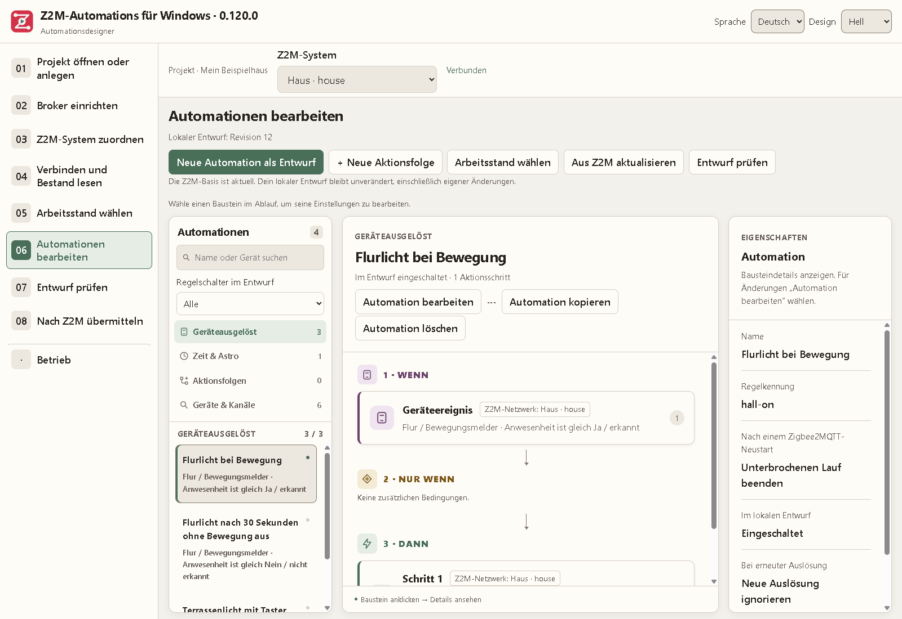

**Abbildung 1 — Der Arbeitsplatz.** Orientiere dich in dieser Reihenfolge:

1. **Nummerierte Navigation links:** Einrichtung, Bearbeitung, Prüfung und
   Übermittlung. Darunter verwaltet **Betrieb** die gespeicherten Regeln.
2. **Z2M-System oberhalb des Arbeitsbereichs:** Das ist das gerade bearbeitete
   oder gesteuerte Netz. Prüfe es vor jeder Übermittlung und jedem Start.
3. **Automationsliste:** Suche nach Namen oder Geräten und wähle die Kategorie.
   Unter **Zeit & Astro** stehen zeitgesteuerte Regeln. Eine leere
   Gerätekategorie bedeutet nicht, dass Zeitregeln verschwunden sind.
4. **Ablauf in der Mitte:** Wenn → Nur wenn → Dann der ausgewählten Regel.
5. **Eigenschaften rechts:** Details zur ausgewählten Regel oder zum Baustein.
   Für Änderungen wähle **Automation bearbeiten**.

Liste, Ablauf und Eigenschaften besitzen eigene Scrollbereiche. Platziere den
Mauszeiger über dem Bereich, den du scrollen möchtest. Die letzte Regel kann
unterhalb des sichtbaren Listenendes liegen. Leere Suche und Regelschalterfilter,
wenn eine erwartete Regel fehlt. In schmalen Fenstern ordnet sich die Oberfläche
neu an und bietet die Auswahl **Arbeitsschritt**.

Wähle oben **Sprache → Deutsch** und ein helles oder dunkles **Design**.
Ein Sprachwechsel übersetzt keine selbst vergebenen Geräte- oder Regelnamen,
MQTT-Werte, Topics oder Dateiinhalte.

Mit Tab / Umschalt+Tab wechselst du den Fokus. Enter oder die Leertaste bedienen
geeignete Steuerelemente, Escape bricht unterstützte Dialoge ab.
Die Fokusmarkierung zeigt das per Tastatur bediente Element.
**Abbrechen** übernimmt eine Formularänderung nicht.

Wähle **Hilfe · F1** oder drücke **F1**, um das vollständig mitgelieferte Handbuch
auch ohne Internetzugang zu öffnen. Es startet beim Kapitel zum aktuellen Schritt;
bei einem geöffneten Regelformular erklärt es den Editor. Deine unfertigen
Eingaben bleiben in der App erhalten. Das Handbuch bietet einen Inhaltslink,
eine Textsuche und einen Sprachwechsel.
Wähle eine Abbildung zum Vergrößern; Escape oder Schließen führt zum Text zurück.

Verweile mit der Maus über einem wichtigen Steuerelement oder fokussiere es per
Tastatur, um eine kurze Erklärung zu sehen. App-Hinweise nutzen dieselbe
Schriftfamilie und Schriftgröße, auch innerhalb von Dialogen. Zum Lesen kannst
du den Mauszeiger auf den Hinweis bewegen. Escape blendet den Hinweis aus und
lässt seinen Dialog geöffnet. Warnungen zum Betriebsstopp bleiben auf der Seite
und in Bestätigungen sichtbar; Tooltips ergänzen diese Hinweise.

## 4. Schritt 1: Projekt anlegen, öffnen und speichern

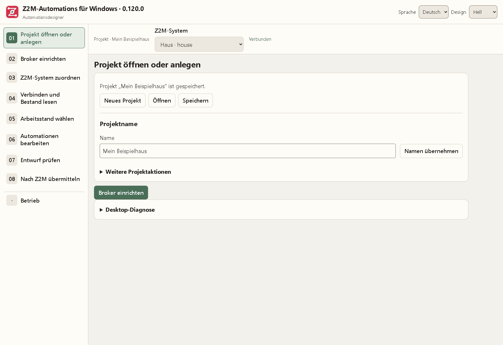

**Abbildung 2 — Das lokale Projekt verwalten.** Die Aussage zum gespeicherten
oder ungespeicherten Projekt betrifft die lokale Datei, nicht den Z2M-Stand.

1. Öffne **01 Projekt öffnen oder anlegen**.
2. Lege ein Projekt mit einem aussagekräftigen Namen an, etwa **Mein Beispielhaus**.
3. Speichere es in einem gesicherten eigenen Ordner mit der neuen Endung
   **.z2map**.
4. Speichere hier erneut nach Änderungen an Brokern, Netzen und Entwürfen.
5. Unter den weiteren Projektaktionen findest du Speichern unter, Sicherungen
   und das Öffnen eines anderen Projekts. Den Dateidialog stellt dein
   Betriebssystem bereit.

Ein bereits eingerichtetes Projekt kann direkt unter **Automationen bearbeiten**
öffnen. Das ist vorgesehen. Für Dateiaktionen gehst du zurück zu Schritt 1.

Zum Aufbewahren von Formularänderungen sind zwei Schritte nötig: zunächst das
Formular in das lokale Projekt übernehmen, dann die Projektdatei speichern.
Auch **Ausgeschaltet zum Entwurf hinzufügen** legt eine Regel zunächst lokal an;
Z2M wird dadurch nicht verändert.

Bestehende **.z2ma**-Dateien bleiben lesbar. Beim Speichern wird das Projektformat
aktualisiert, ein vorhandener Dateiname aber nicht automatisch umbenannt.
Wähle **Speichern unter** und ausdrücklich **.z2map**, wenn du die neue Endung
verwenden möchtest. Bewahre das Original auf, bis die neue Datei wieder
erfolgreich geöffnet wurde.

Portable Projekte enthalten keine Broker-Passwörter oder privaten TLS-Schlüssel.
Auf einem anderen Computer musst du dessen Zugangsdaten gesondert hinterlegen.

## 5. Schritt 2: Broker und Zugangsdaten einrichten

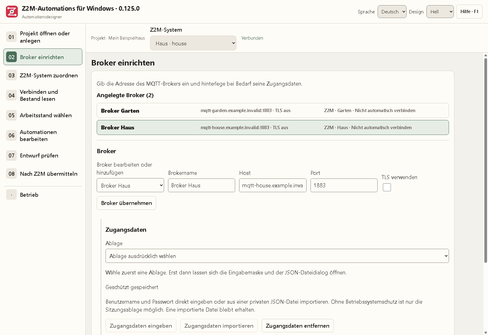

**Abbildung 3 — Eine Broker-Verbindung.** Gemeint ist die Adresse des MQTT-Servers,
nicht die URL oder Portnummer der Zigbee2MQTT-Weboberfläche.

1. Öffne **02 Broker einrichten**.
2. Wähle einen vorhandenen Broker zum Bearbeiten oder lege einen neuen an.
3. Trage Anzeigename, Host und Port anhand deiner MQTT-Konfiguration ein.
4. Aktiviere gegebenenfalls TLS und übernimm das Brokerformular.
5. Wähle bei erforderlicher Anmeldung zuerst den Speicherort für Zugangsdaten
   und danach **Zugangsdaten eingeben** oder **Zugangsdaten importieren**.

Die erfundenen Beispieladressen in den Bildern sind absichtlich keine nutzbaren
Server. Für deine Installation benötigst du die tatsächliche Adresse, den Port,
die TLS-Anforderungen und gegebenenfalls Benutzername und Passwort.
Ein Gerätetopic ist keine Serveradresse.

### Zugangsdaten aufbewahren

| Auswahl | Was passiert? | Beim nächsten Start |
| --- | --- | --- |
| Geschützte Speicherung | Das Betriebssystem schützt die Daten auf diesem Computer | Verfügbar, wenn Betriebssystemschutz bzw. Schlüsselbund zugänglich sind |
| Sitzungsspeicherung | Daten gelten für die aktuelle App-Sitzung | Nach erneutem Öffnen wieder eingeben |
| Ohne Anmeldung | Nur für ausdrücklich so eingerichtete Broker geeignet | Verbindung ohne MQTT-Zugangsdaten |

Unter Ubuntu wird ein fehlender Schlüsseldienst nicht stillschweigend durch
Klartextspeicherung ersetzt. Entsperre den Schlüsselbund oder wähle ausdrücklich
Sitzungsspeicherung. Beim Import bleibt die Zugangsdaten-Datei erhalten; bewahre
sie privat auf.

**Beim Öffnen dieses Projekts automatisch verbinden** ist eine ausdrückliche
Einstellung für diesen Computer, dieses Projekt und diese Brokeradresse.
Wähle hinterlegte Zugangsdaten oder ausdrücklich eine Verbindung ohne Anmeldung.
Fehlende bzw. nur für die Sitzung gespeicherte Zugangsdaten können die nächste
automatische Verbindung verhindern. Nach der Korrektur verbindest du in
Schritt 4 erneut.

TLS prüft Zertifikate. Für eine private CA oder Client-Zertifikate nutze die
TLS-Einstellungen im Verbindungsbereich. Importiertes Material bleibt im
Hauptprozess für diese Projektsitzung und wird nicht in Projekte exportiert.

## 6. Schritt 3: Z2M-Netz zuordnen

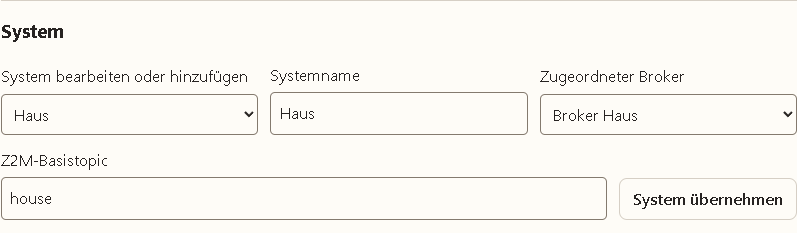

**Abbildung 4 — Broker und Netz unterscheiden.** Ein Broker kann mehrere
Z2M-Netze bedienen. Jedes Netz benötigt eine eindeutige eigene Zuordnung.

1. Öffne **03 Z2M-System zuordnen**.
2. Vergib einen Anzeigenamen, beispielsweise **Haus**.
3. Wähle den Broker, den diese Zigbee2MQTT-Instanz tatsächlich verwendet.
4. Trage ihr Basistopic aus der Z2M-Konfiguration ein, beispielsweise **house**.
5. Übernimm das Formular und speichere das Projekt.

Das Basistopic identifiziert die Instanz auf MQTT. Hänge keinen Gerätenamen und
keinen Platzhalter an. Der Anzeigename Haus ist lediglich eine Beschriftung;
er ändert nicht das in Z2M konfigurierte Topic.

Wiederhole dies für eine weitere Instanz, etwa **Garten** mit Basistopic
**garden**. Bis zu acht Systeme sind möglich. Mehrere Netze können einen Broker
teilen oder getrennte Broker verwenden. Für systemübergreifende Funktionen
benötigst du eindeutige Basistopics.

Partnerfreigaben sind erforderlich, wenn Regeln Geräte eines anderen Netzes
nutzen. Richte zuerst ein Netz vollständig ein und folge anschließend dem
[Kapitel zu zwei Netzen](#networks).

## 7. Schritt 4: Verbinden und Bestand lesen

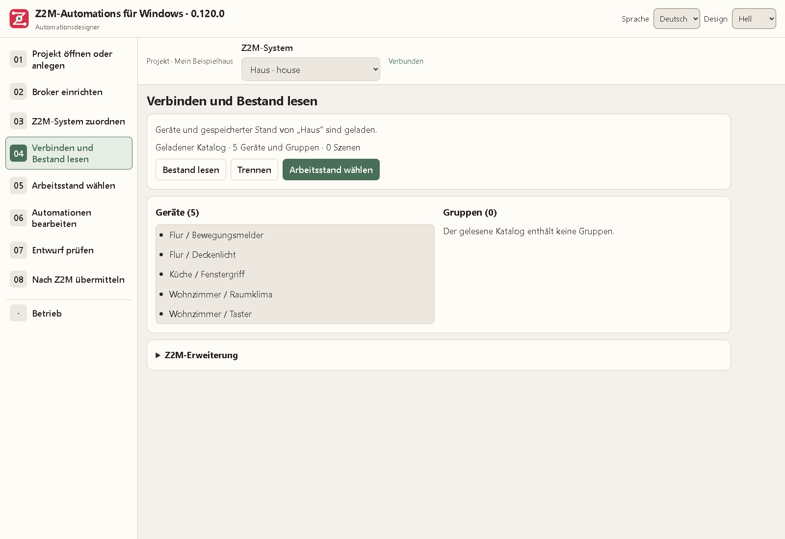

**Abbildung 5 — Vor dem Bearbeiten einlesen.** Hier erhält die App Gerätefähigkeiten
und die gespeicherte Automationskonfiguration für eine zuverlässige Prüfung.

1. Wähle oberhalb des Arbeitsbereichs das richtige Netz.
2. Öffne **04 Verbinden und Bestand lesen**.
3. Verbinde über den eingerichteten Broker und warte auf den vollständigen Bestand.
4. Kontrolliere, ob die erwarteten Geräte und Gruppen erscheinen.
5. Falls eine passende Erweiterung fehlt, verwende **Z2M-Erweiterung** auf dieser
   Seite und lies die ausdrückliche Installations- bzw. Updatebestätigung.
6. Arbeite nach erfolgreichem Einlesen mit dem lokalen Entwurf weiter.

Das Bestandslesen gibt keine Regeln frei und startet oder stoppt keinen
Automatikbetrieb. Beim Verbinden werden außerdem vorhandene Automationen
eingelesen und mit der lokalen Arbeit abgeglichen; siehe [Zusammenführen](#drafts).

Lies den Bestand nach neuen Geräten, geänderten Gerätefähigkeiten oder einem
Erweiterungsupdate erneut. In der Desktop-App befindet sich die Leseaktion in
Schritt 4. Im Symcon-Browserdesigner bzw. in der Kachel heißt die entsprechende
Aktion **Gerätedaten aktualisieren**; die Verbindungsverwaltung unterscheidet
sich dort von der eigenständigen App.

Stehen nur Gerätekennungen statt Namen da oder fehlen Kanäle, kontrolliere zuerst
das ausgewählte Netz und lies dessen Bestand erneut.
Eine verbundene MQTT-Verbindung allein bestätigt noch keinen aktuellen
Gerätekatalog und keine aktuelle Erweiterungsantwort.

Lies für systemübergreifende Regeln alle beteiligten Netze ein. Fehlen notwendige
Partner-Gerätedaten, muss die Übertragung bereits vor dem Betriebsstopp anhalten.
Der bisherige Automatikbetrieb läuft währenddessen weiter.

## 8. Arbeitsstände, automatisches Zusammenführen und Konflikte

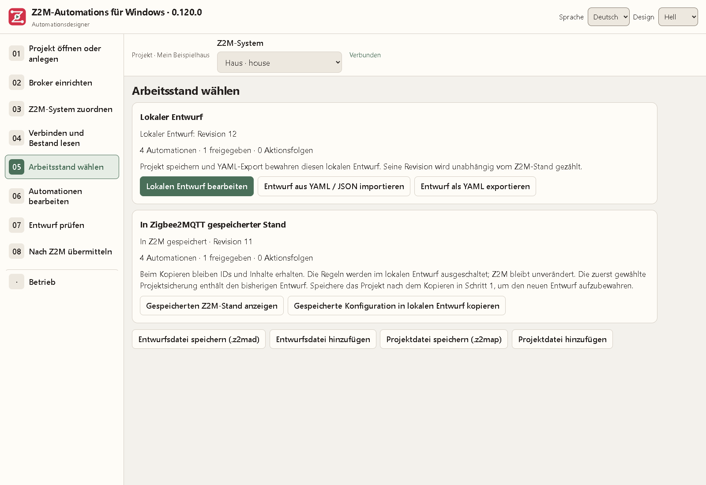

**Abbildung 6 — Zwei Orte für Inhalte.** Der bearbeitbare lokale Entwurf und die
in Z2M gespeicherte Konfiguration werden getrennt angezeigt. Einlesen lädt keine
eigenen Änderungen nach Z2M hoch.

### Beim normalen Verbinden

Nach dem vollständigen Lesen vergleicht die App den zuletzt akzeptierten
gemeinsamen Inhalt, den aktuellen lokalen Entwurf und den neuen Z2M-Inhalt.
Die Zuordnung erfolgt anhand stabiler Regelkennungen.

- Neu angelegte lokale Regeln bleiben beim Nachladen bestehender Regeln erhalten.
- Unabhängige neue Z2M-Regeln werden in den lokalen Entwurf aufgenommen.
- Unabhängige Änderungen können automatisch zusammengeführt werden.
- Unterschiedliche Änderungen derselben Regel oder Änderung gegen Löschung
  erfordern eine ausdrückliche Auswahl.

Wenn du vor dem ersten Z2M-Abgleich bereits lokal gearbeitet hast, musst du diese
Ergänzung deshalb nicht verwerfen. Verbinde und lasse die App die Inhalte
abgleichen. **Aus Z2M aktualisieren** in Schritt 6 startet ausdrücklich ein neues
Einlesen mit anschließendem Abgleich.

### Wenn ein Versionskonflikt erscheint

1. Übernimm oder schließe zuerst offene Bearbeitungsformulare.
2. Lies für jeden betroffenen Eintrag die lokale und die Z2M-Fassung.
3. Wähle **Meine Fassung behalten** oder **Gelesene Fassung übernehmen**. Damit wählst du eine Fassung dieses Eintrags;
   widersprüchliche Felder einer Regel werden nicht beliebig miteinander vermischt.
4. Prüfe alle Konflikte und wähle **Auswahl zusammenführen**.
5. Kontrolliere die Regelliste und speichere das Projekt.
6. Prüfe und übermittle gesondert, wenn Z2M diesen neuen Stand verwenden soll.

Vor dem Übernehmen eines Abgleichs oder Imports entsteht automatisch eine
Wiederherstellungssicherung. **Vorherigen Entwurf wiederherstellen** kann diese
lokale Änderung zurücknehmen, solange ihr genaues Ergebnis noch aktuell ist.
Weitere Änderungen können diese direkte Rücknahme verhindern; nutze dann bei
Bedarf eine gespeicherte Projektsicherung.

**Gespeicherte Konfiguration in lokalen Entwurf kopieren** in Schritt 5
unterscheidet sich vom Zusammenführen. Es ersetzt nach Bestätigung und Sicherung die lokale
Konfiguration. Verwende es nur, wenn du wirklich den gesamten Z2M-Inhalt
übernehmen möchtest.

Kann ein neues Netz noch nicht gelesen werden, wähle ausdrücklich
**Offline bearbeiten**. Solche Entwürfe lassen sich speichern, benötigen vor der
Übertragung aber weiterhin frische Gerätedaten und die Gegenprüfung durch Z2M.
Ein älterer Z2M-Stand oder eine unklare Antwort darf deine lokale Arbeit nicht
unbemerkt zurücksetzen.

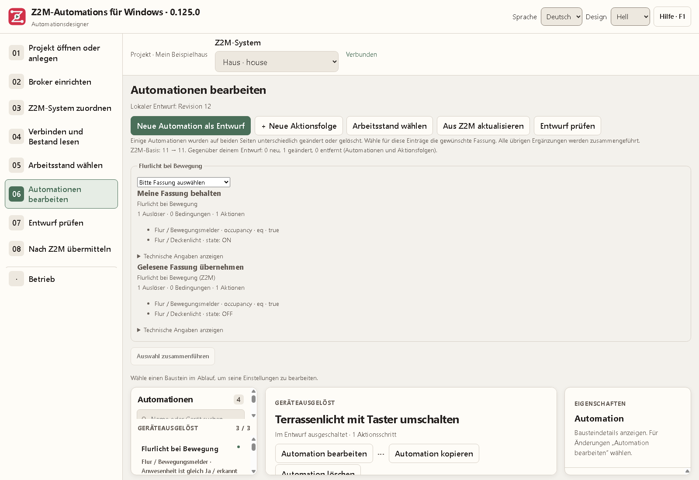

**Detail — Einen Konflikt bewusst auflösen.** Vergleiche Auslöser und Aktionen,
bevor du eine Fassung wählst. Andere unabhängige Regeln bleiben erhalten.

## 9. Eine Regel aufbauen: Wenn, Nur wenn, Dann

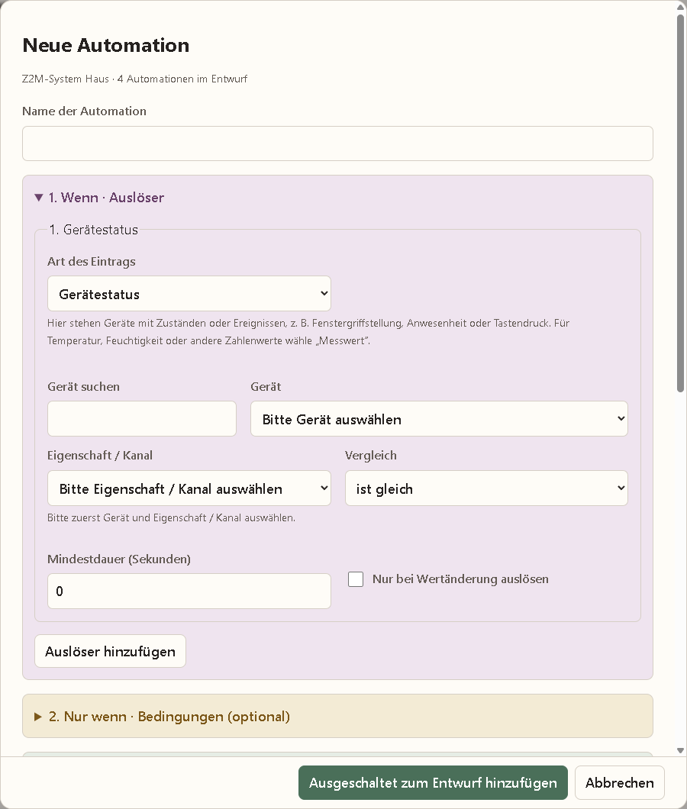

**Abbildung 7 — Die Regel beginnt lokal.** Vergib einen Namen und fülle die
Abschnitte aus. **Ausgeschaltet zum Entwurf hinzufügen** hält eine neue Regel
zunächst ausgeschaltet. Im Formular erreichst du durch Scrollen Bedingungen,
Aktionen und weitere Einstellungen.

### Wenn — Auslöser

Ein Auslöser beantwortet: **Welches Ereignis soll die Regel starten?**

| Art | Typischer Einsatz | Auswahl |
| --- | --- | --- |
| Gerätestatus | Anwesenheit, Kontakt- bzw. Griffstellung, Tastendruck | Gerät → diskrete Eigenschaft → Vergleich → angebotener Wert |
| Messwert | Temperatur, Feuchtigkeit, Helligkeit, Leistung | Gerät → numerische Eigenschaft → Vergleich → Grenzwert |
| Uhrzeit | Feste tägliche Zeit | Uhrzeit und Zeitzone |
| Sonnenaufgang / Sonnenuntergang | Astronomisches Ereignis | Ereignis, Zeitversatz, Ort und Zeitzone |

**Mehrere Auslöser sind alternativ verknüpft (ODER).** Jeder passende Auslöser
kann die Regel starten. Es müssen nicht alle gleichzeitig zutreffen.

Für „Taster gedrückt, während das Fenster offen ist“ gehört der Taster unter
**Wenn** und der Fensterzustand unter **Nur wenn**. Zwei Einträge unter Wenn
würden bedeuten, dass jedes dieser Ereignisse die Regel starten könnte.

Die **Mindestdauer** verlangt, dass der Gerätevergleich entsprechend viele
Sekunden ununterbrochen zutrifft. Wird er vorher falsch, wird dieser wartende
Auslöser verworfen. Null bedeutet keine Mindestwartezeit.

**Nur bei Wertänderung auslösen** ignoriert wiederholte Meldungen desselben
Wertes. Das kann für einen dauerhaften Zustand sinnvoll sein. Viele Taster
melden bei aufeinanderfolgenden Tastendrücken jedoch wiederholt denselben Text,
etwa single. Lasse die Option aus, wenn jeder dieser Tastendrücke auslösen soll.

### Warum steht ein Taster auch bei Messwert?

Gefiltert werden Eigenschaften, nicht die alltagssprachlichen Gerätenamen.
Ein Taster kann zusätzlich einen numerischen Batteriestand liefern, ein
Radarsensor einen Helligkeitswert. Diese Kanäle gehören zu Messwert; die
Tastendruck- bzw. Anwesenheitskanäle zu Gerätestatus. Eine Fenstergriffstellung
ist ein Status.

### Nur wenn — Bedingungen

Bedingungen beantworten: **Unter welchen Voraussetzungen dürfen die Aktionen
ausgeführt werden?** Alle aufgeführten Bedingungen müssen erfüllt sein (UND).
Eine leere Bedingungsliste schränkt die Regel nicht zusätzlich ein.
Möglich sind Gerätezustände, Messwerte, Wochentage und Zeitfenster.

Standardmäßig werden Bedingungen beim Start und vor Aktionen geprüft.
**Nur beim Start prüfen** beschränkt eine Bedingung auf den Laufbeginn.
Beispielsweise kann „Licht ist aus“ bewusst nur beim Start gelten, wenn eine
folgende Aktion genau dieses Licht einschaltet.

Ein unbekannter Wert aus einem anderen Netz ist kein positives Prüfergebnis.
Bestätige vor einer systemübergreifenden Bedingung Kataloge, Freigaben und
Empfängerbetrieb.

### Dann — Aktionen

Die Aktionen laufen in der angezeigten Reihenfolge. **Wartezeit vor diesem
Schritt** wartet vor der Aktion, nicht danach. Kontrolliere nach Ergänzungen
oder Verschieben von Schritten erneut die Reihenfolge.

- **Werte setzen:** Eine oder mehrere beschreibbare Eigenschaften eines Geräts
  als gemeinsamen Befehl setzen.
- **Umschalten:** Einen geeigneten Statuskanal wie state oder state_l1 umschalten.
- **Szene:** Eine vom ausgewählten Ziel angebotene Szene aufrufen.
- **Aktionsfolge:** Eine bereits im Entwurf vorhandene Folge wiederverwenden.

Angeboten werden die beschreibbaren Kanäle des gewählten Ziels. Ein Messwert ist
nicht automatisch beschreibbar. Bei passenden Statuskanälen bietet auch Werte
setzen die Auswahl Ein, Aus oder Umschalten. Schreibe keine übersetzten
Bedienwörter in rohe YAML-Werte: ON, OFF und TOGGLE bleiben Protokollwerte.

## 10. Beispiel: Licht bei Bewegung, nach 30 Sekunden ausschalten

Zwei Regeln machen Ein- und Ausschalten gut nachvollziehbar.
Der Sensor muss Anwesenheit melden, die Leuchte einen beschreibbaren
Statuskanal anbieten.

### Regel A: einschalten

1. Wähle das Netz des Sensors und **06 Automationen bearbeiten**.
2. Wähle **Neue Automation als Entwurf**.
3. Vergib den Namen **Flurlicht bei Bewegung**.
4. Wähle unter **Wenn** die Art **Gerätestatus**, den Bewegungsmelder, seine
   Anwesenheitseigenschaft, **ist gleich** und **Ja / erkannt**.
5. Belasse die Mindestdauer bei **0**.
6. Lasse Bedingungen für dieses erste Beispiel leer.
7. Wähle unter **Dann** die Art **Werte setzen**, die Flurleuchte, ihren
   Statuskanal und **Ein**. Die Wartezeit bleibt **0**.
8. Füge die Regel ausgeschaltet zum Entwurf hinzu und speichere das Projekt.

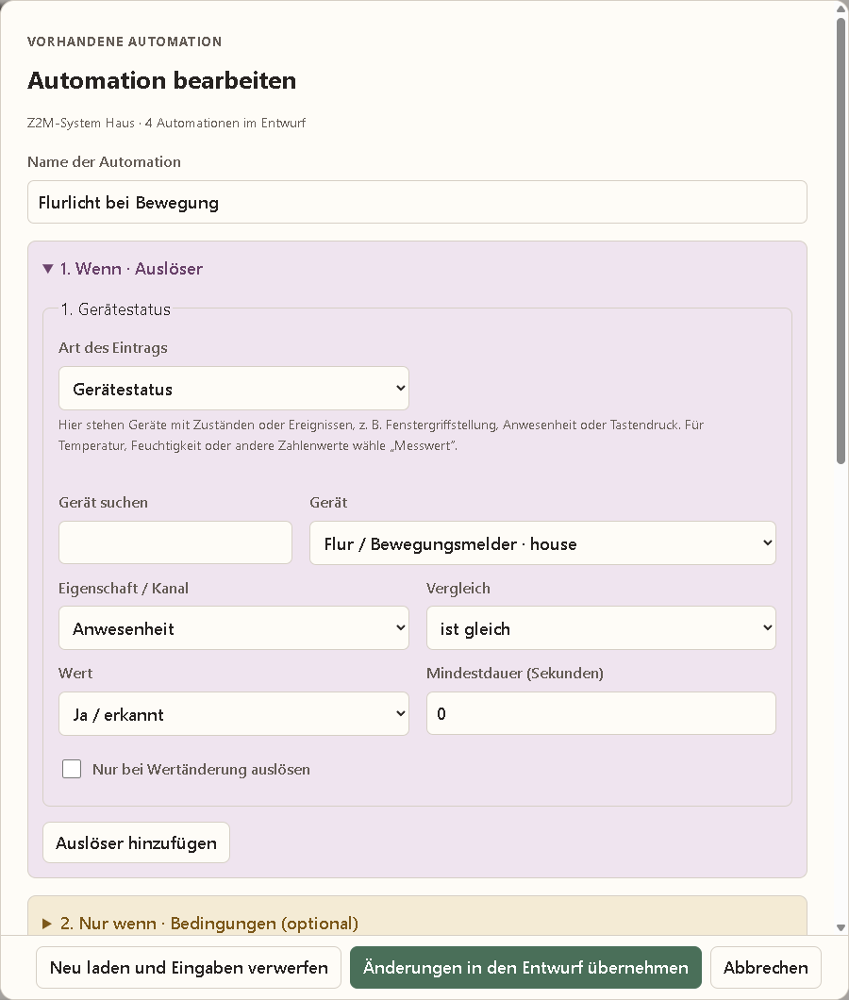

**Detail — Der fertige Einschaltauslöser.** Der Name erklärt den Zweck;
Eigenschaft und Vergleichswert legen die tatsächlich passende Sensormeldung fest.

### Regel B: nach Abwesenheit ausschalten

1. Lege **Flurlicht nach 30 Sekunden ohne Bewegung aus** an.
2. Wähle denselben Sensor und seine Anwesenheitseigenschaft.
3. Vergleiche mit **Nein / nicht erkannt**.
4. Trage eine **Mindestdauer von 30 Sekunden** ein.
5. Ergänze **Werte setzen**: Flurleuchte → Status → **Aus**, Wartezeit **0**.
6. Füge den ausgeschalteten Entwurf hinzu und speichere.

Kehrt die Bewegung vor Ablauf der 30 Sekunden zurück, wird der Ausschaltauslöser
verworfen. Das ist etwas anderes als ein sofort gestarteter Lauf mit einem
bedingungslosen Ausschaltbefehl nach 30 Sekunden Verzögerung.

Prüfe und übermittle anschließend beide Regeln. Gib sie im Bereich Betrieb
bewusst frei und aktiviere den Automatikbetrieb. Eine Bewegung soll einschalten,
30 Sekunden durchgehende Abwesenheit sollen ausschalten.
Berücksichtige zusätzlich Meldeintervall und Erkennungsnachlauf des Sensors.

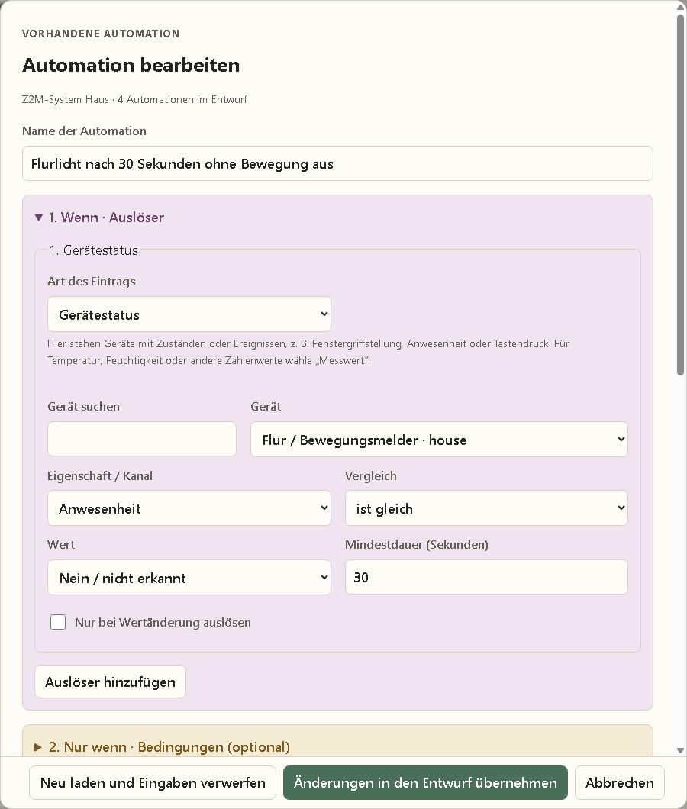

**Detail — Durchgehende Abwesenheit abwarten.** Die 30 Sekunden gehören zur
Mindestdauer des Auslösers. Sie sind keine bedingungslose Wartezeit der Aus-Aktion.

### Eine Helligkeitsbedingung ergänzen

Bearbeite Regel A. Füge unter **Nur wenn** die Art **Messwert**, den
Helligkeitskanal des Sensors und beispielsweise **ist kleiner als 30 lx** hinzu.
Wähle einen zur realen Installation passenden Grenzwert. Prüfe, übermittle und
teste erneut. Maßgeblich ist der letzte gültige Sensorwert; die Bedingung fordert
keine neue Messung an.

## 11. Beispiele: Taster, Messwert, Fenstergriff und Sonnenuntergang

### Taster schaltet Licht um

Nutze **Gerätestatus → Taster → action → ist gleich → single** als Auslöser.
Wähle den tatsächlich angebotenen Tasterwert; nicht jedes Gerät verwendet single.
Lasse „Nur bei Wertänderung auslösen“ für wiederholte gleiche Tastendrücke aus.

Ergänze eine Aktion **Umschalten** und wähle die Leuchte sowie ihren beschreibbaren
Statuskanal. Bei Mehrkanalschaltern ist der beabsichtigte Kanal wichtig, etwa
**Status L1 [state_l1]**. Teste diesen Kanal und kontrolliere die physische Wirkung.
Für eine Leuchte in einem anderen Netz gilt das entsprechende Kapitel unten.

### Eine Fenstergriffstellung löst aus

Wähle **Gerätestatus**, den Griff, seine Positionseigenschaft, den Vergleich und
einen tatsächlich angebotenen Wert. Werte wie up sind Gerätedaten.
Gehe nicht davon aus, dass jeder Hersteller die gleichen Bedeutungen verwendet.
Vergleiche den gemeldeten Wert mit der tatsächlichen Griffstellung.

Nutze den Griff stattdessen als Bedingung, wenn ein anderes Ereignis, etwa ein
Tastendruck, nur bei dieser Griffstellung eine Aktion auslösen soll.

### Ein Messwert löst aus

Wähle **Messwert → Klimasensor → Temperatur → ist größer als** und trage deinen
Grenzwert ein, beispielsweise 25 °C. Die Eigenschaft muss numerisch sein.
Berücksichtige vor dem Steuern von Heizung, Lüftung oder anderen Geräten deren
Meldehäufigkeit, Mindestdauer und wiederholte Werte.

### Eine Aktion bei Sonnenuntergang

Wähle **Sonnenuntergang**, den richtigen Ort und die Zeitzone. Ein Versatz von
**-15 Minuten** bedeutet 15 Minuten vor Sonnenuntergang, **+15 Minuten** danach.
Position und Zeitzone müssen zum Standort passen.
Solche Regeln findest du in der Liste unter **Zeit & Astro**.

Die Beispiele zeigen Konfigurationsmuster. Wähle passende Geräte und Grenzwerte
für deine eigene Anlage und überprüfe das Ergebnis beaufsichtigt.

## 12. Schritt 7: Entwurf prüfen und Fehler korrigieren

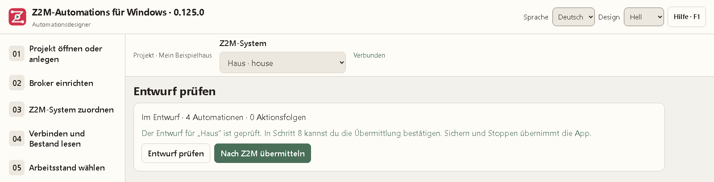

**Abbildung 8 — Bereit für eine gesonderte Übermittlung.** Eine erfolgreiche
Prüfung allein verändert die gespeicherte Z2M-Konfiguration noch nicht.

1. Übernimm oder schließe offene Bearbeitungsformulare.
2. Wähle **Entwurf prüfen** in Schritt 6 oder öffne **07 Entwurf prüfen**.
3. Lies Ergebnis, Zielnetz und mögliche Befunde.
4. Springe über **Zur Stelle im Entwurf** direkt zum betroffenen Feld.
5. Übernimm die Korrektur und prüfe erneut.
6. Gehe erst bei einem aktuell bereiten Entwurf zu Schritt 8.

Eine Offlineprüfung prüft die lokale Struktur. Eine aktuelle verbundene Prüfung
bezieht zusätzlich bestätigte Gerätefähigkeiten und den Empfänger ein.
Änderungen an Entwurf, Systemzuordnung oder relevanten Gerätedaten können die
vorherige Prüfung ungültig machen. Prüfe danach erneut; ein früheres grünes
Ergebnis ist keine dauerhafte Übertragungserlaubnis.

Partner-Gerätedaten werden **vor** einem Betriebsstopp geprüft. Fehlt ein
erforderlicher Partnerkatalog, lies zuerst dessen Netz ein und prüfe erneut.
Während diese Voraussetzung fehlt, soll der bisherige Automatikbetrieb
weiterlaufen.

## 13. Schritt 8: Übermitteln und bisherigen Betrieb fortsetzen

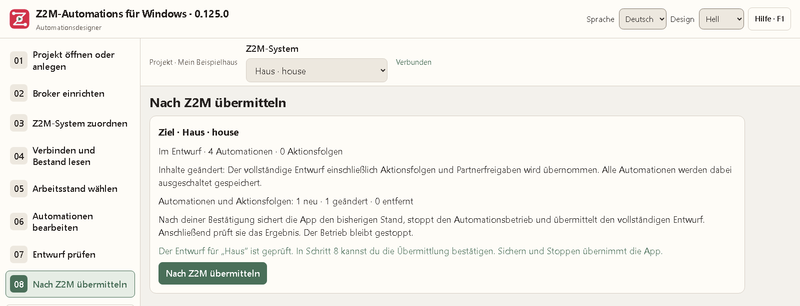

**Abbildung 9 — Ziel und vollständigen Entwurf prüfen.** Übermittelt wird der
geprüfte Stand des ausgewählten Netzes, nicht nur die gerade markierte Regel.
Kontrolliere neue, geänderte und entfernte Einträge.

1. Kontrolliere Netzname, Basistopic und Regelanzahl.
2. Wähle **Nach Z2M übermitteln**.
3. Lies die Bestätigung einschließlich der Auswirkungen auf Betrieb und Schalter.
4. Entscheide über **Bisherigen Betrieb anschließend wieder aufnehmen**.
5. Bestätige einmal und warte bis zum Abschluss mit Rückprüfung.
6. Lies Ergebnis und bestätigte Anzahl freigegebener Regeln.

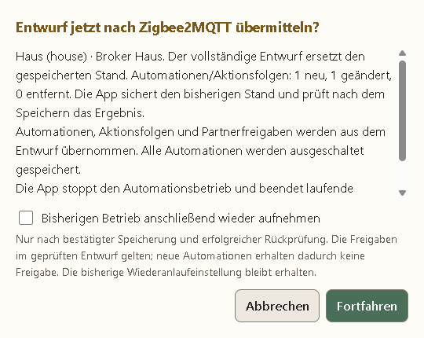

**Abbildung 10 — Die Wiederaufnahme ist eine ausdrückliche Wahl je Übertragung.**
Die Option ist zunächst ausgeschaltet und erteilt neuen Regeln keine Freigabe.

| Situation | Ergebnis |
| --- | --- |
| Normale Inhaltsübertragung ohne Wiederaufnahme | Alter Inhalt wird gesichert, Betrieb gestoppt und Regeln werden ausgeschaltet gespeichert |
| Gewählte Wiederaufnahme bei zuvor bestätigt aktivem Betrieb | Nach erfolgreicher Prüfung, Speicherung und Rückprüfung läuft der bisherige Betrieb mit den geprüften Freigaben weiter |
| Zuvor gestoppter oder nicht bestätigter Betrieb | Wird dadurch nicht gestartet |
| Neue bzw. importierte ausgeschaltete Regel | Bleibt bis zur ausdrücklichen Freigabe ausgeschaltet |
| Fehlende Prüfung oder unklare Bestätigung | Kein automatisch wiederholter Start oder Upload |

Reine Schalteränderungen werden gesondert erkannt und erhalten die geprüften
Freigaben. Lies Übertragungsart und abschließende Anzahl, um den gespeicherten
Zustand zu verstehen.

Eine verzögerte Antwort ist kein Anlass, mehrfach auf Übermitteln zu klicken.
Prüfe bei unklarem Ergebnis den Status bzw. gespeicherten Stand.
Ein Timeout beweist nicht, dass ein Befehl nicht ausgeführt wurde.

Diese Wiederaufnahme unterscheidet sich von **Automatikbetrieb nach Z2M-Neustart
fortsetzen** im Bereich Betrieb. Die eine Wahl betrifft diese Übertragung, die
andere die gespeicherte Einstellung für einen späteren Neustart.

## 14. Betrieb: Freigeben, starten, testen und stoppen

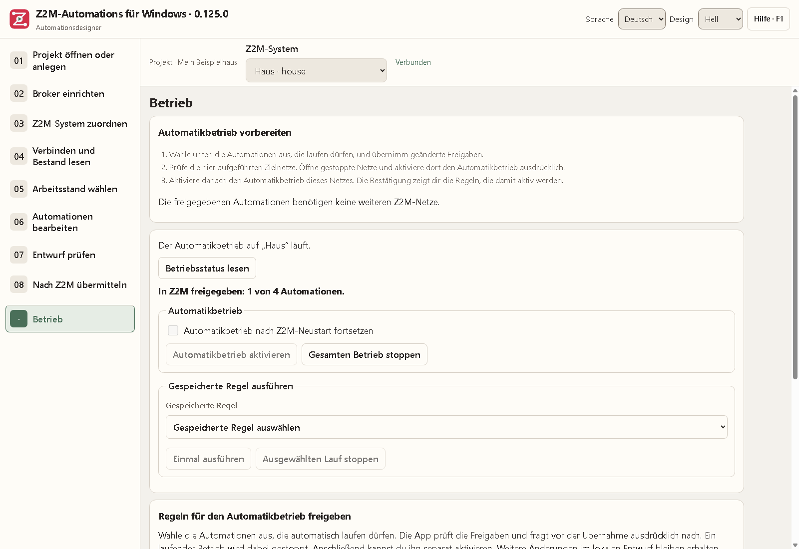

**Abbildung 11 — Betrieb und einzelne Freigaben sind getrennt.**
„In Z2M freigegeben“ zählt die aktuell bestätigten gespeicherten Regeln.

### Regeln freigeben

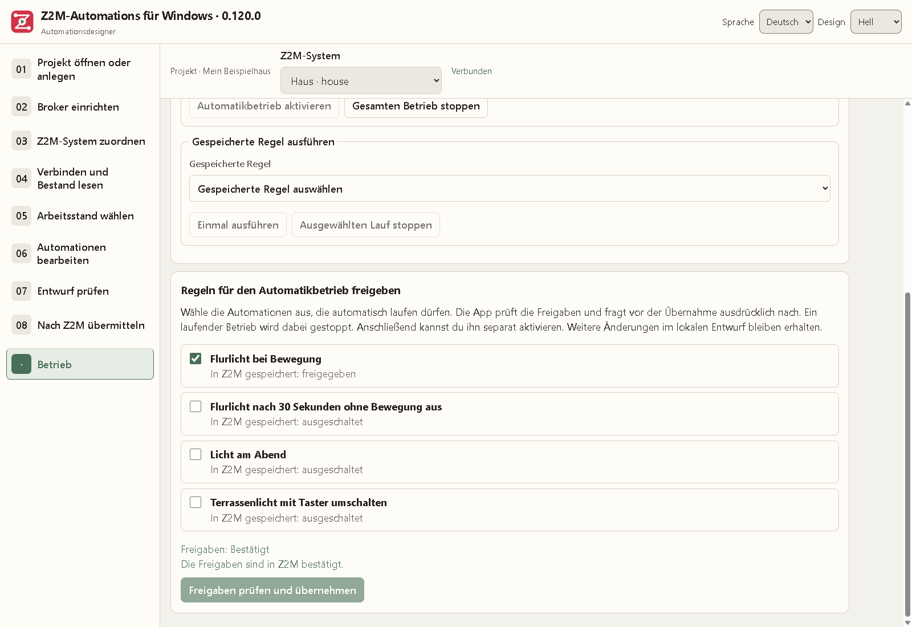

**Abbildung 12 — Bestimme genau, welche Regeln automatisch reagieren dürfen.**
Ein Häkchen bereitet eine Änderung vor. Erst Prüfung, Bestätigung und erfolgreiche
Übermittlung verändern den gespeicherten Zustand.

1. Öffne **Betrieb** für das richtige Netz.
2. Lies den Betriebsstatus, wenn noch kein aktueller bestätigter Stand vorliegt.
3. Wähle unter **Regeln für den Automatikbetrieb freigeben** die gewünschten Regeln.
4. Wähle **Freigaben prüfen und übernehmen** und lies die Bestätigung.
5. Warte auf die bestätigte gespeicherte Anzahl.
6. Aktiviere den Automatikbetrieb danach gesondert, wenn angezeigt.

Der Bestätigungszustand wird mit Text und Farbe dargestellt:
**Nicht bestätigt** bedeutet, dass Auswahl bzw. Ergebnis nicht bestätigt sind;
**Unbekannt** bedeutet, dass aktuelle Bestätigungsdaten fehlen;
**Bestätigt** bezieht sich auf den passenden gespeicherten Freigabestand.
Eine grüne Freigabebestätigung allein bedeutet nicht, dass der Automatikbetrieb läuft.

### Automatikbetrieb aktivieren

Wähle das gewünschte Neustartverhalten und danach **Automatikbetrieb aktivieren**.
Warte auf die bestätigte Betriebsanzeige. Ein nicht bedienbarer Startknopf kann
bedeuten, dass keine Regel freigegeben ist, das Netz bereits läuft oder der
aktuelle Stand noch nicht bestätigt wurde.

### Eine gespeicherte Regel einmal ausführen

Wähle unter **Gespeicherte Regel ausführen** eine Regel und danach
**Einmal ausführen**. Das ist ein echter Auftrag für die gespeicherte Regel,
keine Vorschau ungespeicherter Formulareingaben.
Kontrolliere vorher Bedingungen, Zielgeräte und Verzögerungen.
Eine ausgeschaltete Automatikfreigabe verhindert nicht grundsätzlich einen
ausdrücklich erlaubten Einzeltest.

Beobachte den Laufstatus. Die Auftragsbestätigung bestätigt die Annahme;
die Gerätewirkung musst du gesondert überprüfen.
Mit **Ausgewählten Lauf stoppen** beendest du den betreffenden aktiven Lauf,
mit **Gesamten Betrieb stoppen** den beabsichtigten Netzbetrieb.
Bereits ausgeführte Geräteaktionen werden dadurch nicht rückgängig gemacht.

Das Schließen oder Deinstallieren der App stoppt die Erweiterung nicht.
Sende und bestätige den passenden Stoppbefehl im verbundenen Zustand, wenn
Automationen beendet werden sollen.

## 15. Automationen über zwei Z2M-Netze

Beispiel: Ein Taster gehört zu **Haus**, die **Terrasse / Beleuchtung** zu
**Garten**. Die Regel gehört zu Haus, weil ihr Geräteauslöser dort liegt.
Die Aktion darf ein Zielgerät in Garten verwenden.

### Beide Seiten vorbereiten

1. Richte beide Netze mit eindeutigen Topics ein.
2. Verbinde und lies beide Bestände. Verwende auf beiden Seiten die aktuelle
   Erweiterung; entfernte Gerätebedingungen benötigen mindestens Version 0.2.1.
3. Richte in Schritt 3 die benötigten Partnererklärungen für beide Systeme ein.
   Dieser Desktop-Ablauf prüft die Freigaben beider Seiten.
4. Prüfe und übermittle geänderte Systemkonfigurationen jeweils gesondert.
5. Bestätige den Betrieb sowohl im Quellnetz als auch im benötigten Empfängernetz.

Bei einem gemeinsamen Broker ist keine Broker-Brücke erforderlich. Bei
getrennten Brokern benötigen die Erweiterungsnachrichten eine unabhängig
eingerichtete MQTT-Brücke und passende Rechte für **z2ma/mesh/#**.
Dass die App mit beiden Brokern verbunden ist, verbindet die Broker selbst nicht.

Der Assistent **Systeme miteinander verbinden** in Schritt 3 prüft lesbare
Voraussetzungen und bietet ergänzende Mosquitto-Beispiele für Partner, ACL und
Brücke. Sie enthalten Platzhalter. Sie installieren keine Brücke, ändern keine
Benutzer und beweisen keine Rechte der Z2M- oder Bridge-Konten.
Erhalte die bestehende Serverkonfiguration und vermeide doppelte Bridge-Wege.

### Die Beispielregel anlegen

1. Wähle **Haus**.
2. Lege **Terrassenlicht mit Taster umschalten** an.
3. Wähle unter Wenn den tatsächlichen Tasterwert des Haus-Tasters, etwa single.
4. Wähle unter Dann die Art **Umschalten**.
5. Wähle zuerst **Z2M-System des Geräts → Garten**, danach das Zielgerät.
6. Wähle **Terrasse / Beleuchtung** und **Status L1 [state_l1]**.
7. Übernimm die ausgeschaltete Regel, prüfe, übermittle und gib sie bewusst frei.
8. Prüfe den Betrieb in Haus und beim Garten-Empfänger.
   Betätige erst danach den echten Taster und kontrolliere die Leuchte.

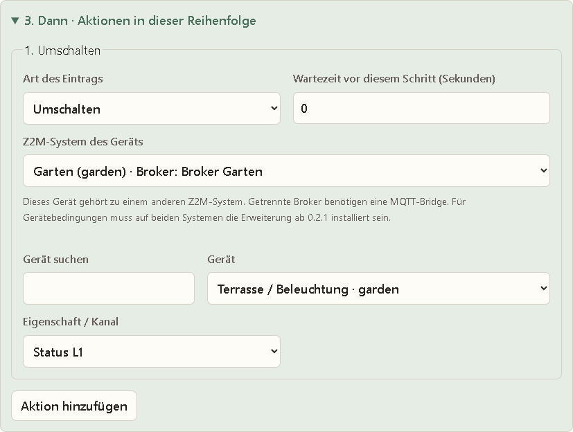

**Detail — Zuerst das Gerätenetz wählen.** Die Leuchte gehört zu Garten;
der Haus-Taster bleibt der Auslöser der Haus-Regel.

Die Ablaufkarten zeigen das Netz des jeweiligen Geräts.
Ist der Empfänger gestoppt, nutze den direkten Wechsel zu dessen **Betrieb**,
prüfe bzw. starte dieses System und kehre zum Ausgangssystem zurück.
Die App startet nicht automatisch alle beteiligten Netze.

Ein Empfänger kann Partnerbetrieb benötigen, auch wenn keine eigene lokale
Automation freigegeben ist. Die dafür vorgesehene Empfänger-Startaktion macht
das ausdrücklich sichtbar. Ein fehlender oder unbekannter entfernter Wert darf
nicht als erfüllte Bedingung behandelt werden.

## 16. Projektdateien, Entwurfsdateien, Sicherung und Wiederherstellung

| Datei | Zweck | Wichtige Grenze |
| --- | --- | --- |
| .z2map | Vollständiges Desktop-Projekt speichern | Enthält zugeordnete Netze und Entwürfe, keine Brokergeheimnisse |
| .z2ma | Bisheriges Projektformat bzw. bisheriger Dateiname | Bleibt lesbar; neuer Dateiname über Speichern unter |
| .z2mad | Ausgewählte Regeln mit benötigten Aktionsfolgen austauschen | Ergänzen in ein ausdrücklich gewähltes vorhandenes Zielnetz |
| YAML / JSON-Konfiguration | Systemkonfiguration ansehen oder austauschen | Ersetzender Import unterscheidet sich vom Ergänzen einzelner Entwürfe |

### Ausgewählte Regeln als Entwurfsdatei speichern

1. Öffne die Entwurfs- bzw. Dateiaktionen des ausgewählten Netzes.
2. Wähle das Speichern einer Entwurfsdatei.
3. Markiere die gewünschten Regeln. Benötigte Aktionsfolgen werden einbezogen.
4. Speichere als **.z2mad** an einem selbst gewählten Ort.
5. Bewahre zusätzlich das vollständige Projekt auf, wenn du dessen gesamte
   Broker- und Netzeinrichtung benötigst.

### Entwurfsdatei ergänzen oder Regeln aus einem anderen Projekt übernehmen

1. Öffne das Zielprojekt und wähle das Zielnetz.
2. Wähle **Entwurfsdatei hinzufügen**.
3. Wähle eine unterstützte Entwurfs- oder Projektdatei.
4. Bei mehreren Quellnetzen wähle das gewünschte Quellnetz.
5. Markiere Regeln und Ziel und prüfe Versions- bzw. Abhängigkeitsentscheidungen.
6. Bestätige den lokalen Import, kontrolliere die Liste und speichere das Projekt.
7. Lies Gerätedaten, prüfe und übermittle später gesondert.

Importierte Ergänzungen beginnen ausgeschaltet. Regelimport legt keine
Verbindungshoheit an und erweitert keine Partnerrechte des Zielnetzes.
Der gleiche portable Entwurfsbehälter wird von App, Symcon-Browserdesigner und
Kachel unterstützt; Verbindungen und Zugangsdaten bleiben produktspezifisch.

Automatische Wiederherstellungssicherung und ausdrückliche Projektsicherung
haben unterschiedliche Aufgaben. Die automatische Sicherung dient dem
Zurücknehmen einer kürzlichen lokalen Änderung. Die Projektsicherung ist eine
aufbewahrte Datei zum späteren Öffnen oder Übertragen auf einen anderen Computer.
Beide enthalten keine Broker-Passwörter.

Wurde eine Projektdatei außerhalb der App geändert, erhalte mit **Speichern unter**
beide Fassungen. Überschreibe sie nicht ungeprüft. Öffne zur Untersuchung zunächst
eine Kopie einer Sicherung; das Öffnen setzt Z2M nicht automatisch zurück.

## 17. Aktionsfolgen und weitere Einstellungen

### Wiederverwendbare Aktionsfolgen

Wähle **Neue Aktionsfolge**, vergib einen eindeutigen Namen und lege die
Aktionen in der gewünschten Reihenfolge an. Speichere lokal und wähle diese
Folge anschließend als Aktion einer Regel.
Folgen dürfen nicht verschachtelt sein; unterstützt werden bis zu 16 Schritte.
Erhalte referenzierte Folgen beim Exportieren oder Kopieren von Regeln.

### Wenn eine laufende Regel erneut ausgelöst wird

Unter **Weitere Einstellungen** bestimmst du, wie die Regel bei erneuter
Auslösung während eines Laufs reagiert. Sie kann den neuen Auslöser ignorieren,
neu beginnen oder die aktuelle Wartezeit zurücksetzen.
Wähle das bei verzögerten Abläufen bewusst. Das Zurücksetzen der aktuellen
Wartezeit wiederholt keine bereits ausgeführten Aktionen.

### Nach einem Z2M-Neustart

Standardmäßig wird ein unterbrochener Lauf beendet. Die Fortsetzungsoptionen
betreffen wartende Automatikläufe und unterscheiden eine noch laufende von
einer bereits abgelaufenen Wartezeit.
Ausfallzeit zählt mit, erledigte Aktionen werden nicht wiederholt und Einzeltests
nicht fortgesetzt. Zusätzlich muss der übergeordnete Automatikbetrieb nach
Neustart erlaubt sein.

Lasse bei ersten einfachen Regeln die Voreinstellungen bestehen, bis Auslöser,
Zielgerät und Betrieb grundsätzlich getestet sind.

## 18. App oder Z2M-Erweiterung aktualisieren

### Anwendung aktualisieren

1. Übernimm offene Formulare und speichere alle Projekte.
2. Bewahre eine Projektsicherung und das vorherige Installationspaket auf.
3. Schließe die App.
4. Starte unter Windows das neue Setup mit gleichem Installationsbereich und
   Verzeichnis. Unter Ubuntu installierst du die neue DEB mit apt.
5. Öffne das Projekt erneut und prüfe Netze, Entwürfe, Sprache und Zugangsdaten.

App-Updates sind manuell. Eine neue App-Version aktualisiert nicht automatisch
die Erweiterung in jedem Netz.

### Erweiterung aktualisieren

1. Wähle das beabsichtigte Netz und öffne Schritt 4.
2. Vergleiche unter **Z2M-Erweiterung** installierte und mitgelieferte Version.
3. Starte das ausdrückliche Update und lies die Bestätigung.
4. Warte auf Sicherung, Stopp, Aktualisierung, Z2M-Neustart und Statusbestätigung.
5. Lies den Bestand erneut und prüfe davon abhängige Regeln.

Ein Erweiterungsupdate kann den Betrieb dieses Netzes unterbrechen und Z2M
neu starten. Der verwaltete Ablauf prüft das Ergebnis und stellt den bisherigen
Automatikbetrieb wieder her, wenn seine Voraussetzungen erfüllt sind.
Lies die Abschlussmeldung; wiederhole eine unklare Installation nicht blind.
Aktualisiere weitere Netze bei Bedarf bewusst einzeln.

### Zu einer älteren App zurückkehren

Bewahre aktuelles Projekt und Sicherung auf.
Deinstalliere unter Windows die neuere App und installiere die frühere Version
im ursprünglichen Bereich. Verwende unter Ubuntu den tatsächlichen älteren
Dateinamen:

~~~sh
sudo apt install --allow-downgrades ./<older-package>.deb
~~~

Kann eine ältere App ein neueres Projektformat nicht lesen, öffne eine Kopie der
vorher aufbewahrten Sicherung.
Das Zurückstufen der App setzt weder Erweiterung noch Z2M-Regeln zurück.

### Deinstallieren

Entferne die Windows-App unter **Installierte Apps** oder unter Ubuntu mit:

~~~sh
sudo apt remove z2m-automations
~~~

Bewahre Projekte und Sicherungen auf.
Wenn Automationen beendet werden sollen, stoppe den betreffenden Z2M-Betrieb
ausdrücklich vor dem Trennen der Verbindung.

## 19. Fehlerbehebung und Diagnose

| Beobachtung | Zuerst prüfen | Vorgehen |
| --- | --- | --- |
| Broker verbindet nicht | Host, Port, Anmeldung, TLS, Erreichbarkeit | Schritt 2 korrigieren, in Schritt 4 neu verbinden |
| Geschützte Zugangsdaten fehlen | Schlüsseldienst bzw. gesperrter Ubuntu-Schlüsselbund | Entsperren oder ausdrücklich Sitzungsspeicherung wählen |
| Nur Gerätekennungen oder fehlende Kanäle | Netz, Erweiterung und frischer Katalog | Richtiges Netz einlesen, nötigenfalls Erweiterung aktualisieren |
| Fenstergriff fehlt in einer Auswahl | Auslöserart und lesbare Positionseigenschaft | Gerätestatus wählen, Katalog aktualisieren, tatsächliche Eigenschaft prüfen |
| Taster erscheint unter Messwert | Zusätzlich vorhandener numerischer Kanal | Tastendruck unter Gerätestatus auswählen; Batterie ist ein Messwert |
| Eine Automation scheint zu fehlen | Suche, Schalterfilter, Kategorie, Scrollposition | Filter leeren, Zeit & Astro prüfen und innerhalb der Liste scrollen |
| Nach Öffnen erscheint alter Entwurf | Nach Übernahme nicht gespeichert oder andere Datei geöffnet | Gewünschte Datei in Schritt 1 speichern und durch erneutes Öffnen prüfen |
| Prüfung erfolgreich, Übermittlung gesperrt | Entwurf oder System wurde inzwischen geändert | Aktuellen ausgewählten Entwurf neu prüfen |
| Partnerdaten verhindern Übermittlung | Frischer Katalog im benötigten anderen Netz fehlt | Dort zuerst lesen; der bestehende Betrieb soll weiterlaufen |
| Gespeicherte Regel reagiert nicht | Freigabe, Gesamtbetrieb, Quelle/Empfänger und Auslöser | Status lesen, bewusst freigeben, erforderliches Netz starten |
| Umschalten hat keine Wirkung | Exakter Statuskanal, Zielnetz und Empfängerbetrieb | state gegenüber state_l1 und das richtige Gerät prüfen |
| Freigaben grün, Betrieb gestoppt | Aussagen betreffen unterschiedliche Zustände | Nach bestätigten Freigaben Gesamtbetrieb aktivieren |
| Ergebnis von Upload oder Start unklar | Antwort kann verspätet oder verloren sein | Status bzw. Übertragungsstand lesen, Befehl nicht automatisch wiederholen |
| Mehrere Fassungen widersprechen sich | Gleiche Regelkennung auf beiden Seiten geändert | Jeweils lokale/Z2M-Fassung wählen und Ergebnis kontrollieren |
| App geschlossen, Regeln laufen weiter | Die Erweiterung führt aus | Neu verbinden und beabsichtigten Stopp senden |

Öffne für ein reproduzierbares Problem **Desktop-Diagnose** in Schritt 1 und
starte die Aufzeichnung. Sie läuft eine Minute.
Stelle das Problem nach und öffne anschließend die Aufzeichnung.
Die Statusabfrage verlängert ihre ursprüngliche Laufzeit nicht.

Nenne bei einer Fehlermeldung App-Version, Betriebssystem, Erweiterungsversion,
betroffenes Netz, Arbeitsschritte sowie erwartetes und beobachtetes Ergebnis.
Prüfe exportiertes Material vor dem Teilen. Veröffentliche keine Zugangsdaten
oder vollständigen privaten Projekte für eine einfache Oberflächenfrage.

## 20. Abschlussprüfung und Glossar

### Ein erstes funktionierendes Netz

- Das richtige Projekt wurde gespeichert und lässt sich wieder öffnen.
- Der Broker verbindet mit dem beabsichtigten Zugangsmodus.
- Das richtige Z2M-Basistopic ist zugeordnet.
- Erweiterung und Gerätebestand sind aktuell.
- Vorhandene Z2M-Regeln und lokale Arbeit wurden abgeglichen.
- Eine ausgeschaltete Beispielregel wurde vervollständigt und geprüft.
- Ihre Übermittlung ist für das richtige Netz bestätigt.
- Die gewünschten gespeicherten Regeln sind freigegeben.
- Der Automatikbetrieb ist bestätigt aktiv.
- Ein praktischer Test zeigt die erwartete Gerätewirkung.

### Vor einem systemübergreifenden Test

- Beide Kataloge und benötigten Partnerfreigaben sind aktuell.
- Bei getrennten Brokern sind Brücke und ACL eingerichtet.
- Der Auslöser gehört zum Quellnetz.
- Bedingungen und Aktionen verweisen auf das beabsichtigte Gerätenetz.
- Quell- und Empfängerbetrieb wurden geprüft.
- Es ist klar, welches reale Gerät der Test verändert.

- **Basistopic:** MQTT-Namensraum einer Z2M-Instanz.
- **Katalog:** Gerätedaten einschließlich Gruppen/Szenen für Auswahl und Prüfung.
- **Entwurf:** Bearbeitbare lokale Arbeitskonfiguration.
- **Freigabe:** Erlaubnis einer gespeicherten Regel für automatische Ausführung.
- **Revision:** Versionszähler innerhalb seines eigenen lokalen oder entfernten Bezugs.
- **Rückprüfung:** Frisches Einlesen zur Bestätigung nach einem Schreibvorgang.
- **Empfänger:** Netz, dem das entfernte Zielgerät gehört.
- **Aktionsfolge:** Geordnete wiederverwendbare Aktionsliste.
- **TOGGLE:** Protokollwert zum Umschalten eines geeigneten Statuskanals.

Für konkrete Feldnamen gilt die deutsche Beschriftung deiner aktuellen App.
Gerätespezifische Namen und angebotene Werte stammen aus deinem eigenen Bestand.
